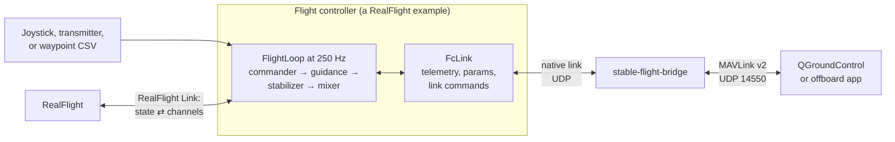

# Stable Flight

[](https://github.com/wboayue/stable-flight/actions/workflows/test.yaml)
[](https://opensource.org/licenses/MIT)
[](https://coveralls.io/github/wboayue/stable-flight?branch=main)

## Overview

Stable Flight provides the foundation for a Rust-powered flight controller designed for VTOL drones. It utilizes Software-in-the-Loop (SITL) simulation to safely refine flight control logic before real-world deployment. My goal is to create an easily extendable, robust, and approachable flight controller leveraging [Rust's advantages](https://wboayue.com/posts/flight-controller-why-rust/) in systems programming. See the following document for an [architecture overview](architecture.md).

**Status:** Stable Flight flies a quadcopter, and a tailsitter that hovers and transitions to plane flight and back, from a joystick (stabilized plane) or a waypoint script (plane waypoint navigation), in simulation only: RealFlight SITL, from a joystick, a waypoint script, or QGroundControl through the MAVLink bridge. It does not fly real hardware yet: the [ARK FPV firmware](firmware/ark-fpv) is a stub that reads no sensors and drives no motors. The tailsitter's aerobatics are planned ([`tailsitter-sitl`](https://github.com/wboayue/stable-flight/milestone/2)).

Starting with simulation allowed me to quickly iterate on flight stabilizer logic and test different airframes without worrying about building hardware. Simulated crashes cut costs and speed up testing compared to real-world failures.

Perfect for anyone keen to explore flight controllers, tweak control logic, or script flights in simulation.

## How It Fits Together

A RealFlight example is the flight controller: it runs `FlightLoop` against the simulator and serves telemetry, params, and link commands to a companion. The bridge turns that native link into MAVLink for a ground station.



`link_pilot` can take the bridge's place for scripted link flights. On a board, sensor and ESC drivers take RealFlight's place, and the link runs over USB or a UART (planned).

## Crates

The repository is a Cargo workspace:

| Crate | Purpose |
|---|---|
| [`stable-flight`](crates/stable-flight) | Flight-control core: pipeline traits, guidance and cascaded-PID stabilizers for copters, planes, and tailsitters, mixers, and `FlightLoop` (one control tick). `no_std`, with no simulator or I/O dependencies |
| [`stable-flight-link`](crates/stable-flight-link) | Wire protocol between the flight controller and a companion computer: `Uplink`/`Downlink` messages, versioned COBS frames, and the byte-level `Link` trait. `no_std` |
| [`stable-flight-mavlink`](crates/stable-flight-mavlink) | MAVLink message builders for the bridge: pure functions from core values to MAVLink payloads |
| [`stable-flight-bridge`](crates/stable-flight-bridge) | Companion-computer binary translating the native link to MAVLink for ground stations (QGC): params, state, arming, joystick and offboard setpoints, land |
| [`stable-flight-sitl`](crates/stable-flight-sitl) | Simulator-independent software-in-the-loop harness: commanders, the real-time `RealTimeRunner` + `ShutdownSignal`, and the per-tick `CsvRecorder` |
| [`stable-flight-sitl-realflight`](crates/stable-flight-sitl-realflight) | RealFlight backend: `RealFlightVehicle`, tuned `airframes`, and the RealFlight examples |
| [`stable-flight-sim`](crates/stable-flight-sim) | Deterministic rigid-body multirotor, airplane, tailsitter, and quadplane simulator (unpublished) for closed-loop tests in `cargo test` and CI. `no_std` |
| [`stable-flight-tools`](crates/stable-flight-tools) | Developer binaries (unpublished): `plot_flight`, `generate_figure_eight`, `link_pilot`, and `check_frames` |

Board firmware lives outside the workspace, one nested workspace per board:

| Board | Firmware | Status |
|---|---|---|
| [ARK FPV](https://arkelectron.com/product/ark-fpv/) (STM32H743) | [`firmware/ark-fpv`](firmware/ark-fpv) | Stub, does not fly: runs `FlightLoop` at 250 Hz on RTIC 2 with placeholder inputs; no sensors, motors, or link yet |

## Supported Simulators

Each simulator backend is its own crate, so a backend's dependencies never reach the others.

| Simulator | Crate | Status |
|---|---|---|
| [RealFlight](https://www.realflight.com) | [`stable-flight-sitl-realflight`](crates/stable-flight-sitl-realflight) | Flies QuadCopterX: manual (joystick or transmitter), scripted, and from the link (QGC via the bridge). Flies the eXplora VTOL tailsitter in hover and plane flight with transitions both ways: manual and scripted |

For `cargo test` and CI, [`stable-flight-sim`](crates/stable-flight-sim) flies the pipeline closed loop on deterministic in-repo multirotor, airplane, tailsitter, and quadplane models: no realism, no setup, the same flight every run.

RealFlight was chosen for its realistic physics model, API for external drone control, wide selection of RC aircraft, and ability to define custom aircraft models. Other simulators (Gazebo, JSBSim, X-Plane) can be added as `stable-flight-sitl-<simulator>` crates.

## Test Models

* [QuadcopterX](https://github.com/ArduPilot/SITL_Models/tree/master/RealFlight/Released_Models/Multicopters/QuadCopterX): A go-to for mastering control theory basics. The flight controller is tuned for and flies this model.
* [eXplora VTOL](https://github.com/robustini/eXploraVTOL/tree/main/simulation): A tricky tail-sitter testing smooth copter-to-plane transitions. Flies in hover from a joystick or a waypoint script (takeoff, a small figure-eight, landing), and transitions to plane flight and back: stabilized from a joystick, or a scripted mission (climb, transition, plane laps on waypoint navigation, back transition, landing); aerobatics are planned ([`tailsitter-sitl`](https://github.com/wboayue/stable-flight/milestone/2)). Its tuning: [tailsitter tuning guide](docs/tuning/tailsitter.md).

The ArduPilot repository also provides a helpful [collection of models](https://github.com/ArduPilot/SITL_Models/tree/master/RealFlight/Released_Models).

## Prerequisites

* **Rust**: 1.89 or newer; install with [rustup](https://rustup.rs/).
* **RealFlight Simulator**: The flight stabilizer was developed using RealFlight Evolution but should work with older versions as well. RealFlight runs natively on Windows, but can also run on macOS using virtualization software like Parallels.

After installing RealFlight, enable RealFlight Link as described in the [`stable-flight-sitl-realflight` README](crates/stable-flight-sitl-realflight/README.md#setup).

## Getting Started

Runnable entrypoints are the crate examples (`crates/*/examples/`); run them from the repository root. Pick one that matches the input you want:

| Flight | Pilot | Run |
|---|---|---|
| Quadcopter, manual | Joystick or Spektrum transmitter | `just fly-manual` |
| Quadcopter, scripted | Waypoint CSV | `just fly-auto` |
| Quadcopter, from a companion | QGC through the bridge, or `link_pilot` | `just fly-companion` + `just bridge` (or `just link-pilot`) |
| Quadcopter autotune | None: tunes, prints gains, lands | `just fly-autotune` |
| Tailsitter, manual | Joystick (D-pad picks copter or plane) | `just fly-tailsitter` |
| Tailsitter, scripted | Waypoint CSV: hover, or a transition mission | `just fly-tailsitter-auto` |

Every flight serves telemetry and params over the link, so `just bridge` + QGC can watch any of them. The tailsitter and autotune commands are in the [`stable-flight-sitl-realflight` README](crates/stable-flight-sitl-realflight/README.md#examples); the commands behind the copter recipes:

```bash
# The bridge: the examples send params and telemetry over the native link, and it speaks
# MAVLink to QGC (UDP 14550). Start it once; it keeps running across flights. Or: just bridge
cargo run -p stable-flight-bridge

# Joystick (Logitech Extreme 3D) controlling a quadcopter in RealFlight
# (RealFlight host defaults to 10.211.55.3:8080; override with --host; --commander spektrum
# for a Spektrum transmitter through the WS3000T dongle). Or: just fly-manual
cargo run -p stable-flight-sitl-realflight --example copter-manual-realflight

# Scripted figure-eight in RealFlight (script path is the first arg, --host to override host). Or: just fly-auto
cargo run -p stable-flight-sitl-realflight --example copter-auto-realflight

# Flown from the native link, holding when it goes quiet; link_pilot plays the companion instead
# of the bridge. Or: just fly-companion, then just link-pilot
cargo run -p stable-flight-sitl-realflight --example copter-companion-realflight
cargo run --bin link_pilot

# Joystick smoke test (no simulator required)
cargo run --example extreme_3d_commander
# Spektrum transmitter (WS3000T dongle) check: raw dongle values next to the command
cargo run --example spektrum_commander

# Regenerate flights/figure_eight.csv, centered on the QuadCopterX spawn point (flags like --half-width resize the path)
cargo run --bin generate_figure_eight
```

Scripted flights are CSV waypoint files under `flights/` (`x,y,altitude,cruise_speed`,
in meters and m/s); `ScriptCommander::new(path)` loads and loops them.

To inspect a scripted path without flying it, render it as a static 3D image with the
`plot_flight` binary (altitude on the vertical axis, path segments colored by cruise speed,
a ground-projected shadow for depth). It reads any waypoint CSV in the `flights/` format and
lives in the unpublished `stable-flight-tools` crate, so it never weighs down the library:

```bash
# Render to SVG or PNG — the output extension selects the format
cargo run --bin plot_flight -- flights/figure_eight.csv figure_eight.svg

# Rotate the camera with --pitch/--yaw (degrees); e.g. near top-down reads the horizontal shape
cargo run --bin plot_flight -- flights/figure_eight.csv top.png --pitch 80 --yaw 0
```

```
Usage: plot_flight [OPTIONS] <INPUT> <OUTPUT>

Arguments:
  <INPUT>   Waypoint CSV to render (columns: x,y,altitude,cruise_speed)
  <OUTPUT>  Output image path; the .svg or .png extension selects the format

Options:
      --pitch <DEG>  Camera tilt above the horizontal, in degrees (default ~28.6)
      --yaw <DEG>    Camera rotation about the vertical axis, in degrees (default ~28.6)
```

Each example wires the same six-component pipeline. The [`stable-flight` README](crates/stable-flight/README.md) covers the pipeline, guidance, stabilizers, and mixers; the [`stable-flight-sitl` README](crates/stable-flight-sitl/README.md) covers the commanders and real-time runner; the [`stable-flight-sitl-realflight` README](crates/stable-flight-sitl-realflight/README.md) covers the RealFlight vehicle and airframes.

## Conclusion

This project provides a solid foundation, but there is still work ahead to make it fly on real hardware. The first board is the ARK FPV (STM32H743) running [RTIC 2](https://rtic.rs/2/book/en/); its [firmware](firmware/ark-fpv) runs the flight loop on target, with placeholder sensing and actuation. In simulation, state comes directly from the simulator; on real hardware, noisy sensor data needs to be read and filtered into reliable state estimates, and motor output, arming, and failsafes need to land. I'm excited to tackle these next steps and get a drone airborne with stable flight.

## Getting Involved

Feel free to [open an issue](https://github.com/wboayue/stable-flight/issues), submit a pull request, or reach out with questions or suggestions. See [CONTRIBUTING.md](CONTRIBUTING.md) for how to send a change and [SECURITY.md](SECURITY.md) to report a vulnerability.
