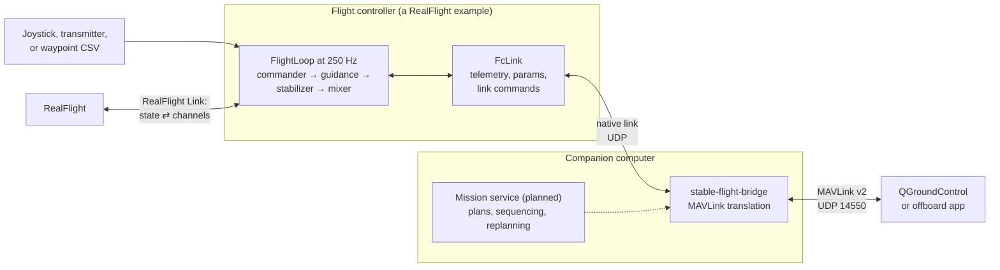

# Stable Flight

[](https://github.com/wboayue/stable-flight/actions/workflows/test.yaml)
[](https://opensource.org/licenses/MIT)
[](https://coveralls.io/github/wboayue/stable-flight?branch=main)

## Overview

Stable Flight is an autonomous flight stack for VTOL drones, written in Rust, split across two computers. A `no_std` flight controller stabilizes the vehicle, guides it to the targets it is given, and owns its safety: link failsafes today, with arm checks and return to launch planned. A companion computer manages the mission: it plans, sequences, and replans the flight, streams targets to the flight controller, and later updates the mission from camera, lidar, and ADS-B data. The flight controller never depends on the companion to stay safe: a quiet companion ends in a failsafe the flight controller chooses. The [design principles](architecture.md#design-principles) set out the split; the [architecture](architecture.md) the rest. Both sides are developed in Software-in-the-Loop (SITL) simulation before hardware, leveraging [Rust's advantages](https://wboayue.com/posts/flight-controller-why-rust/) in systems programming.

**Status:** Stable Flight flies a quadcopter, a tailsitter that hovers and transitions to plane flight and back, from a joystick (stabilized plane), a waypoint script (plane waypoint navigation), or QGroundControl's transition button through the bridge, and a quadplane that hovers, transitions to plane flight and back, and flies copter legs with forward thrust from a waypoint script, in simulation only: RealFlight SITL, from a joystick, a waypoint script, or QGroundControl through the MAVLink bridge; and the X-Plane Alia 250 eVTOL, which hovers from a joystick or QGroundControl and transitions to plane flight and back from a waypoint script. The tailsitter also flies scripted aerobatics on its plane legs: doublets, rolls, and loops. It does not fly real hardware yet: the [ARK FPV firmware](firmware/ark-fpv) is a stub that reads no sensors and drives no motors.

**Planned:** the companion's mission service, flying a QGroundControl plan in X-Plane ([mission-demo](https://github.com/wboayue/stable-flight/milestone/7)); the first board ([ark-fpv](https://github.com/wboayue/stable-flight/milestone/3)); and, for autonomy, a target horizon ([#658](https://github.com/wboayue/stable-flight/issues/658)), a flight envelope, arm checks, and return to launch on the flight controller ([#657](https://github.com/wboayue/stable-flight/issues/657), [#136](https://github.com/wboayue/stable-flight/issues/136), [#468](https://github.com/wboayue/stable-flight/issues/468)), and companion measurements and timestamps for perception ([#656](https://github.com/wboayue/stable-flight/issues/656), [#655](https://github.com/wboayue/stable-flight/issues/655)).

## How It Fits Together

A RealFlight example is the flight controller: it runs `FlightLoop` against the simulator and serves telemetry, params, and link commands to a companion. On the companion, the bridge turns that native link into MAVLink for a ground station, and the mission service (planned) will sequence missions over it.



`link_pilot` can take the bridge's place for scripted link flights. On a board, sensor and ESC drivers take RealFlight's place, and the link runs over USB or a UART (planned).

## Crates

The repository is a Cargo workspace:

| Crate | Purpose |
|---|---|
| [`stable-flight`](crates/stable-flight) | Flight-control core: pipeline traits, guidance and cascaded-PID stabilizers for copters, planes, tailsitters, and quadplanes, mixers, and `FlightLoop` (one control tick). `no_std`, with no simulator or I/O dependencies |
| [`stable-flight-link`](crates/stable-flight-link) | Wire protocol between the flight controller and a companion computer: `Uplink`/`Downlink` messages, versioned COBS frames, and the byte-level `Link` trait. `no_std` |
| [`stable-flight-mavlink`](crates/stable-flight-mavlink) | MAVLink message builders for the bridge: pure functions from core values to MAVLink payloads |
| [`stable-flight-bridge`](crates/stable-flight-bridge) | Companion-computer binary translating the native link to MAVLink for ground stations (QGC): params, state, arming, joystick and offboard setpoints, land, VTOL state and transitions |
| [`stable-flight-sitl`](crates/stable-flight-sitl) | Simulator-independent software-in-the-loop harness: commanders, the real-time `RealTimeRunner` + `ShutdownSignal`, and the per-tick `CsvRecorder` |
| [`stable-flight-sitl-realflight`](crates/stable-flight-sitl-realflight) | RealFlight backend: `RealFlightVehicle`, tuned `airframes`, and the RealFlight examples |
| [`stable-flight-sitl-xplane`](crates/stable-flight-sitl-xplane) | X-Plane backend: `XPlaneVehicle` over UDP datarefs, frame conversion, local-origin tracking, raw state captures, the tuned Alia 250, and the X-Plane examples |
| [`stable-flight-sim`](crates/stable-flight-sim) | Deterministic rigid-body multirotor, airplane, tailsitter, and quadplane simulator (unpublished) for closed-loop tests in `cargo test` and CI. `no_std` |
| [`stable-flight-tools`](crates/stable-flight-tools) | Developer binaries (unpublished): `plot_flight`, `generate_figure_eight`, `link_pilot`, `check_frames`, and the flight-check tools `watch_run` and `lap_stats` |

Board firmware lives outside the workspace, one nested workspace per board:

| Board | Firmware | Status |
|---|---|---|
| [ARK FPV](https://arkelectron.com/product/ark-fpv/) (STM32H743) | [`firmware/ark-fpv`](firmware/ark-fpv) | Stub, does not fly: runs `FlightLoop` at 250 Hz on RTIC 2 with placeholder inputs; no sensors, motors, or link yet |

## Supported Simulators

Each simulator backend is its own crate, so a backend's dependencies never reach the others.

| Simulator | Crate | Status |
|---|---|---|
| [RealFlight](https://www.realflight.com) | [`stable-flight-sitl-realflight`](crates/stable-flight-sitl-realflight) | Flies QuadCopterX: manual (joystick or transmitter), scripted, and from the link (QGC via the bridge). Flies the eXplora VTOL tailsitter in hover and plane flight with transitions both ways: manual, scripted, and from the link (QGC's transition button via the bridge). Flies the Titan Cobra VTOL quadplane in hover and plane flight with transitions both ways: scripted |
| [X-Plane 12](https://www.x-plane.com) | [`stable-flight-sitl-xplane`](crates/stable-flight-sitl-xplane) | Flies the Alia 250 on its lift rotors, manual (joystick) and from the link (QGC via the bridge, map matching X-Plane), and through transitions and plane legs from a waypoint script |

For `cargo test` and CI, [`stable-flight-sim`](crates/stable-flight-sim) flies the pipeline closed loop on deterministic in-repo multirotor, airplane, tailsitter, and quadplane models: no realism, no setup, the same flight every run.

RealFlight was chosen for its realistic physics model, API for external drone control, wide selection of RC aircraft, and ability to define custom aircraft models. X-Plane adds real-world scenery for mission demos ([#352](https://github.com/wboayue/stable-flight/issues/352)). Other simulators (Gazebo, JSBSim) can be added as `stable-flight-sitl-<simulator>` crates.

## Test Models

* [QuadcopterX](https://github.com/ArduPilot/SITL_Models/tree/master/RealFlight/Released_Models/Multicopters/QuadCopterX): A go-to for mastering control theory basics. The flight controller is tuned for and flies this model.
* [eXplora VTOL](https://github.com/robustini/eXploraVTOL/tree/main/simulation): A tricky tail-sitter testing smooth copter-to-plane transitions. Flies in hover from a joystick or a waypoint script (takeoff, a small figure-eight, landing), and transitions to plane flight and back: stabilized from a joystick, or a scripted mission (climb, transition, plane laps on waypoint navigation, back transition, landing), with scripted doublets, rolls, and loops on its plane legs. Its tuning: [tailsitter tuning guide](docs/tuning/tailsitter.md).
* [Titan Cobra VTOL](https://github.com/ArduPilot/SITL_Models/tree/master/RealFlight/Released_Models/QuadPlanes/Titan_Cobra_VTOL): A lift+cruise quadplane (four lift rotors, a pusher, an A-tail). Flies from a waypoint script: hover and landing, copter legs with the pusher taking the nose-down pitch, and a plane lap with transitions both ways. Its tuning: [quadplane tuning guide](docs/tuning/quadplane.md).

* [BETA Technologies Alia 250](https://www.x-plane.com) (X-Plane 12's stock model): a full-size lift+cruise eVTOL, 2,857 kg at X-Plane's default load. Hovers on its four lift rotors from a joystick or QGC, and flies a scripted lap from a waypoint script: transition, plane legs offshore, back transition, landing. Its tuning: [quadplane tuning guide](docs/tuning/quadplane.md).

The ArduPilot repository also provides a helpful [collection of models](https://github.com/ArduPilot/SITL_Models/tree/master/RealFlight/Released_Models).

## Prerequisites

* **Rust**: 1.89 or newer; install with [rustup](https://rustup.rs/).
* **RealFlight Simulator**: The flight stabilizer was developed using RealFlight Evolution but should work with older versions as well. RealFlight runs natively on Windows, but can also run on macOS using virtualization software like Parallels.

After installing RealFlight, enable RealFlight Link as described in the [`stable-flight-sitl-realflight` README](crates/stable-flight-sitl-realflight/README.md#setup).

## Getting Started

Runnable entrypoints are the crate examples (`crates/*/examples/`); run them from the repository root. Pick one that matches the input you want:

| Flight | Pilot | Run |
|---|---|---|
| Quadcopter, from a companion | QGC through the bridge, or `link_pilot` | `just fly-companion` + `just bridge` (or `just link-pilot`) |
| Quadcopter, scripted | Waypoint CSV | `just fly-auto` |
| Quadcopter autotune | None: tunes, prints gains, lands | `just fly-autotune` |
| Quadcopter, manual | Joystick or Spektrum transmitter | `just fly-manual` |
| Tailsitter, from a companion | QGC through the bridge (transition button) | `just fly-tailsitter-companion` + `just bridge --vehicle-type tailsitter` |
| Tailsitter, scripted | Waypoint CSV: hover, or a transition mission | `just fly-tailsitter-auto` |
| Tailsitter, manual | Joystick (D-pad picks copter or plane) | `just fly-tailsitter` |

Scripts and joysticks fly the flight controller directly, for development and tests; missions come from the companion.

Every flight serves telemetry and params over the link, so `just bridge` + QGC can watch any of them. The tailsitter and autotune commands are in the [`stable-flight-sitl-realflight` README](crates/stable-flight-sitl-realflight/README.md#examples); the commands behind the copter recipes:

```bash
# The bridge: the examples send params and telemetry over the native link, and it speaks
# MAVLink to QGC (UDP 14550). Start it once; it keeps running across flights. Or: just bridge
cargo run -p stable-flight-bridge

# Joystick (Logitech Extreme 3D) controlling a quadcopter in RealFlight
# (RealFlight host defaults to 10.211.55.3:8080; override with --host; --commander spektrum
# for a Spektrum transmitter through the WS3000T dongle). Or: just fly-manual
cargo run -p stable-flight-sitl-realflight --example copter-manual-realflight

# Scripted figure-eight in RealFlight (script path is the first arg, --host to override host). Or: just fly-auto
cargo run -p stable-flight-sitl-realflight --example copter-auto-realflight

# Flown from the native link, holding when it goes quiet; link_pilot plays the companion instead
# of the bridge. Or: just fly-companion, then just link-pilot
cargo run -p stable-flight-sitl-realflight --example copter-companion-realflight
cargo run --bin link_pilot

# Joystick smoke test (no simulator required)
cargo run --example extreme_3d_commander
# Spektrum transmitter (WS3000T dongle) check: raw dongle values next to the command
cargo run --example spektrum_commander

# Regenerate flights/figure_eight.csv, centered on the start (flags like --half-width resize the path)
cargo run --bin generate_figure_eight
```

Scripted flights are CSV waypoint files under `flights/` (`x,y,altitude,cruise_speed`,
in meters and m/s, then optional `regime`, `heading`, and `hold_s`); `ScriptCommander::new(path)`
loads and loops them.

To inspect a scripted path without flying it, render it as a static 3D image with the
`plot_flight` binary (altitude on the vertical axis, path segments colored by cruise speed,
a ground-projected shadow for depth). It reads any waypoint CSV in the `flights/` format and
lives in the unpublished `stable-flight-tools` crate, so it never weighs down the library:

```bash
# Render to SVG or PNG — the output extension selects the format
cargo run --bin plot_flight -- flights/figure_eight.csv figure_eight.svg

# Rotate the camera with --pitch/--yaw (degrees); e.g. near top-down reads the horizontal shape
cargo run --bin plot_flight -- flights/figure_eight.csv top.png --pitch 80 --yaw 0
```

```
Usage: plot_flight [OPTIONS] <INPUT> <OUTPUT>

Arguments:
  <INPUT>   Waypoint CSV to render (columns: x,y,altitude,cruise_speed)
  <OUTPUT>  Output image path; the .svg or .png extension selects the format

Options:
      --pitch <DEG>  Camera tilt above the horizontal, in degrees (default ~28.6)
      --yaw <DEG>    Camera rotation about the vertical axis, in degrees (default ~28.6)
```

Each example wires the same six-component pipeline. The [`stable-flight` README](crates/stable-flight/README.md) covers the pipeline, guidance, stabilizers, and mixers; the [`stable-flight-sitl` README](crates/stable-flight-sitl/README.md) covers the commanders and real-time runner; the [`stable-flight-sitl-realflight` README](crates/stable-flight-sitl-realflight/README.md) covers the RealFlight vehicle and airframes.

## Getting Involved

Ask questions and share ideas or flights in [Discussions](https://github.com/wboayue/stable-flight/discussions), [open an issue](https://github.com/wboayue/stable-flight/issues) for a bug or planned work, or submit a pull request. See [CONTRIBUTING.md](CONTRIBUTING.md) for how to send a change and [SECURITY.md](SECURITY.md) to report a vulnerability.
