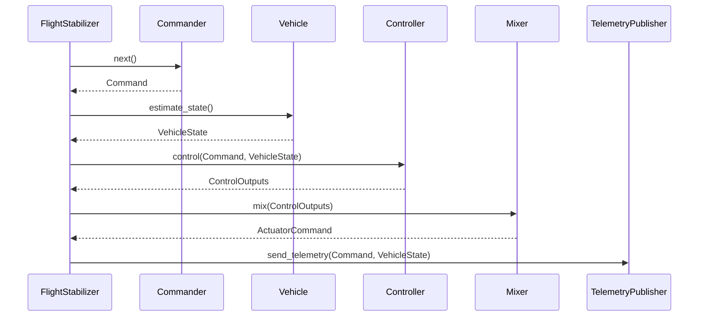

# Architecture

The heart of the stabilizer FlightStabilizer component. The FlightStabilizer depends on several traits.

* Commander. Commanders generate Rate, Attitude or Position control commands for the controller. 
* Vehicle. Vehicle represents a physical or simulated vehicle and support retrieval of state and actuation of the vehicle
* Controller. Controller implement the PID control logic to stabilize the vehicle.
* Mixer. Mixers transform the output of the controller into actuation commands for the vehicle.
* TelemetryPublisher. Publishes the current state of the vehicle.

The flight stabilization loop runs at a configuration frequency and does the following continuously.

