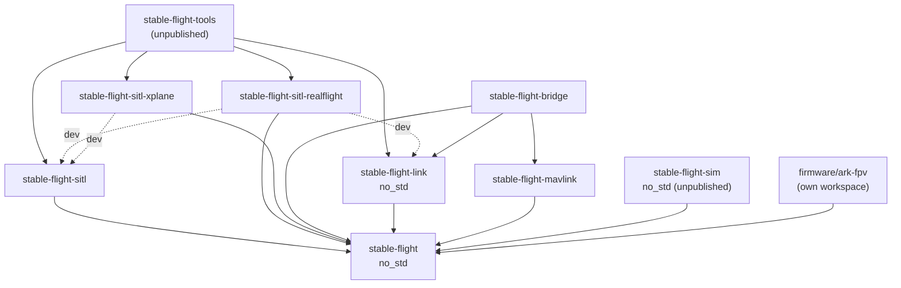
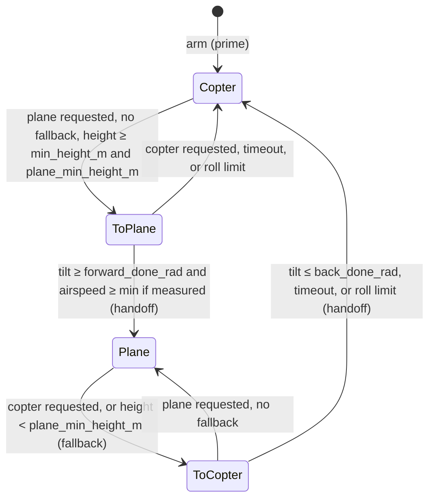

## Architecture

Crate boundaries and the rationale behind the design. The [project README](README.md) is the
overview; trait contracts are in core rustdoc.

## Crate Boundaries

The repository is a Cargo workspace. Dependencies point one way:



Solid arrows are dependencies, dashed ones dev-dependencies (examples and tests).

* **`stable-flight`**: the flight-control core: pipeline traits, the data passed between them
  (`Command`/`ControlInput`, `Setpoint`, `VehicleState`, `ControlOutput`, `ActuatorCommand`,
  `TelemetryRecord`), guidance, stabilizers and their PID `controllers`, mixers, and
  `FlightLoop`. No simulator, I/O, clock, or thread dependencies, and `no_std`, so it runs on
  hardware.
* **`stable-flight-link`**: the flight controller ⇄ companion wire protocol ([Link](#link)).
  `no_std`; depends only on the core (`serde` feature).
* **`stable-flight-mavlink`**: pure functions from core values to `mavlink` payloads, plus the
  telemetry-only estimates they need (home, landed state, geodetic projection). Depends only on
  the core and `mavlink`, so the bridge's encoding is testable without I/O and reusable by an
  onboard MAVLink option ([#156](https://github.com/wboayue/stable-flight/issues/156)).
* **`stable-flight-bridge`**: the companion binary that translates the native link to MAVLink.
  Never depends on the sitl harness, so it runs the same against SITL and a board.
* **`stable-flight-sitl`**: the simulator-independent harness: joystick and scripted
  commanders, `RealTimeRunner`, and `ShutdownSignal`.
* **`stable-flight-sitl-realflight`**, **`stable-flight-sitl-xplane`**: the RealFlight and
  X-Plane backends ([Simulator Backends](#simulator-backends)).
* **`stable-flight-sim`**: the in-repo simulator for closed-loop tests ([In-Repo
  Simulator](#in-repo-simulator)). `no_std`; depends only on the core.
* **`stable-flight-tools`**: unpublished developer binaries, so library consumers never compile
  their dependencies.
* **`firmware/`**: excluded from the workspace; each board is its own nested workspace.

## Simulator Backends

Each simulator gets its own `stable-flight-sitl-<simulator>` crate, so its dependencies
(protocol clients, FFI, system libraries) never reach the core, the harness, or another backend.

* **Dependency rule.** A backend depends on the core, its simulator client, and small shared
  utilities, and on `stable-flight-sitl` only as a dev-dependency (examples), so it works with
  any runner: the sitl runners, a HIL rig, or a third-party harness. CI fails if a backend lists
  `stable-flight-sitl` under `cargo tree -e normal`.
* **Frame contract.** Every `StateSource` reports `VehicleState` in one convention (the table in
  its rustdoc), whatever the simulator uses natively, so nothing downstream knows which
  simulator is attached. The body frame is the airframe's own: a tailsitter's is the airplane's
  (x along the nose, as ArduPilot does), so it hovers at pitch +90°. A simulator body frame that
  differs is a constant rotation applied at the `StateSource` boundary
  (`RealFlightConfiguration::body_rotation`, set per airframe); on hardware the same rotation is
  the IMU driver's or estimator's board orientation
  ([#241](https://github.com/wboayue/stable-flight/issues/241)). Controllers never see it.
* **Timing contract.** `FlightLoop` calls `state` then `actuate` once per tick, so a backend
  says which call talks to the simulator and how old its state is. The `Vehicle` rustdoc is the
  reference; each backend documents its own timing.
* **Conformance.** `stable_flight::testing::conformance` (core `testing` feature) lists physical
  scenarios and the `VehicleState` each must yield; `conformance_tests!` runs a backend's native
  fixtures through them. It lives in the core so backends and in-core estimators test against it
  without the harness.
* **Airframes.** Tuned gains, the mixer, channel mapping, and body rotation live in the
  backend's `airframes` module, next to the simulated model they were tuned on.
* **Per-backend mapping types.** Each backend has its own `ActuatorMapping` (and `Airframe`):
  RealFlight maps slots to twelve 0–1 channels, X-Plane maps motors to engines and servos to
  wing surfaces in degrees (`SurfaceLink`: each end of the servo's range its own deflection, so
  a surface's sign and uneven travel are data). A shared type waits until a third backend shows a common shape.

### X-Plane

X-Plane runs free in real time and streams datarefs over UDP at most once per rendered frame
(60–120 Hz), with no lockstep, so `XPlaneVehicle` runs under `RealTimeRunner`, holding each
state for the ticks between frames, rather than a lockstep runner. Its local frame has a
whole-degree origin that moves when the aircraft relocates or flies far from it;
`LocalOrigin` keeps position relative to where the aircraft started (the bridge's
`--origin`), absorbing a moved origin from the last position and velocity rather than by
geodesy, which would mix X-Plane's projection with a flat-earth one at the jump. Up is the
elevation above sea level, not `local_y`, which is height over the plane tangent at the local
origin and drifts from the ground with distance. Rejected: horizontal position from latitude and
longitude (`f32` on the wire: 0.4–0.8 m steps).

`actuate` writes once per received frame: X-Plane applies only the last write before each
frame, and between frames the state, so the commands, barely move (only `dt`-driven ramps and
integrators). A quadplane writes 21 datarefs a frame; writing every tick would send five times
that for nothing. Rejected: writing only changed values, which needs a periodic refresh to
recover a lost datagram, where a write per frame refreshes everything anyway.

### In-Repo Simulator

RealFlight and X-Plane can't run in `cargo test` or CI, so without another plant
the pipeline's closed loop is only checked by hand. `stable-flight-sim` is that plant: a rigid
body on a ground plane in deterministic wind, as a multirotor (motor lag, quadratic thrust,
linear drag), an airplane (stability-derivative aerodynamics, servo-driven surfaces, a
tractor prop), or a tailsitter (the airplane's aerodynamics with its motors along the wing and
the elevons in their wash), stepped in lockstep with `FlightLoop` (no wall clock, only seeded noise), so a
test flight repeats bit for bit and runs in milliseconds. It aims at plausible dynamics, not fidelity; RealFlight stays
the check for realism.

* **Why not JSBSim (or Gazebo).** An external engine brings a C++ build or a process to
  manage in CI, nondeterminism from its own scheduling, and no `no_std` path. A small Rust
  model is enough for what the tests assert (loops close, modes sequence, limits flag) and,
  being `no_std` with fixed-size math, can later drive a board in hardware-in-the-loop runs.
* **Geometry from the mixer.** Each motor's torque comes from its `TableMixer` row's factors
  (a factor of 1 at the model's moment arm), and each servo moves the aileron, elevator, and
  rudder axes its row names (an axis's deflection is the servos' least-squares fit to the
  factors, so elevons and separate surfaces read back alike). The sim and mixer can't
  disagree on motor order, spin, or surface slots, and there is no second table to keep in
  sync.
* **Four vehicles over shared parts.** `SimCopter`, `SimPlane`, `SimTailsitter`, and
  `SimQuadPlane` are separate types over crate-private components: lockstep timing, the
  actuator delay, wind, gyro noise, the rigid body, and ground contact live once; each vehicle
  adds only its loads. The airplane, tailsitter, and quadplane share one fixed-wing dynamics:
  the tailsitter adds its motor arm, wash, and resting on its tail; the quadplane adds lift
  rotors along body `−z`, laid out by the mixer's motor rows as on the copter, and takes its
  pusher from the mixer's one pusher row (`MixRow::pusher`), so the slot has one source. A
  public generic
  vehicle (`SimVehicle<P: Physics>`) was rejected: its trait would have to absorb what the
  vehicles differ in (how each rests on the ground, plane-only flow angles) and stay stable as a
  public API, for less duplication than the vehicles' thin builder glue. A generic VTOL
  (per-rotor position and thrust axis, tilt servos) was rejected for the quadplane too: fixed
  lift rotors need no axis per rotor, and taking geometry from the model instead of the mixer
  would let the two disagree. It waits for a tiltrotor.
* **Prop wash by momentum theory.** A tailsitter's elevons hold it in a hover only in the
  props' wash, so the surface terms see the actuator disc's far-wake pressure (thrust over
  disc area) on top of the free stream's; lift, drag, and damping see the free stream.
  Sinking tail first, the air meets the wash head on and the surfaces see the static jet
  less the sink, so authority fades with the sink, as the eXplora's did in RealFlight (#123).
  ArduPilot's SITL instead adds 20 m/s × throttle to the airspeed of every moment
  (`SIM_Plane.cpp:154-162`), which ties authority to throttle rather than thrust and damps
  the body in a still hover.
* **Bounded at any angle of attack.** A tailsitter flies broadside to the air in a hover and
  backward when it sinks, so past the stall drag blends into a flat plate's (`2·sin²α`)
  with the lift, and static pitch stability acts on `sin α`. The attached-flow formulas,
  extrapolated, give a drag coefficient near 6 broadside and a pitch moment that flips sign
  across reversed flow.
* **Spec bands, not snapshots.** Step-response tests hold each loop to ArduPilot's and PX4's
  autotune targets (cited in `tests/step_response.rs`), not to whatever the sim measured, so
  a regression and a tuning gap both fail. Each airframe's roll and pitch gains come from
  running the core autotune on the sim.
* **Perturbation ranges, not a fitted plant.** Delay, gyro noise and vibration, a disturbance
  moment, and motor mismatch are parameters to sweep, so the autotune *method* is checked on
  many plausible plants and transfers to hardware. Fitting the sim to RealFlight's QuadCopterX
  (#365) was rejected: it would match one simulated plant, and its gains still wouldn't be a
  board's.
* **Not a backend crate.** It meets the frame and timing contracts and covers every
  conformance scenario like a backend, but it has no simulator client, so it isn't a
  `stable-flight-sitl-<simulator>` crate. Core can't take it as a dev-dependency (a cycle
  builds two copies of core), so the closed-loop tests live in its `tests/`.

## Link

`stable-flight-link` is the native protocol between the flight controller and a companion
computer. The wire format is the core types themselves (`Command`, `VehicleState`, an owned
`TelemetryRecord`) in postcard, so the flight controller carries no MAVLink dialect; the bridge
translates to MAVLink in `std` code.

* **Frame.** `[version u8][postcard payload][crc16 LE]`, COBS-encoded, `0x00`-terminated. COBS
  gives the length. Postcard isn't self-describing (a reordered field decodes as garbage, not an
  error), so every frame carries `PROTOCOL_VERSION` and the receiver rejects a mismatch; any
  message shape change bumps it. The CRC (CRC-16/IBM-3740, bitwise to save flash) is checked
  before the version, so a corrupted version byte reads as corruption.
* **Sealed messages.** Only `Uplink` and `Downlink` implement `Message`.
* **Fixed size.** Every message fits `MAX_FRAME_LEN` (384 bytes; a test checks the worst case),
  so both ends use stack buffers.
* **One frame per decode.** `decode` rejects bytes after the delimiter, so a transport that hands
  over two frames at once fails loudly instead of losing the second.
* **Transport-agnostic.** `Link` moves encoded frames without blocking. Like `Vehicle`, it is two
  traits blanket-joined (`LinkRx` + `LinkTx`), so the router and the publisher each own one half
  of the same transport. Every transport carries the same frames:

| Setup | `Link` |
|---|---|
| Tests | `loopback::Loopback` (`testing` feature) |
| SITL flight controller and bridge on one host | `udp::UdpLink` (`std` feature) |
| Real board (planned) | USB-CDC, then a TELEM UART ([#155](https://github.com/wboayue/stable-flight/issues/155)) |

On the flight controller, reading the link is separate from commanding: `UplinkRouter` drains
`LinkRx` between ticks and routes each uplink to a bounded queue (params to the `ParamServer`,
`Control` to a link-fed commander), so params work whichever commander flies. `LinkPublisher` is
the `TelemetryPublisher` that owns `LinkTx`.

On the companion, `stable-flight-bridge` presents the flight controller as MAVLink system 1,
component 1, so MAVLink never runs on the board. It is a pure state machine (messages in,
messages out, clock injected) behind a thin I/O loop, holding only what translation needs: the
flight controller's last heartbeat (to send `HEARTBEAT` only while it is alive, and to confirm an
arm, disarm, land, or transition before acking it), when the ground station was last heard (to
send `Control::Heartbeat` only while it is), and a param cache (to answer `PARAM_REQUEST_READ`
without a round trip). Param listings and writes go to the flight controller, whose echo is
forwarded unchanged, so the flight controller stays the only judge of a value. Staleness,
failsafe, and arm decisions stay on the flight controller; the bridge translates and never
decides. What it translates: the [bridge README](crates/stable-flight-bridge/README.md).

## Flight Loop and Runners

`FlightLoop` (core) owns the six components and runs one tick per `step(dt)`, with no notion of
time. A runner decides when ticks happen: `RealTimeRunner` (sitl) paces them on the wall clock
until a `ShutdownSignal` is set; a lockstep simulator runner or a hardware timer can drive the
same `FlightLoop`. Shutdown, pacing, and tick sequencing are separate pieces, so each runner only
supplies pacing.

## Core Components

* **Commander**: produces a `Command` (arm flag, requested `FlightRegime`, and `ControlInput`)
  each tick, from joysticks, scripts, the link, or navigation.
* **Vehicle**: `StateSource + Actuator` (blanket-implemented), so sensing and actuation can be
  separate components on hardware (IMU/estimator, ESC output) while a simulator client implements
  both on one type. `ComposedVehicle<S, A>` joins a separate state source and actuator.
* **Guidance**: the outer loop. Turns a `ControlInput` into a `Setpoint` (attitude or rate) in
  the requested regime, and owns the flight mode ([flight regimes](#flight-regimes)):
  position and altitude loops for waypoints, and stick interpretation that needs memory (the
  heading-hold target). `FlightLoop` calls guidance and the stabilizer every tick, and a guidance
  paces its own slow loops (`CopterGuidance`'s lateral loop); pacing inside guidance keeps pilot
  sticks read every tick, where a loop-level divider would add a guidance period of latency.
  A plane's waypoint altitude and airspeed are one total energy loop (`guidance::plane`
  `TecsConfig`, ArduPilot's and PX4's TECS): thrust sets the rate of total specific energy
  (height and airspeed together), pitch the balance between them. Separate pitch→altitude and
  thrust→airspeed loops each assume the other has margin: at the pitch limit the airspeed
  loop holds speed by taking the power the climb needs, and the Alia 250 sank asked to climb
  and limit-cycled ±10–15 m in level flight (#454). Rejected: keeping the pair and running
  full thrust while pitch is pinned (on the sim Alia it climbed, but a 30 m descent ran 235 m
  past its altitude); PX4's rates-only form with a trajectory generator (more state for the
  same behavior on these airframes); a synthetic airspeed when none is measured (core has no
  plane wind estimate, and ground speed reads fast in a tailwind: #456), so without an airspeed
  pitch holds altitude and thrust follows pitch, as ArduPilot does. The pitch integral acts
  on the balance rate error, against a high-passed airspeed rate, within the limits a forward
  transition passes in, and the pitch demand's airspeed part isn't held to half the climb's
  energy rate as thrust's is (#505). Rejected: an integral of the energy error (it winds
  nose-down through a descent's catch-up while the height error stays open, and the sim
  Alia's forward transition reached its airspeed gate only by its windup against the
  transition's pitch cap: with the cap passed in, it timed out); the held airspeed part (the
  transition pitches up against its rotors' acceleration and reaches its gate 3 s inside the
  timeout); ArduPilot's bound on the integral, 5° past the limits of the proportional term (at
  the transition's first few m/s that term sits far past a limit, and the bound winds the
  integral 70° up).
* **Wind estimate**: `CopterGuidance` owns a `estimation::wind::WindEstimator` and feeds it
  every airborne tick. Thrust acts along the thrust frame's `z`, so the specific force along
  its `x` and `y` is the air's push alone. Each axis inverts its drag model (bluff-body plus
  momentum, ArduPilot's and PX4's drag fusion) to air velocity, and a two-state linear Kalman
  filter on world wind fuses each axis with noise scaled by the drag's slope. A tailsitter
  hovers in `View::tailsitter`, so its thrust frame comes for free, and its span, with little
  drag, counts for little. Rejected: a full EKF with drag fusion, as both stacks run inside
  their navigation filters (the backends hand over a clean state, so inverting the model first
  leaves a linear filter); one isotropic drag model (a flat plate's push follows its normal,
  not the wind, which is what made the lean-chasing weathervane spin in #417); and estimating
  from the lateral loop's integral (it carries the push, not the wind, with the loop's lag).
  VTOL guidances pause it outside copter flight, and a quadplane while its pusher thrusts
  along the body. The estimate reaches telemetry through `Guidance::wind`, not the link yet.
* **Stabilizer**: the inner loop, cascaded PIDs from setpoint error to `ControlOutput` (setpoint
  units: `Setpoint` rustdoc).
* **Mixer**: maps thrust and moments to `ActuatorCommand`'s generic motor and servo slots. The
  mixer sets what each slot means; the backend's mapping (e.g. `ActuatorMapping`) sets which
  channel it drives. `TableMixer` covers multirotors and thrust-and-servo frames with one table
  per frame (a row per slot). A lift+cruise VTOL flies two actuator sets at once, so
  `ControlOutput::cruise` carries the pusher's thrust and the surfaces' moments beside the lift
  rotors' `thrust` and `moments`, and the table's pusher and servo rows take it (PX4 splits
  rotor and surface torque the same way, `vtol_att_control/standard.cpp:294-368`). It's an
  `Option`, `None` for every other frame, so their stabilizers and tables don't change.
  Rejected: PX4's body thrust vector (`thrust: Vec3`), which still needs a second moment set
  and has no lateral-thrust consumer; and a composite mixer over two tables, which needs slot
  offsets on `TableMixer` and a second overlap check.
* **TelemetryPublisher**: receives each tick's `TelemetryRecord`. A tuple `(A, B)` fans out to
  both, and `()` is the no-op sink (`stable_flight::composition`).
* **View**: `View<T>` runs any guidance or stabilizer in a body frame rotated by a constant: the
  state goes in rotated, and a stabilizer's moments come back in the body frame. A tailsitter
  hovers on the copter guidance and stabilizer in `View::tailsitter` (90° in pitch), where
  nose-up hover reads level, away from the airplane frame's Euler singularity, as ArduPilot's
  tailsitter AHRS view does (PX4 instead keeps a hover body frame and views its fixed-wing
  controllers). The view's Euler angles are singular at forward flight, which the transition
  pitches toward, so `CopterStabilizer` takes its attitude error from quaternions (tilt of the
  thrust axis, then heading, as PX4's multicopter attitude control does) rather than Euler
  differences, and its loops output body rates at any attitude.

## Flight Stabilization Loop

Each `FlightLoop::step` does the following; this section is the reference for tick ordering.

* The commander sees the **previous** tick's state; guidance and the stabilizer see this tick's
  **fresh** estimate.
* `FlightLoop::prime` runs once before the first tick: `state(Duration::ZERO)`, then
  `Guidance::prime` and `Stabilizer::prime` with that state.
* **`Command::arm` gates the motors.** A disarmed tick still runs the commander, the estimator,
  `actuate`, and telemetry, but skips guidance, the stabilizer, and the mixer: it actuates
  `ActuatorCommand::default()` (motors off) and records a neutral, idle setpoint at the current
  heading with zero control and a copter flight mode, so nothing winds up on the ground. Each
  disarmed → armed edge (including the first armed tick) re-primes guidance, then the
  stabilizer, from the fresh estimate, so integrals start from zero and the heading hold latches
  where the vehicle points. Armed at ground idle, `CopterStabilizer` clears its integrals each
  tick for the same reason. Guidance marks the setpoint `idle`, since only it knows the pilot's
  throttle and the mode: thrust alone can't tell, because the altitude loop asks for zero thrust
  in the air (shedding a climb) and a piloted idle throttle needn't be exactly zero. Waypoint and
  land setpoints are never idle: core has no land detector to tell a touchdown
  ([#395](https://github.com/wboayue/stable-flight/issues/395)). `arm` is a level the commander
  returns every tick; arming checks are commander-side policy ([#136](https://github.com/wboayue/stable-flight/issues/136),
  [link failsafe](#link-failsafe)).
* **The copter's rate path** (`CopterStabilizer`): the rate loop flies the body rates through
  a two-pole Butterworth low-pass (`gyro_cutoff_hz`, 40 Hz, PX4's `IMU_GYRO_CUTOFF`), and its D
  acts on the filtered measured rate, not the error, so a setpoint step has no derivative kick
  (PX4's `RateControl`). The angle loop reads the attitude, so the filter sits in the rate loop
  alone. The filter's lag is the price: at 40 Hz it costs `quad_x`'s designed rate loop most of
  its margin unless the design models it (#373). On the sim's robustness noise (0.1 rad/s at
  90 Hz), 40 Hz passed the most rows; 20 Hz (ArduPilot's `INS_GYRO_FILTER`), 30 Hz, and 50 Hz
  and up lost clean ones. A D low-pass on the error, ArduPilot's `ATC_RAT_RLL_FLTD`, lost
  rows at 20 and 40 Hz. Notch filters wait for hardware that needs them.
* Telemetry is published after `actuate`, with the whole tick in one `TelemetryRecord`,
  including the limits it hit: guidance, the stabilizer, and the mixer each report a `Saturation`
  for their last call (only they know what they clipped), and the loop merges them (none while
  disarmed).


## Flight Regimes

A VTOL flies two regimes, copter (rotor-borne) and plane (wing-borne), and moves between them
deliberately. The pieces:

* **Request: `Command::regime`, a level.** The commander returns the regime it wants every tick,
  like `arm`, so repeating a request can't restart a transition and a failsafe's fallback asks
  for copter by default (`Command::new`). Both ArduPilot and PX4 treat the request as a level
  too: ArduPilot derives it from the flight mode (`ArduPlane/quadplane.cpp`, `in_vtol_mode`),
  PX4 latches a transition command (`vtol_att_control_main.cpp`). The regime is orthogonal to
  the `ControlInput`: the input says what to fly (sticks, a waypoint, a landing), the regime
  how. Rejected: a `FlightRequest` enum replacing `ControlInput` (`Takeoff`, `Fly`, `Land`
  duplicate inputs that exist), and a one-shot `ChangeRegime` input (it still has to say what to
  fly, and an event is lost if a tick drops it).
* **State: one owner, guidance.** `FlightMode` (`Copter`, `Plane`, `ToPlane`, `ToCopter`) is
  what guidance actually flies; `Guidance::flight_mode` reports it with a `ModeRefusal` when
  the request can't be met, and `FlightLoop` puts it in `TelemetryRecord::flight_mode` (and
  the link heartbeat). A copter-only guidance reports nothing: the loop records
  `FlightModeReport::copter_only`, which refuses `Plane` as `Unsupported`. Both stacks decide
  the mode in one place before control runs each tick. Rejected: a supervisor in `FlightLoop`
  broadcasting the mode to every stage; it would split mode logic from the guidance that has
  the state to decide it.
* **Phases are not modes.** Takeoff and landing are vertical, in the copter regime, flown by
  `ControlInput` (a waypoint up, `Land` down) and decided by commanders (`TouchdownDetector`).
  Height is a guard against starting a transition, not a mode: `guidance::vtol::Transition`
  refuses below a height above the arming point (`ModeRefusal::BelowMinAltitude`), which
  covers the ground too (`OnGround` waits for a landed estimator,
  [#66](https://github.com/wboayue/stable-flight/issues/66)). `Land` implies copter.
* **Flip, not blend.** A tailsitter drives the same elevons and motors in both regimes, so a
  transition hands control from one controller to the other instead of weighting both: one
  active controller and integrator set, testable per mode, one controller per tick. ArduPilot
  and PX4 both flip for tailsitters, with a short thrust hold or blend at the handoff
  (`ArduPlane/tailsitter.cpp`; PX4 `vtol_att_control/tailsitter.cpp`). Blending suits separate
  lift and cruise actuators; for a tailsitter it would mix two controllers fighting over shared
  actuators, their integrators winding on each other's errors, and attitude errors from
  different frames near the view's singularity. `guidance::vtol::Transition` owns the mode and
  ramps a frame-free tilt target (the nose's angle from vertical) for whichever controller
  flies the transition, and flags the tick control passes between them; `ThrustHandoff`
  blends thrust across it. The plane side is `PlaneGuidance` and `PlaneStabilizer`
  (`Setpoint::Plane` attitudes with coordinated turns, `Setpoint::PlaneRate` body rates at any
  attitude for rolls and loops). `TailsitterGuidance` wires them: the forward ramp on the
  hover controller, the back ramp on the plane controller, a roll past the limit cutting a
  transition short (checked before the step, since a sideways lean also tilts the nose), and
  the incoming guidance primed at the handoff. `TailsitterStabilizer` flies each setpoint on
  the side its variant names and primes the incoming side, so the mixer never sees the regime.
  Each composite's params chain its parts' tables.
* **Ramps fly past the cruise limits.** A ramp's setpoint is marked `transition`, and the
  stabilizer saturates its pitch at ±90° instead of the hover tilt or plane pitch limit, which
  sit below the handover angles (a plane's 30° cap against a 45° back handover): capped, a ramp
  stalls short of completing and flies to its timeout. ArduPilot's tailsitter ramps the same
  way, limited only to ±85° on either side (`ArduPlane/tailsitter.cpp:871`, `:957`, applied
  after the plane's pitch limit, `Attitude.cpp:429`); PX4 flies its back ramp on the
  multicopter controller (`vtol_att_control/tailsitter.cpp:264-285`). Rejected: rejecting a cap
  below the handover when the configs are validated. The two values live in different
  components' configs and params, so it needs a cross-component check `FlightLoop` doesn't
  have, and it forces a high cap on all hover or plane flight.
* **Airspeed is optional.** `VehicleState::airspeed_mps` is `None` without air data
  (`valid_airspeed_mps` also drops NaN and negative readings). The forward transition
  completes on tilt and, when a valid airspeed is present, a minimum airspeed (as PX4 does).
  A forward timeout falls back to hover, as PX4's does, since without an airspeed gate the
  vehicle may not be flying; a back timeout completes, as in both stacks.

`Transition` moves through the modes as below (`TransitionConfig` names the limits). A forward
transition that times out or hits the roll limit, or plane flight below `plane_min_height_m`,
is a fallback (a quadchute): plane flight stays refused until copter is requested again, and
the guidance flies a waypoint as a hover where copter flight took over. A mission's plane
waypoint can be kilometers off; chasing it on the rotors at the plane leg's speed is what this
stops (#453). Sticks keep flying, as PX4's manual modes do after a quadchute. PX4 switches straight to hover below `VT_FW_MIN_ALT` and returns home
(`vtol_type.cpp:231-243`, `COM_QC_ACT`); here the back transition flies, losing 1.9–3.3 m
on the sim (#450), and the commander picks what follows the hover. Rejected: ArduPilot's
lift assist below `Q_ASSIST_ALT` (`VTOL_Assist.cpp:16-45`), which stays in plane flight but
needs a new blend in `Plane` and has nothing to assist with on a tailsitter.



| Mode | Flown by | Tilt target (nose from vertical) |
|---|---|---|
| `Copter` | Hover: copter guidance and stabilizer in `View::tailsitter` | None |
| `ToPlane` | Hover | Ramps from the current tilt at `forward_rate_radps`, up to `forward_max_tilt_rad` |
| `Plane` | Plane: `PlaneGuidance`, `PlaneStabilizer` | None |
| `ToCopter` | Plane | Ramps from the current tilt to 0 at `back_rate_radps` |

At each handoff the incoming side is primed and `ThrustHandoff` blends thrust over `handoff_s`.

A lift+cruise VTOL (quadplane) stays level, so tilt can't mark its progress: its lift rotors
and wing share the lift through a transition, and `guidance::vtol::LiftTransition` owns the
mode and that lift share. Forward, the rotors hold the hover until a valid airspeed reaches
`min_airspeed_mps`, then hand the lift to the wing linearly over `lift_ramp_s` (ArduPilot's
SLT transition, `ArduPlane/quadplane.cpp:1480-1599`); without airspeed it never ramps and times
out to copter, since the wing's speed is unknown; the timeout bounds only that wait (as
ArduPilot's `Q_TRANS_FAIL`, `:1488-1491`), so a started ramp never throws the weight back onto
the rotors mid-way. Back, the share ramps up over `back_ramp_s`
and the transition completes once the ground speed along the body `x` axis (airspeed without a
ground velocity) is below `back_speed_mps`, or after `back_timeout_s` (PX4,
`vtol_att_control/standard.cpp:98-115`, `:250-254`). Height and abandonment are
`Transition`'s, through one shared gate. Rejected: generalizing `Transition` with a completion
policy, which would leave its tilt ramp, rates, and done angles meaningless for a quadplane
and its config validated per kind.

```mermaid
stateDiagram-v2
    [*] --> Copter: arm (prime)
    Copter --> ToPlane: plane requested, no fallback, height ≥ min_height_m and plane_min_height_m (lift share 1)
    ToPlane --> ToPlane: airspeed ≥ min_airspeed_mps starts the lift ramp (1 → 0 over lift_ramp_s)
    ToPlane --> Plane: lift ramp done (handoff)
    ToPlane --> Copter: copter requested, timeout_s waiting on airspeed, or roll limit
    Plane --> ToCopter: copter requested, or height < plane_min_height_m (fallback; lift share 0 → 1 over back_ramp_s)
    ToCopter --> Plane: plane requested, no fallback
    ToCopter --> Copter: forward speed < back_speed_mps, back_timeout_s, or roll limit (handoff)
```



* **Blend for lift+cruise.** The lift rotors and the surfaces and pusher are separate
  actuators, so a transition flies both controllers at once (as PX4's standard VTOL and
  ArduPilot's SLT do): `QuadPlaneGuidance` emits `Setpoint::Blend` (a hover attitude, a plane
  attitude, and the lift share) through a transition, and in copter flight while forward
  thrust is on (below), and either side's own setpoint otherwise; `QuadPlaneStabilizer` flies the lift rotors on `CopterStabilizer` (`thrust`,
  `moments`), weighted by the share, and the surfaces and pusher on `PlaneStabilizer`
  (`ControlOutput::cruise`), in full (PX4 `standard.cpp:294-368`), holding the surfaces
  neutral in a hover (PX4's `VT_ELEV_MC_LOCK`). A side that starts flying is primed.
* **Forward on the plane's thrust and pitch.** Through the forward transition the hover side
  holds the altitude it began at (a waypoint that moves with the vehicle, its tilt replaced),
  wings level; the pusher flies the plane guidance's thrust for the command, rising at most
  `pusher_slew_per_s` (PX4's `VT_PSHER_SLEW`) up to `forward_thrust`, and both sides fly its
  pitch within ArduPilot's transition limits (0 below 3 m/s, ±3° waiting, ±8° ramping,
  `ArduPlane/quadplane.cpp:4747-4766`), as ArduPilot flies its throttle and pitch from the
  plane controller. Measured on the sim quadplane (#391): forward 8.2 s, +0.6/−0.3 m.
  Rejected, with their numbers on the same flight: PX4's fixed `VT_F_TRANS_THR` (1.0)
  through ArduPilot's timed ramp, which overspeeds to 32 m/s, balloons 9 m, and dives 11 m
  after the handoff, since PX4 ends its ramp on airspeed instead; and pitch 0 on both sides
  (+1.0/−0.7 m), or the plane's pitch on the elevator alone with the lift rotors holding 0,
  two controllers fighting over pitch (+0.6/−0.2 m). Going back the pusher is cut and drag
  alone slows it, both sides level (7.3 s, −0.5 m).
* **Forward thrust in copter flight.** Tilted nose down to move ahead or hold into wind,
  the wing at negative α pushes a quadplane down: on the sim, 13 m lost on a 100 m leg, and
  no climb off the ground in an 11 m/s headwind; tail first it flips (#427). On a waypoint or
  land, `ForwardThrust` holds nose-down pitch to `pitch_limit_rad` and gives the pusher
  `gain · tan(pitch)`, ArduPilot's `Q_FWD_THR_USE` 1 (`ArduPlane/quadplane.cpp:2942-3058`),
  flown as a blend at lift share 1; with it every leg and back transition on the sim loses at
  most 2 m. Off by default, as ArduPilot and PX4 ship it. Rejected, with their numbers:
  PX4's `(sin(limit) − sin(pitch)) · VT_FWD_THRUST_SC` (`vtol_type.cpp:510-516`), too weak
  under the 27° tilt cap to hold or fly upwind in 8 m/s of wind (blown 150–250 m); a lower
  tilt cap (10–15°), which fixes calm legs but leaves less lean than the 18° an 11 m/s
  headwind needs; a cruise-speed cap, which bounds ground speed, not airspeed, so a 5 m/s
  upwind leg in 8 m/s still crashes; and yawing toward the waypoint, which avoids the flip
  but not the sink.

## Link Failsafe

A companion's link drops (late USB enumeration, brownouts, a crashed bridge), and the flight
controller, not the companion, decides what happens. `FailsafeCommander<P, F>` (core
`commanders::failsafe`) is a commander like any other, ahead of guidance. Its state
(`FailsafeState`, limits from `FailsafeConfig`):

```mermaid
stateDiagram-v2
    [*] --> Fallback: first tick
    Primary --> Fallback: stale for timeout_s
    Fallback --> Primary: fresh for recover_after_s, fallback releases; waypoint or disarmed
    Fallback --> AwaitingSticks: same, but armed on sticks
    AwaitingSticks --> Primary: an axis moves takeover_stick_delta
    AwaitingSticks --> Fallback: stale
```



The fallback flies in `Fallback` and `AwaitingSticks`. The rules:

* The primary is a `LinkedCommander`, which reports `since_update_s`: time since its last valid
  message, measured on the flight controller from the `dt` it is given, so no clock sync with
  the sender is needed. It runs every tick, flying or not, so it keeps draining its queue.
* What counts as fresh is the primary's call: `LinkCommander` takes any message while it flies a
  waypoint, but only commands while it flies sticks, so a joystick stream that stops falls back
  even though the link still heartbeats.
* **Falls back** when the primary has gone `timeout_s` without a message, or was never heard: it
  starts in the fallback. The `Fallback` is engaged once per switch with the current state and
  the last command flown; `HoldCommander` latches that position and arm state, or, if that
  command was an armed land, finishes the land at the same position (as PX4 does).
* **Returns** only after the primary has been fresh for `recover_after_s` without a break, and
  the fallback allows it (`can_release`: a landing must finish).
* **Arming:** the fallback may keep the vehicle armed or disarm it but never arms it; a fresh
  primary's disarm is always honored, even during recovery. At the handover back, the primary's
  latched arm is synced to the vehicle's (`LinkedCommander::sync_arm`), so an arm request made
  while the fallback flew, which a ground station has already seen fail, doesn't arm the vehicle
  later; a new request does.
* **Regime:** a link requests a regime with `Control::Regime`, latched like `Arm`, not with each
  command's `regime`: setpoint streams (a joystick, an offboard app) then can't transition the
  vehicle as a side effect, and a ground station's transition needs no input to resend. At the
  handover back, the primary's regime is synced to the fallback's (`sync_regime`; a hold flies
  copter), so a VTOL the hold brought back to a hover stays there until a new request.
* **Sticks after a hold:** to an armed vehicle, a stick input takes over only once an axis moves
  `takeover_stick_delta` from where it was at recovery, so a forgotten joystick at low throttle
  can't drop the vehicle out of a hold; a waypoint, or anything to a disarmed vehicle, takes over
  at once. Stopping an external commander from arming at all waits for a pilot arm source (RC,
  [#134](https://github.com/wboayue/stable-flight/issues/134)).
* The state reaches telemetry through `Commander::failsafe` → `TelemetryRecord::failsafe`
  (`Primary`, `Fallback`, or `AwaitingSticks`); the link heartbeat's `link_ok` is `false` while
  the fallback flies, and each change is announced once as status text, which the bridge shows
  in QGC (`STATUSTEXT`).
* **Landing:** while an armed `ControlInput::Land` flies, from the primary or the fallback, the
  failsafe watches it with a `TouchdownDetector` and, on touchdown, disarms and syncs the
  primary's arm. The detector lives here, not in the primary, because the primary runs every
  tick even while the fallback flies: a hold that follows the land's descent would read as
  touchdown and disarm the vehicle in the air once the link returned. A land that carries on
  across a handover keeps its detector; any interruption (a hold, a disarm, another input)
  starts it over.

Estimator-health failsafes are [#66](https://github.com/wboayue/stable-flight/issues/66).

## Input Policy (no panics in the tick)

Nothing that runs every tick panics on its inputs. Guidance, stabilizers, controllers, and
mixers:

* **Saturate** out-of-range normalized commands (roll/pitch/yaw and moments to [-1, 1],
  throttle and thrust to [0, 1]) and physical targets to their configured limit (attitude
  setpoint angles to the stabilizer's `max_angles_rad`). A controller that produces a normalized
  command saturates its output; one that consumes it saturates its input too.
* Give an **unsupported `ControlInput` or `Setpoint` variant** (both `#[non_exhaustive]`) neutral
  output: a guidance returns a level setpoint at the current heading with zero thrust, a
  stabilizer zero thrust and moments.
* Treat a **NaN command as neutral** (level, hold zero rate, no thrust).
* Return **neutral output on a non-finite error** (NaN/∞ setpoint or estimate), without letting
  it into integral or derivative state; the first finite tick afterwards has no derivative kick,
  and neither does the first tick after construction (altitude takes D from measured velocity, so
  it never kicks). Neutral is zero tilt/rate/moment, except altitude, whose neutral is hover
  thrust. The body-rate loop applies this per axis, so a bad gyro axis doesn't take damping off
  the others.
* **Wrap angles** to [-π, π) instead of range-checking them.

Only construction-time config validation and a positive, finite `dt` (guaranteed by the runners)
are asserted. The helpers live in the core's crate-private `math` module.

These are last-resort behaviors that keep the loop alive, not a failsafe. A NaN thrust reaching
the mixer becomes 0, which cuts the motors; holding the last thrust could fly away instead, and
the stateless mixer can't choose better. Real failsafes (estimator health checks, then a land or
disarm commander) belong upstream ([#66](https://github.com/wboayue/stable-flight/issues/66)).

## Config Ownership

Controllers hold only state (integral and derivative history); their gains and limits are a
plain `Copy` config passed to every `control` call. Each composite (`CopterStabilizer`,
`CopterGuidance`) owns exactly one config value, which embeds the per-loop configs, and passes
sub-references down each tick; nothing below it holds a copy.

```text
FlightLoop ──set_guidance_config()───▶ CopterGuidance { config } ───&config.altitude──▶ AltitudeController
                                                                  ──&config.lateral───▶ LateralController
           ──set_stabilizer_config()─▶ CopterStabilizer { config } ─&config.body_rate─▶ BodyRateController (…)
```

The one write point is `Configurable::set_config`, which validates before committing;
`FlightLoop::set_guidance_config`/`set_stabilizer_config` forward to it between ticks. Config
access is a separate, opt-in trait rather than part of `Guidance`/`Stabilizer`, so implementors
without config aren't burdened, and `FlightLoop` hands out no `&mut` to its components, so
nothing can run them out of tick order: what callers need between ticks it forwards
(`set_*_config`, and `start_probe`/`probe`/`stop_probe` on a `Tunable` stabilizer). The
contract:

* **Valid on entry.** Each config has `validate()` (composites tag errors with the loop, e.g.
  `body_rate.max_integral`); `new` and `set_config` enforce it.
* **Bad config still never panics the tick.** Limits go through `math::clamp_symmetric`, under
  which a negative or NaN limit acts as 0 instead of panicking like `f32::clamp`.
* **Tolerate change between ticks.** The integral is re-clamped to the current `max_integral`
  every tick, so shrinking it self-heals. Filter state needs the same treatment.
* **The lateral integral doesn't wind against the tilt cap.** `CopterGuidance` passes the
  lateral loop the acceleration it last cut to `max_tilt_rad`, and the integral doesn't grow
  along it (ArduPilot `libraries/AC_PID/AC_PID_2D.cpp:127-146`). Clamping to `max_integral`
  alone would let a long leg at the tilt limit wind it full and overshoot the waypoint.
* **Retuning `i` is bumpless.** Controllers integrate the error, not the I term, so a new
  integral gain would rescale `i · ∫e` and jump the output. `set_config` rescales each integral
  by `old_i / new_i` so the term carries over (a hover trim survives a retune). Across a zero
  gain it resets the integral: one accumulated under `i = 0` was never applied. The per-tick
  `max_integral` clamp still applies, so a large cut in `i` can still bump the output.
* **Tuning probes are runtime state, not config.** An autotune probe (`Tunable::start_probe`)
  replaces one loop's setpoint inside the tick; it lives next to the controllers'
  state, never in `CopterStabilizerConfig` or its params. Handing the loop back clears its
  derivative history, so the setpoint's jump back doesn't kick it, and keeps its integral; a
  following `set_config` rescales it like any retune. While a step flies a rate loop, the
  angle or heading loop over it holds its integral: the step tilts the vehicle away from that
  loop's setpoint, an error it isn't flying. Clearing the integral instead would drop the trim
  it holds.

### Params

`stable_flight::params` is the naming layer for live tuning (e.g. MAVLink `PARAM_SET`): a flat
name → `f32` view over the same configs, not a second store. Each composite config lists its
fields in a `ParamTable` (`STAB_RATE_RLL_P` → `body_rate.roll_gains.p`). Any `Configurable` with a
table gets `Params`, whose `set_param` writes a copy of the config and commits it through
`set_config`, so validation and the integrator policy above apply to a param write too, and an
invalid value leaves the config unchanged. `FlightLoop` combines its guidance's and
stabilizer's params.

* **Names** fit MAVLink's 16-byte `param_id`: uppercase, component prefix (`STAB_`, `GUID_`),
  then loop (`RATE_`, `ATT_`, `YAW_`, `ALT_`, `LAT_`). Vector components end in `_X`/`_Y`/`_Z`,
  which can't be confused with a `_P` gain. The full list with units is in the `params`
  rustdoc.
* **Units:** angles and angular rates are degrees and deg/s, as PX4 and ArduPilot expose them,
  converted to the config's radians in the table row, so control code stays SI.
* **Addressing:** params are indexed `0..param_count()` in stable table order, the trait's
  primitive; name lookup, read, write, and visit are default methods over it, so a combined view
  (`FlightLoop`) splits only the index. Indices let the flight controller send a few params per
  tick from a cursor, and the bridge passes them through as MAVLink's `param_index`.
* **Stores or rejects:** a successful write stores the value as given, up to deg ↔ rad rounding.
  Out-of-range values are rejected, never clamped, so a link can confirm a write by echoing it.
* **Over the link:** the commander that decodes a request and the publisher that sends replies
  both run inside the tick, with no `&mut` to guidance or the stabilizer. So two bounded queues
  carry requests to `stable_flight_link::params::ParamServer`, polled between ticks (sitl
  `RealTimeRunner::run_with`, or the firmware loop task), and its replies to the publisher.
* Out of scope: persistence and non-`f32` params.

## Autotune

PID autotune tunes a fresh airframe from a bad or unflyable start without a pilot nursing it.
The copter default (`StagePlan::copter_design_search`) fits each rate axis in hover, designs
its gains from the fit, then searches each loop's gain by steps from the design. Relay
feedback and a search from the start gains were rejected (**Design search**, below).

* **Probe and host** (`tuning::Probe`; `Tunable`, implemented by `CopterStabilizer`): a probe
  excites and measures one loop *inside* the tick on the fresh estimate, since a between-ticks
  driver would add a tick of delay to what it measures. Each tick the host hands the probe the
  loop's setpoint, error, whether its path clipped last tick, and its axis's body rate and last
  moment command (`LoopSignals`), before the loop's controller runs; the probe answers with the
  setpoint the controller runs on instead (a step, the identification's square wave). Every
  controller keeps running. The host owns the loop and the
  handoff; the probe owns the signal and the measurement.
* **Step response** (`tuning::StepProbe`): holds the setpoint at the starting measurement plus
  the step for a fixed window, so steps compare on equal terms, and reports `StepMetrics`
  normalized to the step (overshoot, 10–90% rise, settling, bounce-back after the peak, final
  value) from the low-passed response, plus the time the loop's path was clipped: a clipped step
  measures the limit, not the loop. A rate step is short, since a held rate tilts the vehicle.
  The rate PID's D acts on the measured rate, so a step doesn't kick the moment; a step test
  still allows a few clipped ticks (`StepTestPlan::max_saturated_s`). `StepSummary` keeps means and
  ranges over steps, and overshoot per direction, whose difference shows a trim or CG offset.
* **Procedures and executor** (`tuning::autotune`, between ticks): each stage's `Method`
  (`StepTest`, `Search`, `Design`) becomes a procedure, a pure state machine fed the stage's start
  and each probe's `Measurement` (or abort), which answers "run this probe" (optionally on
  candidate gains), "finish with these gains", or "fail". It never touches the flight loop, so its
  decisions are tested by feeding it inputs. `Autotune` executes it: it settles before each
  probe, runs it, guards the envelope, and commits. A step clipped too long, or one during which
  the host froze (`Autotune::note_stall`, e.g. a tick over 50 ms after the last by sitl's
  `RunStats::elapsed`), runs again, within a budget of steps in a row (3 clipped, 10 stalled);
  so does a frozen probe's abort, and for `Envelope::recovery_s` after a freeze breaches don't
  count: the vehicle moved while the host saw nothing (RealFlight returned one state for
  0.47 s and the vehicle came back at −19° pitch, #524). The runner's resyncs
  (`RunStats::skipped_ticks`) aren't freezes: at about 223 Hz it falls 100 ms behind every few
  seconds with no tick late by much. While the host runs slow for a stretch
  (`Autotune::set_host_slow`, e.g. sitl's `RunStats::host_slow`), the running probe stops at
  once and counts as stalled, and settling waits without timing out: every tick gets the
  nominal `dt`, so at half rate a step held for its ticks tilts twice as far, and RealFlight's
  slow stretches outlast the settle timeout (#438). A design stage's fit and hold run through
  it instead: RealFlight's slow stretches at 222–225 Hz left 1.1–3.3 s between them, too short
  for a settle and a 3 s fit, and a fit with the physics 12% ahead of the ticks designs rate P
  5–13% lower on the sim, which the search climbs from (#524). While the vehicle's state is
  stale (`Autotune::set_state_stale`: a simulator link down awaiting a reconnect, the state
  held while the vehicle flies on unseen), every tick is a freeze: any running probe, fit
  included, stops as stalled, settles and holds wait, and the jump when the state clears is
  excused for `Envelope::recovery_s` from there. Past `Envelope::max_stale_s` (2 s) the stage
  fails `HostFault`: RealFlight's reconnects come 0.5, 1.5, and 3.5 s into an outage, and a
  QuadCopterX unseen for 3.5 s mid-step rolled over on the link's last inputs (#309). Stale
  time sums the nominal `dt`, so a reconnect attempt that blocks its tick (up to the 250 ms
  connect timeout) reads short. The core gets only the verdict, so it stays clock-free. Candidate gains go in once
  the vehicle has settled on the committed gains and come out when the probe ends, so a
  candidate flies only its step.
* **Gain search** (`Method::Search`): the largest gain of one term whose step pairs meet a
  criterion, assuming the response worsens as the gain grows. A baseline on the start gains, then a
  bracket (`×1.3` per pair) and bisection to 10%, each point one `±` pair judged on its means
  (trim doesn't bias it). The result, backed off 10% (as ArduPilot does), is verified with fresh
  pairs and kept only if it flies no worse than the baseline (`Acceptance`), when the baseline
  met the criterion; otherwise it need only meet the criterion. A too-high start fails the
  criterion yet settles fast, overshooting within the settle band, so holding the result to
  it would keep the high gain (#361). A start above the search's maximum isn't flown: it's
  lowered to the maximum and committed at once, so the vehicle settles on it and it stays if
  nothing better passes or the stage fails, since a gain that high can ring once disturbed and
  never settle (#375). A start whose steps keep clipping leaves no baseline rather than ending
  the stage. Each loop's search starts from its design (`SearchPlan::copter`):
  * Rate: D as designed, P searched on overshoot ≤ 0.05 and
    bounce-back ≤ 0.1 (ArduPilot's default aggressiveness). Rate P has a sharp limit
    (QuadCopterX: P 1.14 flew clean, 1.22 overshot 0.18; #298), so a bracket point passes only on
    two pairs in a row (ArduPilot's `ignore_next`). Above the start
    the candidates' moment demand clips before overshoot binds, so the search allows clipped
    ticks rather than treating clipping as failure.
  * Angle: P searched on overshoot and bounce-back
    ≤ 0.05 (ArduPilot's angle-P limit); bounce-back counts though a disturbance holds the angle
    short of the step (about 8% on QuadCopterX). Overshoot counts from where each step ends
    (`Criterion::Overshoot::settled_past`), and no step may end past the settle band (0.1),
    so a disturbance holding the angle past the step doesn't count either. ArduPilot judges its
    angle-P peak against the target (`AC_AutoTune_Multi::updating_angle_p_up`). Judged that way,
    every Titan Cobra pitch P from 6.5 down to 1.7 failed: each ended 5–7% past the step without
    ringing (bounce-back 0.00–0.01). The search walked P down to 1.3, the position loop then
    swung pitch ±15°, and the next stage timed out (#564). Rate steps keep judging from the
    step: their 0.25 s window can end mid-rise (yaw rises in about 0.6 s), where the end isn't a
    settled value, and judged from it the sim's yaw search took a P that overshot its 1 s
    test.
  * Yaw rate (`SearchPlan::copter_yaw_rate`): searched from the start, without a design, as
    rate is but on 0.5 rad/s steps, D 0 (ArduPilot's `ATC_RAT_YAW_D` and PX4's `MC_YAWRATE_D`
    default to 0). Prop drag gives a quad little yaw authority, so 1 rad/s steps clip at any P
    that rises within PX4's 0.2 s; on the sim they clipped 4–10× as long and settled on lower
    P. The design's yaw P (5–8 on the sim's quads) clipped 0.5 rad/s steps for 44–116 ms, and
    the search from its D (0.22–0.25) left steps short of 90% in the window. A yaw trim
    (QuadCopterX hovers on 0.40 of yaw moment, #192) takes authority from one direction, so
    the step against it rises slower and the one with it overshoots: the pair's means judge
    it. The I follows P as on roll and pitch, at a larger share (`YAW_RATE_I_PER_P`, 0.3/s):
    after liftoff it rebuilds the trim in 4.9 s on the sim's QuadCopterX yaw, against 7.3 s at
    0.2, at the same tuned P; at 0.4–0.5 the tuned steps overshoot past the spec (#558). The
    yaw integral has its own, larger limit (`BodyRateControllerConfig::yaw_max_integral`,
    5 rad); with the shared 1 rad a fifth of P held 0.40 only from P 2, and the search kept
    its start on every 0.40-trim row. Keeping the start's I instead was rejected: a high I makes
    small P overshoot on the I alone, the bracket stops there, and the result depends on the
    start (0.35 against 0.91 on `racer`). A start whose I builds the trim slowly fails the
    same way: `racer`'s own yaw gains (P 1.5, I 0.1) settle with part of a 0.40 trim on P, and
    every lower candidate drifts with the trim (#296). QuadCopterX has half `quad_x`'s yaw
    authority, so its steps reach only about half the step in the 0.25 s window and its
    search stops on clipping, not on the criterion; on a sim plant fitted to it (RealFlight's
    turns and steps alike) that bound lands on P 1.11–1.15 from every start, overshooting at
    most 0.03. Longer search windows were rejected: at 1 s a start with I as high as P
    overshoots on the I alone and the search falls to P 0.51 (0.5 s does the same on
    `heavy_quad`). The yaw step test watches 1 s instead (`COPTER_YAW_RATE_TEST_STEP`), so
    the slow rise and settle show (#558).
  * D isn't searched the way ArduPilot does (raise D until the response bounces back): with the
    rate I in the loop, overshoot decays without falling back, so bounce-back never bounds D.
  * An envelope breach while a candidate flies fails that candidate, not the run: the committed
    gains go back in and get `Envelope::recovery_s` to recover.
* **Sequence:** innermost first, so each stage flies on the gains the earlier ones found. A stage
  tunes only its own terms; the rest keep their gains. No stage searches the rate loops' I,
  which holds trim rather than shaping the response: it follows P, at `RATE_I_PER_P` (0.2/s;
  yaw: `YAW_RATE_I_PER_P`, 0.3/s) of every rate P a copter search or design sets (`SearchPlan::i_per_p`,
  `DesignPlan::rate_i_per_p`; a search's baseline flies the start's I, so from a start off
  the ratio a candidate differs in I as well as P), as ArduPilot's autotune sets I from P
  (`AUTOTUNE_PI_RATIO_FINAL`, 1.0). On the sim robustness table 1.0 failed most rows, 0.1–0.3
  passed every clean and delayed row, and 0.2 the most trim rows; switching between a low I
  during probes and the final I between them (ArduPilot's `AUTOTUNE_PI_RATIO_FOR_TESTING`)
  bumped the I term at each switch and lost the trim rows (#374). The large-aircraft plan keeps
  the start's I: on the Alia (no rate D) it overshot the rate steps by 10%. Heading isn't
  tuned. Before each probe the vehicle must hold level and still (`Envelope::settle`): roll
  and pitch within the tilt of the attitude target guidance holds (`FlightLoop::setpoint`),
  as ArduPilot's level check compares with the desired attitude, a position hold's lean
  included. Measured from level, a hover leaning to hold its position never settles: the
  eXplora in RealFlight leans 3.4° in calm air, its elevons holding pitch in the propwash,
  past the step settle's 2.5° (#539). The vehicle must also stand still over the ground
  (0.2 m/s): our position hold leans further and faster than ArduPilot's (whose lean grows
  0.5° per meter, capped at 10°), and a step started while it leans back toward its position
  measures the return too; under a CG offset the sim `quad_x`'s rate searches kept nothing.
  A lean cap alone (10°) still let those steps start. The envelope still reads tilt from
  level, a safety limit whatever guidance asks. Their rates must be within the rate, read through the stabilizer's gyro
  low-pass (raw, the sim's gyro noise held them over the settle, so no stage started; the
  envelope reads the raw rates, so a breach shows on its first tick). The yaw rate counts only
  for yaw rate and heading stages: on `racer` with 25 ms of delay the yaw loop rings at ±0.18
  rad/s on its start gains without tilting the vehicle, which would hold up every roll and
  pitch stage (#518); ArduPilot's level check covers every axis (`AC_AutoTune::currently_level`,
  yaw within `AUTOTUNE_LEVEL_RATE_Y_CD`, 7.5°/s), and widens its limits up to twice as the
  wait grows, which here started about half
  the probes before the vehicle was still and made angle steps clip. An identification that
  can't settle starts at the timeout instead of failing: the fit only gains excitation from
  the ringing. A step can't, so a loop the run hasn't reached yet that rings on its start
  gains would fail the stage; the design search designs every loop before it steps any. A finished stage commits its gains through
  `set_stabilizer_config`.
* **Envelope and outcomes:** tilt, body rate, or altitude loss past the `Envelope` limits, a
  probe abort, or a rate setpoint interrupting an angle stage fails the run, and the config goes
  back to the last kept stage: earlier stages stay, and nothing the failing stage tried
  survives except gains it lowered from above its search's maximum. A design isn't kept until
  its loop's search finishes, so a failure anywhere before then (a design error, a breach on
  the design during its search's baseline) puts that loop's earlier gains back; each other
  stage keeps only its own loop's gains. A search that keeps no result keeps its start only
  if the start's steps met the criterion, else the run's start: a design that never passed
  doesn't outlive its search.
  Disarming before completion reverts to the config at start. The caller owns the trigger and the
  logging (`AutotuneEvent`s); the executor has no clock. The envelope and settle read tilt and
  per-axis rates in the frame the probed loops fly (`Tunable::probe_frame`): a `View`'s, so a
  tailsitter hovering nose up reads level and a roll stage waits on view roll (airplane yaw).
  The stabilizer reports its frame rather than the caller passing it to `Autotune`, so the
  two can't disagree: the frame comes from whichever stabilizer hosts the probes.
* **Robustness:** the claim is that the method, not one tune, transfers to hardware, so the sim
  checks it on a table of plants (airframes × delay, gyro noise, trim moments) from a low and a
  high start, each result held to the published step targets on its own plant
  ([`robustness`](crates/stable-flight-sim/README.md#closed-loop-tests)). Rows that fail stay
  ignored on the issue blocking them rather than loosening the targets.
* **Design search** (`StagePlan::copter_design_search`, the copter default;
  [#312](https://github.com/wboayue/stable-flight/issues/312)). A search from the start gains
  spends most of each stage settling before each step: on the sim, a rate stage's 50 s holds about 5 s of
  stepping, an angle stage's 61 s about 24 s (182–627 s per row); QuadCopterX in RealFlight
  takes about 9 min. The design search fits each axis and designs its gains, then searches
  each loop from its design, so the search starts near its answer:
  * *Identify* (`tuning::IdentifyProbe`, in each `Method::Design` stage): a shrinking square
    wave of 0.7 rad/s added to the rate setpoint, every loop closed (PX4's excitation:
    `mc_autotune_attitude_control`'s `getIdentificationSignal`, `MC_AT_SYSID_AMP`, added to
    the rate setpoint by `mc_att_control`), and a least-squares fit of the axis's body
    rate to its moment command: a second-order model with a delay (PX4's `ArxRls<2,2,1>`), the
    delay the shortest within 1% of the least residual among those whose moment pushes the
    axis the right way (a positive moment-weight sum). In RealFlight the fits explain only
    35–72% of the rate change, so noise picks among near-tied delays: 10 of 67 recorded
    QuadCopterX fits read under 20 rad/s² (negative in 7); replayed with the filter, 5 did
    (#529). A wider tie (5%) left 1 but took 1-tick delays in 6, which design too hot a loop:
    one rang and failed its stage. A fitted pole at or below 0 is a lag under a tick, which
    the delay absorbs, and designs as zero lag (D 0): in RealFlight both copters' poles
    scatter from −0.2 to 0.2 on noise (Titan Cobra delay 9–10 ticks, QuadCopterX 3–4), and
    half the fits, failing as no lag, ended Cobra design searches after three in a row.
    Replayed, all 26 recorded fits design rate P within 0.47–0.54 on the Cobra and 0.61–0.84
    on QuadCopterX, against 0.48–0.54 and 0.69–1.10 from the 11 that had a lag (#563). PX4
    designs from the fitted coefficients with no lag step (`pid_design::computePidGmvc`), so
    a near-zero pole gives it a near-zero D the same way. An angle stage's fit runs on the
    rate loop under it. A 4°
    wave on the angle setpoint was rejected: its sustained part scales with the start's angle
    P, and each edge kicks the angle D into a one-tick moment spike clipped at 1, which
    RealFlight delivers in part. On the Titan Cobra's start (angle P 3, rate P 0.59) the
    spikes were most of roll's excitation and fit 11 rad/s² against pitch's 22–24, so the
    design rang; without angle D, roll didn't fit at all. On the rate setpoint roll fits 23
    against pitch's 27 (#561). The
    probe keeps each delay's least-squares sums rather than the record and solves them when
    the excitation ends; it fits the rate's change on the last rate and the last change, since
    fitting the last two rates side by side loses the lag in `f32` (up to 1.6 ms off, #516),
    and recursive least squares hadn't converged in 3 s. On the sim, 3 s per axis fit the same
    model from the low, own, and ×3 starts, recovered each airframe's motor lag (29.8, 49.1,
    14.9 ms against 30, 50, 15), and found the actuator delay (1, 3, and 6–7 ticks clean, at
    10 ms, at 25 ms). The fit reads the raw rate and moment: a low-pass on both (PX4's
    autotune prefilters alike) kept the sim's gyro tone out of the rate terms, four poles at
    40 Hz passing 28 of 30 noise-row runs over 5 noise seeds, but on RealFlight's QuadCopterX,
    whose dynamics aren't the model's, every cutoff tried (40–80 Hz, two to eight poles) read
    the 5–13 ms lag as 10–270 ms, and the designed rate P fell to half (#373).
  * *Design* (`tuning::design_rate`, `design_angle_p`, `COPTER_LOOP_SHAPING`): rate D/P at the
    fitted lag, so the PD's zero cancels the motor lag; rate P for a 65° phase margin on the
    model's frequency response, its delay and the stabilizer's gyro low-pass included (left
    out, the filter took all but 2° of `quad_x`'s margin, #373); rate I at `rate_i_per_p` of P;
    angle P the
    largest in the angle search's range that keeps a 65° margin on the angle loop around the
    designed rate loop, less 10%, the rate loop's D on its measurement and P alone on its
    setpoint. A fit whose moment pushes the axis the wrong way has no design: through the
    filter its phase would read a crossover. The angle loop's model leaves the rate I out: its zero sits
    about 45× below the angle crossover, and around a fit with a pole just outside the unit
    circle it flipped the design between P 9 and none on near-identical fits (#374). A fitted integrator past 1 (an unstable pole from a ringing
    start, whose phase meets no crossover) is held at 1. It met the step spec on every clean,
    10 ms, and 25 ms row of `quad_x`, `heavy_quad`, and `racer`, from both starts (60° and 55°
    each missed on some). Angle P by margin rather than by model steps: both put it at the
    range's top on every row, and the steps cost about 19k simulated controller ticks between
    two flight ticks, the margin up to 18 sweeps of the grid, about 7.5k frequency points
    (#517). The design runs on a log-spaced grid from 0.1 rad/s to Nyquist, each crossing
    refined by bisection. A design stage commits its gains without steps, once the vehicle
    holds the settle about the loop's axis on them (0.5 s within the settle timeout); a design
    that doesn't, or breaches the envelope, goes back and the axis is fitted again, as an
    unusable fit is. In RealFlight, fits reading 8 and 19 rad/s² against 25–71 designed pitch
    rate P 3.93 and 2.30, which rang at 0.6 rad/s on pitch and kept the stages after them
    from settling (#518). Only the loop's axis counts, since the other may still ring on its
    start gains. A ceiling on the designed P can't tell those apart: healthy sim designs reach
    P 4.66 (`quad_x` clean), and 31× a low start.
  * *Search* (`SearchPlan::copter`, after every loop is designed): the step search from the
    design, P bracketed from it in either direction, D as designed. Designing everything first keeps a loop still on its start gains from ringing through
    another's steps: `racer`'s pitch on its high start with 25 ms of delay (±2.8 rad/s, #518).
  * *Why search rather than trust the design:* on QuadCopterX in RealFlight the fits scatter
    (acceleration −74 to 98 rad/s² on one axis within a run, delay 1–10 ticks, against no
    such spread on the sim), so the design alone left a loop slower than its start or put
    back to it in 4 of 7 runs: roll rate designed at P 0.39–1.04 (0.39 rose in 149 ms, the
    hand tune in 98–119 ms), and angle P at its ceiling overshooting 0.06 in 3 (#518). The
    scatter isn't the host's timing: every fit's 3 s held all 750 ticks, and the bad fits had
    no more late ticks than the good ones. The search keeps only gains whose steps passed, so
    a bad fit costs bracket points rather than a bad tune.
  * On the sim (#518's sweep), every clean, 10 ms, and 25 ms row of the three airframes from
    both starts passed in 152–380 s (`robustness`); in the same sweep the search from the
    start gains took 308–693 s on the 12 rows it passes and failed the 6 high starts with
    delay to settle. With the yaw search the passing rows take 202–280 s (#296).
  * Rejected, from the same sweep
    ([`autotune_methods`](crates/stable-flight-sim/tests/autotune_methods.rs)): PX4's pole
    placement (`pid_design.hpp:68-103`) assumes one tick of delay and found no design on any
    10 or 25 ms row; a gain search on the model passes gains the model can't predict (4 misses,
    or none found); ArduPilot's QuikTune ramp (`VTOL-quicktune.lua`) needs excitation the
    clean sim lacks, then missed the spec on some rows at every slew threshold from 5 to 80
    (too soft at 5, rate P 0.1–0.3; too stiff at 80, `quad_x` P 5.6), couldn't lower a ×3
    start more than its 20%, and took 26–239 s for the rate loops alone. Also rejected (#518):
    the design kept after a check of two step pairs on it (the loop shaping alone; 77–109 s on
    the sim, unreliable in RealFlight as above); refitting until two designs agree within 25%
    (in RealFlight it settled on a pair of bad fits, roll rate P 0.39); verifying each loop
    right after its design (3 of the 6 rows with 25 ms of delay failed to settle); searching
    the rate loops before designing the angle loops on them (6 of 18 rows failed:
    `AngleUnstable`, `NotSettled`); verifying the angle designs instead of searching them
    (angle P stayed at 9, and `quad_x`'s angle steps clipped with 10 ms of delay).
  * Rejected: relay feedback (Åström–Hägglund) and its tuning rules, which seeded the search
    from the start gains with D and a P cap (`0.6·Ku`). On QuadCopterX it couldn't measure yaw
    rate within the yaw authority left at hover, and on the angle loops it read an ultimate
    gain near 60 (an integrator around a fast rate loop) whose rule P oscillated once the rate
    setpoint saturated (#295); its D held the rate search's P below what `heavy_quad` and
    `racer` support (#378).
  * The design's D (D/P at the fitted lag) holds: on the clean plant from core's defaults,
    `quad_x` and `heavy_quad` rise in 52 and 48 ms against the fastest pairs' 48 and 44 ms
    (`autotune`'s rise tests, within 25%; #531). Rejected (#531): the rate search scaling D
    with P (`racer` 24 ms, but `quad_x` 76 ms and `heavy_quad` 112 ms, and 16 of 42
    `robustness` rows against 21); a search maximum of 6 (16 rows); D at 0.5 or 0.7 of the
    lag, with or without that scaling (12–20 rows, `quad_x` 52–72 ms, `heavy_quad` 64–92 ms);
    and a 55° rate margin (18 rows, `quad_x` 72 ms).
  * Every copter step may clip for 10 ticks (`COPTER_MAX_SATURATED_S`), and roll and pitch
    are searched and step-tested at 5° (`COPTER_TILT_STEP`): at the tuned angle P 9 a
    step asks for more than full moment for its first ticks, a limit rather than a bad loop
    (#310). On the sim's tuned `quad_x`, 5° steps clip for 5 ticks (6–10 under its trim rows)
    and 10° steps for 13 (`heavy_quad` 15). After a QuadCopterX autotune in RealFlight, the
    10° step test was `Invalid` on all 8 runs, and 3 of 16 angle searches kept their start
    after points whose every step clipped. Swept over the angle allowance, the robustness
    table passed 21 rows at 5 ticks, 22 at 6 and 8 (`quad_x`'s three trim rows gained,
    `heavy_quad`'s weak motor or CG offset lost), and 24 at 10 and 15 (nothing lost). 15 ticks
    would also pass 10° steps but spends 60 ms of a 200 ms rise at the limit. The sim spec's
    clip band reads the same allowance, so the RealFlight check is what judges it. With the
    rate allowance, #518 measured `quad_x`'s angle P held at 9 with 10 ms of delay and its
    steps clipping; on the gyro-filtered rate loop with rate I, those rows pass.
  * Open: gyro noise spoils the closed-loop fit: on the sim's noise rows `quad_x`'s and
    `heavy_quad`'s roll rate fits read no lag from the ×3 start and the other rows' rate
    search steps don't settle, while the prefilter that carried them misread RealFlight's lag (*Identify*,
    [#551](https://github.com/wboayue/stable-flight/issues/551)). Of the trim rows, the low
    starts with a CG offset tilt away from the settle (core's default rate I holds at most 0.03
    of moment within its `max_integral`), and `racer`'s rate searches under the CG offset
    pass no candidate ([#374](https://github.com/wboayue/stable-flight/issues/374)).
    `racer`'s ×3 start breaches the rate envelope in its first fit with 25 ms of delay: the
    abort is the safe outcome, and the row stays ignored.
  * `racer` flies its gyro low-pass at 75 Hz, Mission Planner's initial `INS_GYRO_FILTER`
    for 5-inch props (`ConfigInitialParams`): at core's 40 Hz the filter's lag is a large
    share of its loop's, and its rate search stopped at P 0.55, rising in 28 ms against the
    fastest pair's 20 ms. At 75 Hz it rises within one 4 ms tick of the fastest pair; 80 Hz
    and up loses its noise row's time budget (#552).
  * The design search searches yaw rate before roll and pitch: their settles leave yaw out,
    so a yaw start that rings spoils their steps instead. On `racer` with 25 ms of delay,
    core's default yaw gains ring, the design's rate gains overshoot by 0–23% from one step
    to the next (0% from a still hover), and the rate searches passed nothing. A search's
    start that doesn't settle within the settle timeout is lowered by the bracket's factor
    until it does, at most three times (30 s on ringing gains; `racer` needs one, and capped
    at 1–5 the robustness rows pass the same); a tighter settle (0.05 or 0.03 rad/s) didn't help and cost the clean rows
    their time budget (#552).

## Real-Time Loop Management

`RealTimeRunner` (sitl) implements the timing around `FlightLoop::step`:

* Runs at a fixed frequency (e.g. 250 Hz) validated at construction (`RealTimeRunner::new`
  rejects non-positive or non-finite rates and periods that aren't a representable non-zero
  `Duration`).
* Primes the loop, then steps it with the nominal period and sleeps to the next accumulated
  deadline.
* Checks the `ShutdownSignal` before each tick; SIGINT or SIGTERM (Unix) / Ctrl-C or Ctrl-Break
  (Windows) set it once installed, and a second stop signal terminates the process.
* Catches up when up to 100 ms behind: deadlines accumulate, so simulator jitter is absorbed by
  back-to-back ticks and the sum of nominal `dt`s keeps tracking wall time (dropping those ticks
  would slow every `dt`-based clock: integrators, pacing, failsafe timeouts). After a longer
  stall (e.g. a simulator reconnect) it drops the missed deadlines and resyncs rather than
  replaying them, since a long burst would step stale state; heavy resyncing therefore slows
  `dt`-based clocks.
* Returns `RunStats` (ticks, elapsed, average rate, overruns, skipped ticks).

Wiring a vehicle means one implementation per trait (commander, `RealFlightVehicle`, guidance and
stabilizer with an airframe's gains, the airframe's mixer, `LinkPublisher` via `FcLink`), a
`FlightLoop`, and a `RealTimeRunner::run_with` whose callback polls the link so params are served
between ticks. Runnable code: the [`stable-flight-sitl`
README](crates/stable-flight-sitl/README.md#running-the-loop) and
`crates/stable-flight-sitl-realflight/examples/`.
