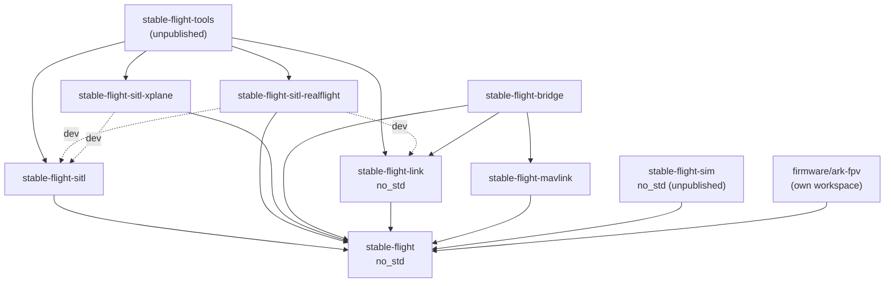

## Architecture

Design principles, crate boundaries, and the rationale behind the design. The
[project README](README.md) is the overview; trait contracts are in core rustdoc.

## Design Principles

Stable Flight is an autonomous flight stack for VTOL aircraft, split across two computers: a
`no_std` flight controller that keeps the vehicle flying, and a companion computer that decides
where it goes. The [link](docs/architecture/link.md#link) between them is the boundary.

* **The flight controller** owns everything that closes a loop at tick rate or that the vehicle
  needs with the companion gone: state estimation, stabilization and mixing, guidance to the
  targets it is given (hover, waypoint, land, transition, loiter), the arm gate and its checks
  ([#136](https://github.com/wboayue/stable-flight/issues/136), planned), failsafes, home and
  return to launch ([#468](https://github.com/wboayue/stable-flight/issues/468), planned; home is
  tracked in the bridge today), and params. Guidance flies the current target; a horizon of the
  current target and the next is planned
  ([#658](https://github.com/wboayue/stable-flight/issues/658)), never a whole mission.
* **The companion** owns everything above that horizon: mission storage, sequencing, and
  replanning ([#350](https://github.com/wboayue/stable-flight/issues/350), planned), and the
  ground station protocol (the bridge translates MAVLink and never decides). Later, perception
  too: camera, lidar, and ADS-B processed on the companion, which replans the mission and
  streams new targets.
* **The link carries** commands, target horizons, and companion measurements up, and
  timestamped state, telemetry, and status down; raw sensor data never crosses it. Measurements (visual odometry, height above
  ground) enter the flight controller's estimator as one more gated sensor
  ([#656](https://github.com/wboayue/stable-flight/issues/656), planned); attitude and rates
  stay onboard. Perception pairs its frames with state through flight-controller timestamps
  and a timesync exchange ([#655](https://github.com/wboayue/stable-flight/issues/655),
  planned), while freshness and failsafe timing stay on the flight controller's own `dt`.
* **The flight controller doesn't rely on the companion to stay safe.** A
  quiet companion ends in a failsafe the flight controller chooses
  ([Link Failsafe](docs/architecture/link.md#link-failsafe)). A misbehaving one stays inside a flight envelope the flight
  controller enforces on every command, whoever sends it: geofence, altitude, and distance
  limits ([#657](https://github.com/wboayue/stable-flight/issues/657), planned), and arming
  will pass the flight controller's own checks. Avoiding traffic and obstacles is the companion's
  job; the envelope is the backstop.

Where new work goes: on the flight controller only if it runs at tick rate or the vehicle needs
it with the companion gone; otherwise on the companion. Core's `WaypointFollower` and sitl's
`ScriptCommander` sequence whole routes on the flight controller as test and SITL tools; real
missions come from the companion.

Missions stay off the flight controller. If it held the mission, every replan would be a
re-upload, and after the companion went quiet it would fly on with a plan nobody can correct. The failsafe flies instead: a hold, or in plane a loiter
then return to launch ([#468](https://github.com/wboayue/stable-flight/issues/468)).

## Crate Boundaries

The repository is a Cargo workspace. Dependencies point one way:

Solid arrows are dependencies, dashed ones dev-dependencies (examples and tests).

* **`stable-flight`**: the flight-control core: pipeline traits, the data passed between them
  (`Command`/`ControlInput`, `Setpoint`, `VehicleState`, `ControlOutput`, `ActuatorCommand`,
  `TelemetryRecord`), guidance, stabilizers and their PID `controllers`, mixers, and
  `FlightLoop`. No simulator, I/O, clock, or thread dependencies, and `no_std`, so it runs on
  hardware.
* **`stable-flight-link`**: the flight controller ⇄ companion wire protocol ([Link](docs/architecture/link.md#link)).
  `no_std`; depends only on the core (`serde` feature).
* **`stable-flight-mavlink`**: pure functions from core values to `mavlink` payloads, plus the
  telemetry-only estimates they need (home, landed state, geodetic projection). Depends only on
  the core and `mavlink`, so the bridge's encoding is testable without I/O and reusable by an
  onboard MAVLink option ([#156](https://github.com/wboayue/stable-flight/issues/156)).
* **`stable-flight-bridge`**: the companion binary that translates the native link to MAVLink.
  Never depends on the sitl harness, so it runs the same against SITL and a board.
* **`stable-flight-sitl`**: the simulator-independent harness: joystick and scripted
  commanders, `RealTimeRunner`, and `ShutdownSignal`.
* **`stable-flight-sitl-realflight`**, **`stable-flight-sitl-xplane`**: the RealFlight and
  X-Plane backends ([Simulator Backends](docs/architecture/simulators.md#simulator-backends)).
* **`stable-flight-sim`**: the in-repo simulator for closed-loop tests ([In-Repo
  Simulator](#in-repo-simulator)). `no_std`; depends only on the core.
* **`stable-flight-tools`**: unpublished developer binaries, so library consumers never compile
  their dependencies.
* **`firmware/`**: excluded from the workspace; each board is its own nested workspace.

## Simulator Backends

See [`docs/architecture/simulators.md`](docs/architecture/simulators.md).

### X-Plane

See [`docs/architecture/simulators.md`](docs/architecture/simulators.md#x-plane).

### In-Repo Simulator

See [`docs/architecture/simulators.md`](docs/architecture/simulators.md#in-repo-simulator).

## Link

See [`docs/architecture/link.md`](docs/architecture/link.md).

## Flight Loop and Runners

See [`docs/architecture/flight-loop.md`](docs/architecture/flight-loop.md).

## Core Components

See [`docs/architecture/flight-loop.md`](docs/architecture/flight-loop.md#core-components).

## Flight Stabilization Loop

See [`docs/architecture/flight-loop.md`](docs/architecture/flight-loop.md#flight-stabilization-loop).

## Flight Regimes

See [`docs/architecture/flight-regimes.md`](docs/architecture/flight-regimes.md).

## Link Failsafe

See [`docs/architecture/link.md`](docs/architecture/link.md#link-failsafe).

## Input Policy (no panics in the tick)

Nothing that runs every tick panics on its inputs. Guidance, stabilizers, controllers, and
mixers:

* **Saturate** out-of-range normalized commands (roll/pitch/yaw and moments to [-1, 1],
  throttle and thrust to [0, 1]) and physical targets to their configured limit (attitude
  setpoint angles to the stabilizer's `max_angles_rad`). A controller that produces a normalized
  command saturates its output; one that consumes it saturates its input too.
* Give an **unsupported `ControlInput` or `Setpoint` variant** (both `#[non_exhaustive]`) neutral
  output: a guidance returns a level setpoint at the current heading with zero thrust, a
  stabilizer zero thrust and moments.
* Treat a **NaN command as neutral** (level, hold zero rate, no thrust).
* Return **neutral output on a non-finite error** (NaN/∞ setpoint or estimate), without letting
  it into integral or derivative state; the first finite tick afterwards has no derivative kick,
  and neither does the first tick after construction (altitude takes D from measured velocity, so
  it never kicks). Neutral is zero tilt/rate/moment, except altitude, whose neutral is hover
  thrust. The body-rate loop applies this per axis, so a bad gyro axis doesn't take damping off
  the others.
* **Wrap angles** to [-π, π) instead of range-checking them.

Only construction-time config validation and a positive, finite `dt` (guaranteed by the runners)
are asserted. The helpers live in the core's crate-private `math` module.

These are last-resort behaviors that keep the loop alive, not a failsafe. A NaN thrust reaching
the mixer becomes 0, which cuts the motors; holding the last thrust could fly away instead, and
the stateless mixer can't choose better. Real failsafes (estimator health checks, then a land or
disarm commander) belong upstream ([#66](https://github.com/wboayue/stable-flight/issues/66)).

## Config Ownership

See [`docs/architecture/config.md`](docs/architecture/config.md).

### Params

See [`docs/architecture/config.md`](docs/architecture/config.md#params).

## Autotune

See [`docs/architecture/autotune.md`](docs/architecture/autotune.md).

## Real-Time Loop Management

See [`docs/architecture/flight-loop.md`](docs/architecture/flight-loop.md#real-time-loop-management).
