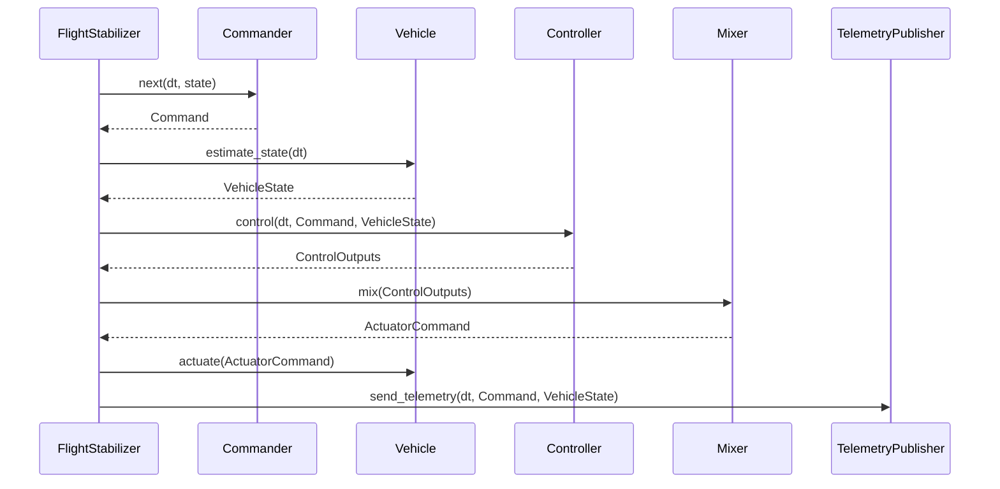

## Architecture

The heart of the system is the `FlightStabilizer` component. The `FlightStabilizer` depends on several traits that together form a flexible and modular flight control architecture.

## Core Components

* **Commander**: Commanders generate Rate, Attitude or Position control commands for the controller. They can come from various sources such as joysticks, pre-recorded scripts, or autonomous navigation systems.
* **Vehicle**: Vehicle represents a physical or simulated vehicle and supports retrieval of state and actuation of the vehicle. This abstraction allows for testing with simulators before deploying to real hardware.
* **Controller**: Controllers implement the PID control logic to stabilize the vehicle by calculating necessary corrections based on the difference between commanded and actual state.
* **Mixer**: Mixers transform the output of the controller into actuation commands for the vehicle, translating abstract control moments into specific motor outputs or control surface positions.
* **TelemetryPublisher**: Publishes the current state of the vehicle for monitoring, debugging, and external systems.

## Flight Stabilization Loop

The flight stabilization loop runs at a configured frequency (target Hz) and does the following continuously:

## Design Patterns

### Dependency Injection

The system uses dependency injection to allow flexible configuration of components. This enables easy swapping of:

* Different command sources (joystick vs script)
* Vehicle implementations (simulation vs real hardware)
* Control algorithms
* Output mixing strategies for different vehicle configurations
* Telemetry systems

### Trait-Based Polymorphism

Each major component is defined by a trait interface, allowing multiple implementations while keeping a consistent API:

* Multiple Commander implementations (e.g., ScriptCommander, Extreme3DCommander)
* Different Vehicle implementations (e.g., RealFlightVehicle, NullVehicle)
* Controller variants for different control approaches
* Mixer implementations for various aircraft configurations (e.g., QuadCopterMixer)
* Various telemetry publishers (e.g., MavlinkPublisher, ConsoleTelemetryPublisher)

## Real-Time Loop Management

The stabilizer implements careful timing control:

* Operates at a fixed frequency (e.g., 250 Hz)
* Calculates and applies sleep durations to maintain consistent timing
* Passes delta time values to components for time-dependent calculations
