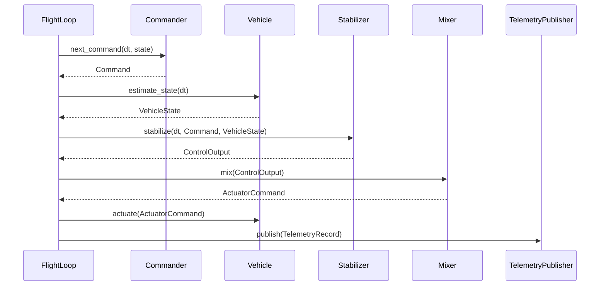

## Architecture

This document expands upon the high-level introduction provided in the [project README](README.md).

## Crate Boundaries

The repository is a Cargo workspace. Dependencies point one way:

```
stable-flight-tools ──► stable-flight-sitl ──► stable-flight ◄── stable-flight-sitl-realflight
                                ▲                                          ┊
                                └┄┄┄┄┄┄┄┄┄┄┄┄┄┄┄┄┄┄ dev ┄┄┄┄┄┄┄┄┄┄┄┄┄┄┄┄┄┄┄┄┘
```

* **`stable-flight`** (`crates/stable-flight`): the flight-control core — pipeline traits, the data passed between them (`Command`, `VehicleState`, `ControlOutput`, `ActuatorCommand`, `TelemetryRecord`), the cascaded-PID stabilizers, the mixers, and `FlightLoop`, which sequences one tick. No simulator, I/O, clock, or thread dependencies, so it can run on hardware. Published.
* **`stable-flight-sitl`** (`crates/stable-flight-sitl`): the simulator-independent software-in-the-loop harness — joystick and scripted commanders, MAVLink/file telemetry, `RealTimeRunner` (wall-clock pacing of a `FlightLoop`), `ShutdownSignal` (SIGINT/Ctrl-C flag), and the backend `conformance` kit (feature). Published.
* **`stable-flight-sitl-realflight`** (`crates/stable-flight-sitl-realflight`): the RealFlight backend — `RealFlightVehicle`, `ActuatorMapping`, tuned `airframes`, and the RealFlight examples. Published.
* **`stable-flight-tools`** (`crates/stable-flight-tools`): developer binaries (`plot_flight`, `generate_figure_eight`). Unpublished, so library consumers never compile `plotters`.
* **`firmware/`**: excluded from the workspace; each board will be its own nested workspace with its own target, profiles, and lockfile.

The split continues per `plans/workspace-migration.md`: the core becomes `no_std`.

## Simulator Backends

Each simulator gets its own `stable-flight-sitl-<simulator>` crate, so its dependencies (protocol clients, FFI, system libraries) never reach the core, the harness, or another backend.

* **Dependency rule.** A backend's normal dependencies are the core and its simulator client only. `stable-flight-sitl` is a dev-dependency (examples, conformance tests), so the backend works with any runner: the sitl runners, a HIL rig, or a third-party harness. CI fails if a backend lists `stable-flight-sitl` under `cargo tree -e normal`.
* **Frame contract.** Every `StateEstimator` reports `VehicleState` in one convention: world `x` north, `y` east, `z` up (altitude), SI units, roll right-wing-down, pitch nose-up, heading clockwise from north, and body rates roll-right/nose-up/nose-right. The table on `VehicleState` (core rustdoc) is the reference. A backend converts from its simulator's native frames at its boundary; nothing downstream knows which simulator is attached.
* **Timing contract.** Each tick calls `estimate_state` then `actuate` once. A backend talks to its simulator at most once per call, produces real state on the priming call (`dt == Duration::ZERO`), and documents how old its state is relative to the last `actuate`. The core `Vehicle` rustdoc is the reference. RealFlight Link is one round-trip per tick, so `RealFlightVehicle` exchanges in `actuate` and returns the cached result: the stabilizer sees state one tick old.
* **Conformance.** `stable_flight_sitl::conformance` (feature `conformance`) lists physical scenarios and the `VehicleState` each must yield. Each backend feeds its simulator's native report for every scenario (a mock-client fixture) through its conversion and checks the result, which catches frame bugs before the backend flies.
* **Airframes.** Tuned gains and channel mappings live in the backend's `airframes` module, next to the simulated model they were tuned on. Examples still inline their pipeline wiring.

## Flight Loop and Runners

The heart of the system is `FlightLoop` (core). It owns the five components and runs one tick per `step(dt)`, with no notion of time. A runner decides when ticks happen: `RealTimeRunner` (sitl) paces them on the wall clock until a `ShutdownSignal` is set; a lockstep simulator runner or a hardware timer interrupt can drive the same `FlightLoop` later and reuse the same `ShutdownSignal`. Shutdown, pacing, and tick sequencing are three separate pieces so each runner only supplies pacing.

## Core Components

* **Commander**: Generates Rate, Attitude, or Waypoint commands for the stabilizer. Sources include joysticks, pre-recorded scripts, and autonomous navigation systems.
* **Vehicle**: Represents a physical or simulated vehicle. It is the composition `StateEstimator + Actuator` (blanket-implemented), so sensing and actuation can be separate components on hardware (IMU/estimator, ESC output) while a simulator bridge implements both on one type. `ComposedVehicle<E, A>` (core) joins a separate estimator and actuator into a `Vehicle`. This abstraction allows for testing with simulators before deploying to real hardware.
* **Stabilizer**: Implements the flight control logic — typically cascaded PID loops — calculating `ControlOutput` based on the difference between commanded and actual state.
* **Mixer**: Translates `ControlOutput` into actuator commands, mapping abstract thrust/moment values to specific motor outputs or control surface positions.
* **TelemetryPublisher**: Publishes the current state of the vehicle for monitoring, debugging, and external systems. A tuple `(A, B)` of publishers is itself a publisher that fans each tick out to both, and `()` is the no-op sink (see `stable_flight::composition`).

## Flight Stabilization Loop

Each `FlightLoop::step` (called by the runner at its configured frequency) does the following. This section is the reference for tick ordering; other docs link here.

* The commander sees the **previous** tick's state; the stabilizer sees this tick's **fresh** estimate.
* `FlightLoop::prime` runs once before the first tick: `estimate_state(Duration::ZERO)`, then `Stabilizer::prime` with that state.
* Telemetry is published after `actuate`, with the whole tick in one `TelemetryRecord`.



## Input Policy (no panics in the tick)

Nothing that runs every tick panics on its inputs. Stabilizers, controllers, and mixers:

* **Saturate** out-of-range normalized commands (roll/pitch/yaw and moments to [-1, 1], throttle and thrust to [0, 1]). A controller that produces a normalized command saturates its output; one that consumes it saturates its input too.
* Treat a **NaN command as neutral** (level, hold zero rate, no thrust).
* Return **neutral output on a non-finite error** (NaN/∞ setpoint or estimate), without letting it into integral or derivative state; the first finite tick afterwards has no derivative kick. Neutral is zero tilt/rate/moment, except altitude, whose neutral is **hover thrust** (0.5), not zero.
* **Wrap angles** to [-π, π) instead of range-checking them.

Only construction-time config validation (every limit a per-tick `clamp` depends on) and `dt > 0` (guaranteed by the runners) are asserted. The helpers live in the core's crate-private `math` module.

These are last-resort behaviours that keep the loop alive, not a failsafe. A NaN thrust reaching the mixer becomes 0, which cuts the motors. Holding the last thrust could fly away instead, and the stateless mixer can't choose better. Real failsafes (estimator health checks, then a land or disarm commander) belong upstream; see the plan's follow-up backlog.

## Design Patterns

### Dependency Injection

The system uses dependency injection to allow flexible configuration of components. This enables easy swapping of:

* Different command sources (joystick vs script)
* Vehicle implementations (simulation vs real hardware)
* Control algorithms
* Output mixing strategies for different vehicle configurations
* Telemetry systems

### Trait-Based Polymorphism

Each major component is defined by a trait interface, allowing multiple implementations while keeping a consistent API:

* Multiple Commander implementations (e.g., the core `WaypointFollower`, which follows and loops any waypoint list; sitl's ScriptCommander, which loads CSV waypoint scripts from `flights/` into a `WaypointFollower`; Extreme3DCommander; SpektrumCommander)
* Different Vehicle implementations (e.g., RealFlightVehicle in `stable-flight-sitl-realflight`)
* Stabilizer variants for different airframes (e.g., CopterStabilizer). A tailsitter stabilizer for the [eXplora VTOL](https://github.com/robustini/eXploraVTOL/tree/main/simulation) model is planned but not started.
* Mixer implementations for various aircraft configurations (e.g., QuadCopterMixer). `TailSitterMixer` is a placeholder: it returns zeroed actuator commands until the tailsitter stabilizer exists.
* Various telemetry publishers (e.g., MavlinkPublisher, FileLogger)

## Real-Time Loop Management

`RealTimeRunner` (sitl) implements the timing around `FlightLoop::step`:

* Operates at a fixed frequency (e.g., 250 Hz) validated at construction (`RealTimeRunner::new` rejects non-positive or non-finite rates and ones whose period isn't a representable non-zero `Duration`)
* Primes the loop, then steps it with the nominal period and sleeps to the next accumulated deadline
* Checks the `ShutdownSignal` before each tick; SIGINT (Unix) / Ctrl-C or Ctrl-Break (Windows) set it once installed, and a second interrupt terminates the process
* Catches up after a slow tick: deadlines accumulate, so missed ticks run back-to-back (resync-on-stall is a planned follow-up)
* Returns `RunStats` (ticks, elapsed, average rate)

## Configuration Example

Wiring a quadcopter in RealFlight means choosing one implementation per trait (e.g. `Extreme3DCommander` or `ScriptCommander`, `RealFlightVehicle`, `CopterStabilizer` with gains from `airframes::quadcopter_x()`, `QuadCopterMixer`, `MavlinkPublisher`), assembling them into a `FlightLoop`, and handing it to a `RealTimeRunner` with a `ShutdownSignal`. The runnable code lives in the [`stable-flight-sitl` README](crates/stable-flight-sitl/README.md#running-the-loop) and `crates/stable-flight-sitl-realflight/examples/copter-*-realflight.rs`.

This architecture's modularity allows for easy testing with different components while maintaining the same core stabilization loop, making it ideal for iterative flight control system development.
