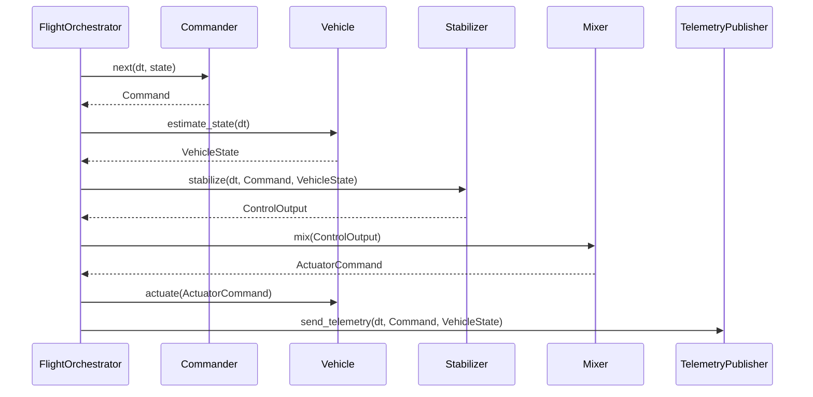

## Architecture

This document expands upon the high-level introduction provided in the [project README](https://github.com/wboayue/stable-flight-sitl/blob/main/README.md).

The heart of the system is the `FlightOrchestrator` component. The `FlightOrchestrator` depends on several traits that together form a flexible and modular flight control architecture.

## Core Components

* **Commander**: Generates Rate, Attitude, or Waypoint commands for the stabilizer. Sources include joysticks, pre-recorded scripts, and autonomous navigation systems.
* **Vehicle**: Represents a physical or simulated vehicle, supporting state estimation and actuation. This abstraction allows for testing with simulators before deploying to real hardware.
* **Stabilizer**: Implements the flight control logic — typically cascaded PID loops — calculating `ControlOutput` based on the difference between commanded and actual state.
* **Mixer**: Translates `ControlOutput` into actuator commands, mapping abstract thrust/moment values to specific motor outputs or control surface positions.
* **TelemetryPublisher**: Publishes the current state of the vehicle for monitoring, debugging, and external systems.

## Flight Stabilization Loop

The flight stabilization loop runs at a configured frequency (target Hz) and does the following continuously:



## Design Patterns

### Dependency Injection

The system uses dependency injection to allow flexible configuration of components. This enables easy swapping of:

* Different command sources (joystick vs script)
* Vehicle implementations (simulation vs real hardware)
* Control algorithms
* Output mixing strategies for different vehicle configurations
* Telemetry systems

### Trait-Based Polymorphism

Each major component is defined by a trait interface, allowing multiple implementations while keeping a consistent API:

* Multiple Commander implementations (e.g., ScriptCommander, Extreme3DCommander, SpektrumCommander)
* Different Vehicle implementations (e.g., RealFlightVehicle)
* Stabilizer variants for different airframes (e.g., CopterStabilizer, VTOL stabilizer)
* Mixer implementations for various aircraft configurations (e.g., QuadCopterMixer, TailsitterMixer)
* Various telemetry publishers (e.g., MavlinkPublisher, FileLogger)

## Real-Time Loop Management

The orchestrator implements careful timing control:

* Operates at a fixed frequency (e.g., 250 Hz), set per call to `run(target_frequency)`
* Calculates and applies sleep durations to maintain consistent timing
* Passes delta time values to components for time-dependent calculations
* Handles SIGINT (Unix) / Ctrl-C (Windows) for graceful shutdown

## Configuration Example

The following example demonstrates how the components can be configured for a quadcopter in the RealFlight simulator:

```rust
// Configure joystick commander (defaults to Attitude mode)
let commander = Extreme3DCommander::new()
    .expect("Failed to create Extreme3D commander");

// Configure RealFlight simulator interface
let vehicle = RealFlightVehicle::new(RealFlightConfiguration {
    bridge: RealFlightRemoteBridge::new("10.211.55.3:8080").expect("Failed to create bridge"),
    mapping: ActuatorMapping {
        motors: [Some(2), Some(0), Some(1), Some(3), None, None, None, None],
        ..Default::default()
    },
});

// Cascaded PID stabilizer for multirotors
let stabilizer = CopterStabilizer::new(CopterStabilizerConfig::default());

// Mixer for quadcopter configuration
let mixer = QuadCopterMixer::default();

// Telemetry via MAVLink protocol
let telemetry = MavlinkPublisher::new(MavlinkConfiguration {});

// Assemble the orchestrator with all components
let mut orchestrator = FlightOrchestrator::new(
    commander,
    vehicle,
    stabilizer,
    mixer,
    telemetry,
);

// Run the control loop at 250 Hz
orchestrator.run(250.0);
```

This architecture's modularity allows for easy testing with different components while maintaining the same core stabilization loop, making it ideal for iterative flight control system development.
