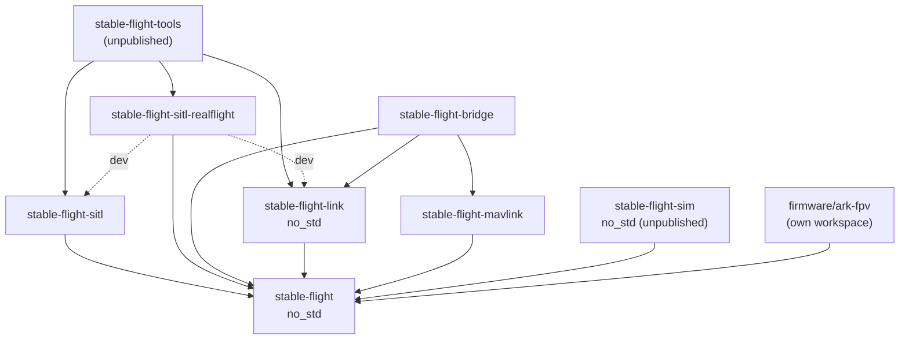
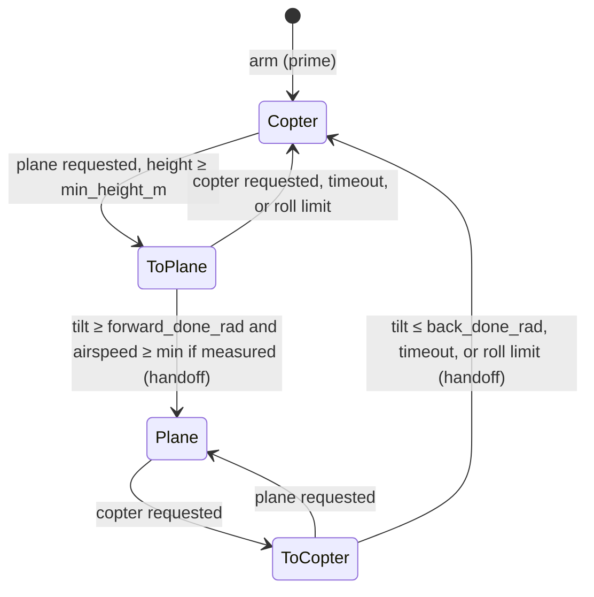

## Architecture

Crate boundaries and the rationale behind the design. The [project README](README.md) is the
overview; trait contracts are in core rustdoc.

## Crate Boundaries

The repository is a Cargo workspace. Dependencies point one way:



Solid arrows are dependencies, dashed ones dev-dependencies (examples and tests).

* **`stable-flight`**: the flight-control core: pipeline traits, the data passed between them
  (`Command`/`ControlInput`, `Setpoint`, `VehicleState`, `ControlOutput`, `ActuatorCommand`,
  `TelemetryRecord`), guidance, stabilizers and their PID `controllers`, mixers, and
  `FlightLoop`. No simulator, I/O, clock, or thread dependencies, and `no_std`, so it runs on
  hardware.
* **`stable-flight-link`**: the flight controller ⇄ companion wire protocol ([Link](#link)).
  `no_std`; depends only on the core (`serde` feature).
* **`stable-flight-mavlink`**: pure functions from core values to `mavlink` payloads, plus the
  telemetry-only estimates they need (home, landed state, geodetic projection). Depends only on
  the core and `mavlink`, so the bridge's encoding is testable without I/O and reusable by an
  onboard MAVLink option ([#156](https://github.com/wboayue/stable-flight/issues/156)).
* **`stable-flight-bridge`**: the companion binary that translates the native link to MAVLink.
  Never depends on the sitl harness, so it runs the same against SITL and a board.
* **`stable-flight-sitl`**: the simulator-independent harness: joystick and scripted
  commanders, `RealTimeRunner`, and `ShutdownSignal`.
* **`stable-flight-sitl-realflight`**: the RealFlight backend ([Simulator
  Backends](#simulator-backends)).
* **`stable-flight-sim`**: the in-repo simulator for closed-loop tests ([In-Repo
  Simulator](#in-repo-simulator)). `no_std`; depends only on the core.
* **`stable-flight-tools`**: unpublished developer binaries, so library consumers never compile
  their dependencies.
* **`firmware/`**: excluded from the workspace; each board is its own nested workspace.

## Simulator Backends

Each simulator gets its own `stable-flight-sitl-<simulator>` crate, so its dependencies
(protocol clients, FFI, system libraries) never reach the core, the harness, or another backend.

* **Dependency rule.** A backend depends on the core, its simulator client, and small shared
  utilities, and on `stable-flight-sitl` only as a dev-dependency (examples), so it works with
  any runner: the sitl runners, a HIL rig, or a third-party harness. CI fails if a backend lists
  `stable-flight-sitl` under `cargo tree -e normal`.
* **Frame contract.** Every `StateSource` reports `VehicleState` in one convention (the table in
  its rustdoc), whatever the simulator uses natively, so nothing downstream knows which
  simulator is attached. The body frame is the airframe's own: a tailsitter's is the airplane's
  (x along the nose, as ArduPilot does), so it hovers at pitch +90°. A simulator body frame that
  differs is a constant rotation applied at the `StateSource` boundary
  (`RealFlightConfiguration::body_rotation`, set per airframe); on hardware the same rotation is
  the IMU driver's or estimator's board orientation
  ([#241](https://github.com/wboayue/stable-flight/issues/241)). Controllers never see it.
* **Timing contract.** `FlightLoop` calls `state` then `actuate` once per tick, so a backend
  says which call talks to the simulator and how old its state is. The `Vehicle` rustdoc is the
  reference; each backend documents its own timing.
* **Conformance.** `stable_flight::testing::conformance` (core `testing` feature) lists physical
  scenarios and the `VehicleState` each must yield; `conformance_tests!` runs a backend's native
  fixtures through them. It lives in the core so backends and in-core estimators test against it
  without the harness.
* **Airframes.** Tuned gains, the mixer, channel mapping, and body rotation live in the
  backend's `airframes` module, next to the simulated model they were tuned on.

### In-Repo Simulator

RealFlight (and X-Plane, planned) can't run in `cargo test` or CI, so without another plant
the pipeline's closed loop is only checked by hand. `stable-flight-sim` is that plant: a rigid
body with motor lag, quadratic thrust, linear drag, a ground plane, and deterministic wind,
stepped in lockstep with `FlightLoop` (no wall clock, only seeded noise), so a test flight
repeats bit for bit and runs in milliseconds. It aims at plausible dynamics, not fidelity; RealFlight stays
the check for realism.

* **Why not JSBSim (or Gazebo).** An external engine brings a C++ build or a process to
  manage in CI, nondeterminism from its own scheduling, and no `no_std` path. A small Rust
  model is enough for what the tests assert (loops close, modes sequence, limits flag) and,
  being `no_std` with fixed-size math, can later drive a board in hardware-in-the-loop runs.
* **Geometry from the mixer.** Each motor's torque comes from its `TableMixer` row's factors
  (a factor of 1 at the model's moment arm), so the sim and mixer can't disagree on motor
  order or spin, and there is no second table to keep in sync.
* **Spec bands, not snapshots.** Step-response tests hold each loop to ArduPilot's and PX4's
  autotune targets (cited in `tests/step_response.rs`), not to whatever the sim measured, so
  a regression and a tuning gap both fail. `quad_x`'s gains come from running the core
  autotune on the sim.
* **Perturbation ranges, not a fitted plant.** Delay, gyro noise and vibration, a disturbance
  moment, and motor mismatch are parameters to sweep, so the autotune *method* is checked on
  many plausible plants and transfers to hardware. Fitting the sim to RealFlight's QuadCopterX
  (#365) was rejected: it would match one simulated plant, and its gains still wouldn't be a
  board's.
* **Not a backend crate.** It meets the frame and timing contracts and covers every
  conformance scenario like a backend, but it has no simulator client, so it isn't a
  `stable-flight-sitl-<simulator>` crate. Core can't take it as a dev-dependency (a cycle
  builds two copies of core), so the closed-loop tests live in its `tests/`.

## Link

`stable-flight-link` is the native protocol between the flight controller and a companion
computer. The wire format is the core types themselves (`Command`, `VehicleState`, an owned
`TelemetryRecord`) in postcard, so the flight controller carries no MAVLink dialect; the bridge
translates to MAVLink in `std` code.

* **Frame.** `[version u8][postcard payload][crc16 LE]`, COBS-encoded, `0x00`-terminated. COBS
  gives the length. Postcard isn't self-describing (a reordered field decodes as garbage, not an
  error), so every frame carries `PROTOCOL_VERSION` and the receiver rejects a mismatch; any
  message shape change bumps it. The CRC (CRC-16/IBM-3740, bitwise to save flash) is checked
  before the version, so a corrupted version byte reads as corruption.
* **Sealed messages.** Only `Uplink` and `Downlink` implement `Message`.
* **Fixed size.** Every message fits `MAX_FRAME_LEN` (256 bytes; a test checks the worst case),
  so both ends use stack buffers.
* **One frame per decode.** `decode` rejects bytes after the delimiter, so a transport that hands
  over two frames at once fails loudly instead of losing the second.
* **Transport-agnostic.** `Link` moves encoded frames without blocking. Like `Vehicle`, it is two
  traits blanket-joined (`LinkRx` + `LinkTx`), so the router and the publisher each own one half
  of the same transport. Every transport carries the same frames:

| Setup | `Link` |
|---|---|
| Tests | `loopback::Loopback` (`testing` feature) |
| SITL flight controller and bridge on one host | `udp::UdpLink` (`std` feature) |
| Real board (planned) | USB-CDC, then a TELEM UART ([#155](https://github.com/wboayue/stable-flight/issues/155)) |

On the flight controller, reading the link is separate from commanding: `UplinkRouter` drains
`LinkRx` between ticks and routes each uplink to a bounded queue (params to the `ParamServer`,
`Control` to a link-fed commander), so params work whichever commander flies. `LinkPublisher` is
the `TelemetryPublisher` that owns `LinkTx`.

On the companion, `stable-flight-bridge` presents the flight controller as MAVLink system 1,
component 1, so MAVLink never runs on the board. It is a pure state machine (messages in,
messages out, clock injected) behind a thin I/O loop, holding only what translation needs: the
flight controller's last heartbeat (to send `HEARTBEAT` only while it is alive, and to confirm an
arm or disarm before acking it), when the ground station was last heard (to send
`Control::Heartbeat` only while it is), and a param cache (to answer `PARAM_REQUEST_READ`
without a round trip). Param listings and writes go to the flight controller, whose echo is
forwarded unchanged, so the flight controller stays the only judge of a value. Staleness,
failsafe, and arm decisions stay on the flight controller; the bridge translates and never
decides. What it translates: the [bridge README](crates/stable-flight-bridge/README.md).

## Flight Loop and Runners

`FlightLoop` (core) owns the six components and runs one tick per `step(dt)`, with no notion of
time. A runner decides when ticks happen: `RealTimeRunner` (sitl) paces them on the wall clock
until a `ShutdownSignal` is set; a lockstep simulator runner or a hardware timer can drive the
same `FlightLoop`. Shutdown, pacing, and tick sequencing are separate pieces, so each runner only
supplies pacing.

## Core Components

* **Commander**: produces a `Command` (arm flag, requested `FlightRegime`, and `ControlInput`)
  each tick, from joysticks, scripts, the link, or navigation.
* **Vehicle**: `StateSource + Actuator` (blanket-implemented), so sensing and actuation can be
  separate components on hardware (IMU/estimator, ESC output) while a simulator client implements
  both on one type. `ComposedVehicle<S, A>` joins a separate state source and actuator.
* **Guidance**: the outer loop. Turns a `ControlInput` into a `Setpoint` (attitude or rate) in
  the requested regime, and owns the flight mode ([flight regimes](#flight-regimes)):
  position and altitude loops for waypoints, and stick interpretation that needs memory (the
  heading-hold target). `FlightLoop` calls guidance and the stabilizer every tick, and a guidance
  paces its own slow loops (`CopterGuidance`'s lateral loop); pacing inside guidance keeps pilot
  sticks read every tick, where a loop-level divider would add a guidance period of latency.
* **Stabilizer**: the inner loop, cascaded PIDs from setpoint error to `ControlOutput` (setpoint
  units: `Setpoint` rustdoc).
* **Mixer**: maps thrust and moments to `ActuatorCommand`'s generic motor and servo slots. The
  mixer sets what each slot means; the backend's mapping (e.g. `ActuatorMapping`) sets which
  channel it drives. `TableMixer` covers multirotors and thrust-and-servo frames with one table
  per frame (a row per slot).
* **TelemetryPublisher**: receives each tick's `TelemetryRecord`. A tuple `(A, B)` fans out to
  both, and `()` is the no-op sink (`stable_flight::composition`).
* **View**: `View<T>` runs any guidance or stabilizer in a body frame rotated by a constant: the
  state goes in rotated, and a stabilizer's moments come back in the body frame. A tailsitter
  hovers on the copter guidance and stabilizer in `View::tailsitter` (90° in pitch), where
  nose-up hover reads level, away from the airplane frame's Euler singularity, as ArduPilot's
  tailsitter AHRS view does (PX4 instead keeps a hover body frame and views its fixed-wing
  controllers). The view's Euler angles are singular at forward flight, which the transition
  pitches toward, so `CopterStabilizer` takes its attitude error from quaternions (tilt of the
  thrust axis, then heading, as PX4's multicopter attitude control does) rather than Euler
  differences, and its loops output body rates at any attitude.

## Flight Stabilization Loop

Each `FlightLoop::step` does the following; this section is the reference for tick ordering.

* The commander sees the **previous** tick's state; guidance and the stabilizer see this tick's
  **fresh** estimate.
* `FlightLoop::prime` runs once before the first tick: `state(Duration::ZERO)`, then
  `Guidance::prime` and `Stabilizer::prime` with that state.
* **`Command::arm` gates the motors.** A disarmed tick still runs the commander, the estimator,
  `actuate`, and telemetry, but skips guidance, the stabilizer, and the mixer: it actuates
  `ActuatorCommand::default()` (motors off) and records a neutral setpoint at the current heading
  with zero control and a copter flight mode, so nothing winds up on the ground. Each disarmed → armed edge (including the
  first armed tick) re-primes guidance, then the stabilizer, from the fresh estimate, so
  integrals start from zero and the heading hold latches where the vehicle points. Armed at zero
  thrust, `CopterStabilizer` clears its integrals each tick for the same reason
  ([#326](https://github.com/wboayue/stable-flight/issues/326) tracks telling ground idle from a
  zero-thrust tick in flight). `arm` is a level the commander returns every tick; arming checks
  are commander-side policy ([#136](https://github.com/wboayue/stable-flight/issues/136),
  [link failsafe](#link-failsafe)).
* Telemetry is published after `actuate`, with the whole tick in one `TelemetryRecord`,
  including the limits it hit: guidance, the stabilizer, and the mixer each report a `Saturation`
  for their last call (only they know what they clipped), and the loop merges them (none while
  disarmed).


## Flight Regimes

A VTOL flies two regimes, copter (rotor-borne) and plane (wing-borne), and moves between them
deliberately. The pieces:

* **Request: `Command::regime`, a level.** The commander returns the regime it wants every tick,
  like `arm`, so repeating a request can't restart a transition and a failsafe's fallback asks
  for copter by default (`Command::new`). Both ArduPilot and PX4 treat the request as a level
  too: ArduPilot derives it from the flight mode (`ArduPlane/quadplane.cpp`, `in_vtol_mode`),
  PX4 latches a transition command (`vtol_att_control_main.cpp`). The regime is orthogonal to
  the `ControlInput`: the input says what to fly (sticks, a waypoint, a landing), the regime
  how. Rejected: a `FlightRequest` enum replacing `ControlInput` (`Takeoff`, `Fly`, `Land`
  duplicate inputs that exist), and a one-shot `ChangeRegime` input (it still has to say what to
  fly, and an event is lost if a tick drops it).
* **State: one owner, guidance.** `FlightMode` (`Copter`, `Plane`, `ToPlane`, `ToCopter`) is
  what guidance actually flies; `Guidance::flight_mode` reports it with a `ModeRefusal` when
  the request can't be met, and `FlightLoop` puts it in `TelemetryRecord::flight_mode` (and
  the link heartbeat). A copter-only guidance reports nothing: the loop records
  `FlightModeReport::copter_only`, which refuses `Plane` as `Unsupported`. Both stacks decide
  the mode in one place before control runs each tick. Rejected: a supervisor in `FlightLoop`
  broadcasting the mode to every stage; it would split mode logic from the guidance that has
  the state to decide it.
* **Phases are not modes.** Takeoff and landing are vertical, in the copter regime, flown by
  `ControlInput` (a waypoint up, `Land` down) and decided by commanders (`TouchdownDetector`).
  Height is a guard against starting a transition, not a mode: `guidance::vtol::Transition`
  refuses below a height above the arming point (`ModeRefusal::BelowMinAltitude`), which
  covers the ground too (`OnGround` waits for a landed estimator,
  [#66](https://github.com/wboayue/stable-flight/issues/66)). `Land` implies copter.
* **Flip, not blend.** A tailsitter drives the same elevons and motors in both regimes, so a
  transition hands control from one controller to the other instead of weighting both: one
  active controller and integrator set, testable per mode, one controller per tick. ArduPilot
  and PX4 both flip for tailsitters, with a short thrust hold or blend at the handoff
  (`ArduPlane/tailsitter.cpp`; PX4 `vtol_att_control/tailsitter.cpp`). Blending suits separate
  lift and cruise actuators; for a tailsitter it would mix two controllers fighting over shared
  actuators, their integrators winding on each other's errors, and attitude errors from
  different frames near the view's singularity. `guidance::vtol::Transition` owns the mode and
  ramps a frame-free tilt target (the nose's angle from vertical) for whichever controller
  flies the transition, and flags the tick control passes between them; `ThrustHandoff`
  blends thrust across it. The plane side is `PlaneGuidance` and `PlaneStabilizer`
  (`Setpoint::Plane` attitudes with coordinated turns, `Setpoint::PlaneRate` body rates at any
  attitude for rolls and loops). `TailsitterGuidance` wires them: the forward ramp on the
  hover controller, the back ramp on the plane controller, a roll past the limit cutting a
  transition short (checked before the step, since a sideways lean also tilts the nose), and
  the incoming guidance primed at the handoff. `TailsitterStabilizer` flies each setpoint on
  the side its variant names and primes the incoming side, so the mixer never sees the regime.
  Each composite's params chain its parts' tables.
* **Airspeed is optional.** `VehicleState::airspeed_mps` is `None` without air data
  (`valid_airspeed_mps` also drops NaN and negative readings). The forward transition
  completes on tilt and, when a valid airspeed is present, a minimum airspeed (as PX4 does).
  A forward timeout falls back to hover, as PX4's does, since without an airspeed gate the
  vehicle may not be flying; a back timeout completes, as in both stacks.

`Transition` moves through the modes as below (`TransitionConfig` names the limits). A forward
transition that times out or hits the roll limit stays refused until copter is requested again.



| Mode | Flown by | Tilt target (nose from vertical) |
|---|---|---|
| `Copter` | Hover: copter guidance and stabilizer in `View::tailsitter` | None |
| `ToPlane` | Hover | Ramps from the current tilt at `forward_rate_radps`, up to `forward_max_tilt_rad` |
| `Plane` | Plane: `PlaneGuidance`, `PlaneStabilizer` | None |
| `ToCopter` | Plane | Ramps from the current tilt to 0 at `back_rate_radps` |

At each handoff the incoming side is primed and `ThrustHandoff` blends thrust over `handoff_s`.

## Link Failsafe

A companion's link drops (late USB enumeration, brownouts, a crashed bridge), and the flight
controller, not the companion, decides what happens. `FailsafeCommander<P, F>` (core
`commanders::failsafe`) is a commander like any other, ahead of guidance. Its state
(`FailsafeState`, limits from `FailsafeConfig`):

```mermaid
stateDiagram-v2
    [*] --> Fallback: first tick
    Primary --> Fallback: stale for timeout_s
    Fallback --> Primary: fresh for recover_after_s, fallback releases; waypoint or disarmed
    Fallback --> AwaitingSticks: same, but armed on sticks
    AwaitingSticks --> Primary: an axis moves takeover_stick_delta
    AwaitingSticks --> Fallback: stale
```



The fallback flies in `Fallback` and `AwaitingSticks`. The rules:

* The primary is a `LinkedCommander`, which reports `since_update_s`: time since its last valid
  message, measured on the flight controller from the `dt` it is given, so no clock sync with
  the sender is needed. It runs every tick, flying or not, so it keeps draining its queue.
* What counts as fresh is the primary's call: `LinkCommander` takes any message while it flies a
  waypoint, but only commands while it flies sticks, so a joystick stream that stops falls back
  even though the link still heartbeats.
* **Falls back** when the primary has gone `timeout_s` without a message, or was never heard: it
  starts in the fallback. The `Fallback` is engaged once per switch with the current state and
  the last command flown; `HoldCommander` latches that position and arm state, or, if that
  command was an armed land, finishes the land at the same position (as PX4 does).
* **Returns** only after the primary has been fresh for `recover_after_s` without a break, and
  the fallback allows it (`can_release`: a landing must finish).
* **Arming:** the fallback may keep the vehicle armed or disarm it but never arms it; a fresh
  primary's disarm is always honored, even during recovery. At the handover back, the primary's
  latched arm is synced to the vehicle's (`LinkedCommander::sync_arm`), so an arm request made
  while the fallback flew, which a ground station has already seen fail, doesn't arm the vehicle
  later; a new request does.
* **Sticks after a hold:** to an armed vehicle, a stick input takes over only once an axis moves
  `takeover_stick_delta` from where it was at recovery, so a forgotten joystick at low throttle
  can't drop the vehicle out of a hold; a waypoint, or anything to a disarmed vehicle, takes over
  at once. Stopping an external commander from arming at all waits for a pilot arm source (RC,
  [#134](https://github.com/wboayue/stable-flight/issues/134)).
* The state reaches telemetry through `Commander::failsafe` → `TelemetryRecord::failsafe`
  (`Primary`, `Fallback`, or `AwaitingSticks`); the link heartbeat's `link_ok` is `false` while
  the fallback flies, and each change is announced once as status text, which the bridge shows
  in QGC (`STATUSTEXT`).
* **Landing:** while an armed `ControlInput::Land` flies, from the primary or the fallback, the
  failsafe watches it with a `TouchdownDetector` and, on touchdown, disarms and syncs the
  primary's arm. The detector lives here, not in the primary, because the primary runs every
  tick even while the fallback flies: a hold that follows the land's descent would read as
  touchdown and disarm the vehicle in the air once the link returned. A land that carries on
  across a handover keeps its detector; any interruption (a hold, a disarm, another input)
  starts it over.

Estimator-health failsafes are [#66](https://github.com/wboayue/stable-flight/issues/66).

## Input Policy (no panics in the tick)

Nothing that runs every tick panics on its inputs. Guidance, stabilizers, controllers, and
mixers:

* **Saturate** out-of-range normalized commands (roll/pitch/yaw and moments to [-1, 1],
  throttle and thrust to [0, 1]) and physical targets to their configured limit (attitude
  setpoint angles to the stabilizer's `max_angles_rad`). A controller that produces a normalized
  command saturates its output; one that consumes it saturates its input too.
* Give an **unsupported `ControlInput` or `Setpoint` variant** (both `#[non_exhaustive]`) neutral
  output: a guidance returns a level setpoint at the current heading with zero thrust, a
  stabilizer zero thrust and moments.
* Treat a **NaN command as neutral** (level, hold zero rate, no thrust).
* Return **neutral output on a non-finite error** (NaN/∞ setpoint or estimate), without letting
  it into integral or derivative state; the first finite tick afterwards has no derivative kick,
  and neither does the first tick after construction (altitude takes D from measured velocity, so
  it never kicks). Neutral is zero tilt/rate/moment, except altitude, whose neutral is hover
  thrust. The body-rate loop applies this per axis, so a bad gyro axis doesn't take damping off
  the others.
* **Wrap angles** to [-π, π) instead of range-checking them.

Only construction-time config validation and a positive, finite `dt` (guaranteed by the runners)
are asserted. The helpers live in the core's crate-private `math` module.

These are last-resort behaviors that keep the loop alive, not a failsafe. A NaN thrust reaching
the mixer becomes 0, which cuts the motors; holding the last thrust could fly away instead, and
the stateless mixer can't choose better. Real failsafes (estimator health checks, then a land or
disarm commander) belong upstream ([#66](https://github.com/wboayue/stable-flight/issues/66)).

## Config Ownership

Controllers hold only state (integral and derivative history); their gains and limits are a
plain `Copy` config passed to every `control` call. Each composite (`CopterStabilizer`,
`CopterGuidance`) owns exactly one config value, which embeds the per-loop configs, and passes
sub-references down each tick; nothing below it holds a copy.

```text
FlightLoop ──set_guidance_config()───▶ CopterGuidance { config } ───&config.altitude──▶ AltitudeController
                                                                  ──&config.lateral───▶ LateralController
           ──set_stabilizer_config()─▶ CopterStabilizer { config } ─&config.body_rate─▶ BodyRateController (…)
```

The one write point is `Configurable::set_config`, which validates before committing;
`FlightLoop::set_guidance_config`/`set_stabilizer_config` forward to it between ticks. Config
access is a separate, opt-in trait rather than part of `Guidance`/`Stabilizer`, so implementors
without config aren't burdened, and `FlightLoop` hands out no `&mut` to its components, so
nothing can run them out of tick order: what callers need between ticks it forwards
(`set_*_config`, and `start_probe`/`probe`/`stop_probe` on a `Tunable` stabilizer). The
contract:

* **Valid on entry.** Each config has `validate()` (composites tag errors with the loop, e.g.
  `body_rate.max_integral`); `new` and `set_config` enforce it.
* **Bad config still never panics the tick.** Limits go through `math::clamp_symmetric`, under
  which a negative or NaN limit acts as 0 instead of panicking like `f32::clamp`.
* **Tolerate change between ticks.** The integral is re-clamped to the current `max_integral`
  every tick, so shrinking it self-heals. Filter state needs the same treatment.
* **The lateral integral doesn't wind against the tilt cap.** `CopterGuidance` passes the
  lateral loop the acceleration it last cut to `max_tilt_rad`, and the integral doesn't grow
  along it (ArduPilot `libraries/AC_PID/AC_PID_2D.cpp:127-146`). Clamping to `max_integral`
  alone would let a long leg at the tilt limit wind it full and overshoot the waypoint.
* **Retuning `i` is bumpless.** Controllers integrate the error, not the I term, so a new
  integral gain would rescale `i · ∫e` and jump the output. `set_config` rescales each integral
  by `old_i / new_i` so the term carries over (a hover trim survives a retune). Across a zero
  gain it resets the integral: one accumulated under `i = 0` was never applied. The per-tick
  `max_integral` clamp still applies, so a large cut in `i` can still bump the output.
* **Tuning probes are runtime state, not config.** An autotune probe (`Tunable::start_probe`)
  replaces one loop's output or setpoint inside the tick; it lives next to the controllers'
  state, never in `CopterStabilizerConfig` or its params. Handing a relay-probed loop back seeds
  its integral so the I term equals the measured trim (`seed_integral`); a following
  `set_config` rescales it like any retune.

### Params

`stable_flight::params` is the naming layer for live tuning (e.g. MAVLink `PARAM_SET`): a flat
name → `f32` view over the same configs, not a second store. Each composite config lists its
fields in a `ParamTable` (`STAB_RATE_RLL_P` → `body_rate.roll_gains.p`). Any `Configurable` with a
table gets `Params`, whose `set_param` writes a copy of the config and commits it through
`set_config`, so validation and the integrator policy above apply to a param write too, and an
invalid value leaves the config unchanged. `FlightLoop` combines its guidance's and
stabilizer's params.

* **Names** fit MAVLink's 16-byte `param_id`: uppercase, component prefix (`STAB_`, `GUID_`),
  then loop (`RATE_`, `ATT_`, `YAW_`, `ALT_`, `LAT_`). Vector components end in `_X`/`_Y`/`_Z`,
  which can't be confused with a `_P` gain. The full list with units is in the `params`
  rustdoc.
* **Units:** angles and angular rates are degrees and deg/s, as PX4 and ArduPilot expose them,
  converted to the config's radians in the table row, so control code stays SI.
* **Addressing:** params are indexed `0..param_count()` in stable table order, the trait's
  primitive; name lookup, read, write, and visit are default methods over it, so a combined view
  (`FlightLoop`) splits only the index. Indices let the flight controller send a few params per
  tick from a cursor, and the bridge passes them through as MAVLink's `param_index`.
* **Stores or rejects:** a successful write stores the value as given, up to deg ↔ rad rounding.
  Out-of-range values are rejected, never clamped, so a link can confirm a write by echoing it.
* **Over the link:** the commander that decodes a request and the publisher that sends replies
  both run inside the tick, with no `&mut` to guidance or the stabilizer. So two bounded queues
  carry requests to `stable_flight_link::params::ParamServer`, polled between ticks (sitl
  `RealTimeRunner::run_with`, or the firmware loop task), and its replies to the publisher.
* Out of scope: persistence and non-`f32` params.

## Autotune

PID autotune tunes a fresh airframe from a bad or unflyable start without a pilot nursing it:
relay feedback (Åström–Hägglund) for the ultimate point, then step-response gain search in hover.

* **Measure** (`tuning::RelayTuner`): the relay replaces one loop's controller output with
  `bias ± h`, switching on the error's sign with hysteresis. The limit cycle's period and
  amplitude give the ultimate point `Ku`, `Tu`. The relay ramps `h` until the cycle is large
  enough, and moves the bias to each cycle's mean output so a steady offset (CG, yaw drag)
  doesn't skew it. The describing function reads `Ku` a few percent low and `Tu` high: the
  conservative direction.
* **Rules** (`tuning::gains_from_ultimate`): Tyreus–Luyben (default) or no-overshoot
  Ziegler–Nichols, as PID, PI, PD, or P. Classic Ziegler–Nichols overshoots too much for a
  multirotor.
* **Probe and host** (`tuning::Probe`; `Tunable`, implemented by `CopterStabilizer`): a probe
  excites and measures one loop *inside* the tick on the fresh estimate, since a between-ticks
  driver would add a tick of delay and bias `Ku`/`Tu`. Each tick the host hands the probe the
  loop's setpoint, error, and whether its path clipped last tick (`LoopSignals`), before the
  loop's controller runs; the probe answers with one `Injection`: a replaced output (relay) or a
  replaced setpoint (step). Every controller keeps running. The host owns the loop and the
  handoff; the probe owns the signal and the measurement.
* **Step response** (`tuning::StepProbe`): holds the setpoint at the starting measurement plus
  the step for a fixed window, so steps compare on equal terms, and reports `StepMetrics`
  normalized to the step (overshoot, 10–90% rise, settling, bounce-back after the peak, final
  value) from the low-passed response, plus the time the loop's path was clipped: a clipped step
  measures the limit, not the loop. A rate step is short, since a held rate tilts the vehicle.
  The rate PID's D acts on the error, so a step's first tick kicks the moment; a step test
  allows a few clipped ticks (`StepTestPlan::max_saturated_s`). `StepSummary` keeps means and
  ranges over steps, and overshoot per direction, whose difference shows a trim or CG offset.
* **Procedures and executor** (`tuning::autotune`, between ticks): each stage's `Method`
  (`Relay`, `StepTest`, `Search`) becomes a procedure, a pure state machine fed the stage's start
  and each probe's `Measurement` (or abort), which answers "run this probe" (optionally on
  candidate gains), "finish with these gains", or "fail". It never touches the flight loop, so its
  decisions are tested by feeding it inputs. `Autotune` executes it: it settles before each
  probe, runs it, guards the envelope, and commits. A step clipped too long, or one during which
  the host stalled (`Autotune::note_stall`, e.g. on sitl's `RunStats::skipped_ticks`), runs
  again, within a budget of steps in a row (3 clipped, 10 stalled). Candidate gains go in once
  the vehicle has settled on the committed gains and come out when the probe ends, so a
  candidate flies only its step.
* **Gain search** (`Method::Search`): the largest gain of one term whose step pairs meet a
  criterion, assuming the response worsens as the gain grows. An optional relay first caps the
  gain (`0.6·Ku`) and seeds the other terms from its rule. A baseline on the start gains, then a
  bracket (`×1.3` per pair) and bisection to 10%, each point one `±` pair judged on its means
  (trim doesn't bias it). The result, backed off 10% (as ArduPilot does), is verified with fresh
  pairs and kept only if it flies no worse than the baseline (`Acceptance`), when the baseline
  met the criterion; otherwise it need only meet the criterion. A too-high start fails the
  criterion yet settles fast, overshooting within the settle band, so holding the result to
  it would keep the high gain (#361). A start above the search's maximum (the relay's
  ceiling) isn't flown, and one whose steps keep clipping leaves no baseline rather than
  ending the stage. The copter plan (`StagePlan::copter_search`) tunes roll and pitch rate,
  then angle, so the angle search flies on the tuned rate loops:
  * Rate: D seeded from the relay's Tyreus–Luyben PD, P searched on overshoot ≤ 0.05 and
    bounce-back ≤ 0.1 (ArduPilot's default aggressiveness). Rate P has a sharp limit
    (QuadCopterX: P 1.14 flew clean, 1.22 overshot 0.18; #298), so a bracket point passes only on
    two pairs in a row (ArduPilot's `ignore_next`). Above the start
    the candidates' moment demand clips before overshoot binds, so the search allows clipped
    ticks rather than treating clipping as failure.
  * Angle: no relay (an angle loop's `Ku` caps nothing), P searched on overshoot and bounce-back
    ≤ 0.05 (ArduPilot's angle-P limit); bounce-back counts though a disturbance holds the angle
    short of the step (about 8% on QuadCopterX).
  * D isn't searched the way ArduPilot does (raise D until the response bounces back): with the
    rate I in the loop, overshoot decays without falling back, so bounce-back never bounds D.
  * An envelope breach while a candidate flies fails that candidate, not the run: the committed
    gains go back in and get `Envelope::recovery_s` to recover.
* **Sequence:** innermost first, so each stage flies on the gains the earlier ones found. A stage
  tunes only its form's terms; the rest keep their gains. That keeps the rate loops' I, which
  holds trim rather than shaping the response: the rule's integral time (`2.2·Tu`) is a
  fraction of a second, about 30× shorter than QuadCopterX's flown hand tune (#295). Yaw rate isn't relay-tuned: the relay can't measure it within
  the yaw authority the mixer leaves at hover
  ([#296](https://github.com/wboayue/stable-flight/issues/296)). The relay on roll and pitch angle
  measures a high ultimate gain (an integrator around a fast rate loop) whose rule P oscillates
  once the rate setpoint saturates, so angles are tuned by step-response search. Before each
  probe the vehicle must hold level and still (`Envelope::settle`). A finished stage commits its
  gains through `set_stabilizer_config`.
* **Envelope and outcomes:** tilt, body rate, or altitude loss past the `Envelope` limits, a
  probe abort, or a rate setpoint interrupting an angle stage fails the run, and the config goes
  back to the last commit: earlier stages stay, nothing the failing stage tried survives.
  Disarming before completion reverts to the config at start. The caller owns the trigger and the
  logging (`AutotuneEvent`s); the executor has no clock. The envelope measures tilt in the body
  frame, so autotune can't yet run on a viewed tailsitter
  ([#321](https://github.com/wboayue/stable-flight/issues/321)).
* **Rate stages keep the angle loop**, which holds the vehicle near level; the relay then
  measures the error the rate PID actually acts on, including the angle loop's D term.

## Real-Time Loop Management

`RealTimeRunner` (sitl) implements the timing around `FlightLoop::step`:

* Runs at a fixed frequency (e.g. 250 Hz) validated at construction (`RealTimeRunner::new`
  rejects non-positive or non-finite rates and periods that aren't a representable non-zero
  `Duration`).
* Primes the loop, then steps it with the nominal period and sleeps to the next accumulated
  deadline.
* Checks the `ShutdownSignal` before each tick; SIGINT or SIGTERM (Unix) / Ctrl-C or Ctrl-Break
  (Windows) set it once installed, and a second stop signal terminates the process.
* Catches up when up to 100 ms behind: deadlines accumulate, so simulator jitter is absorbed by
  back-to-back ticks and the sum of nominal `dt`s keeps tracking wall time (dropping those ticks
  would slow every `dt`-based clock: integrators, pacing, failsafe timeouts). After a longer
  stall (e.g. a simulator reconnect) it drops the missed deadlines and resyncs rather than
  replaying them, since a long burst would step stale state; heavy resyncing therefore slows
  `dt`-based clocks.
* Returns `RunStats` (ticks, elapsed, average rate, overruns, skipped ticks).

Wiring a vehicle means one implementation per trait (commander, `RealFlightVehicle`, guidance and
stabilizer with an airframe's gains, the airframe's mixer, `LinkPublisher` via `FcLink`), a
`FlightLoop`, and a `RealTimeRunner::run_with` whose callback polls the link so params are served
between ticks. Runnable code: the [`stable-flight-sitl`
README](crates/stable-flight-sitl/README.md#running-the-loop) and
`crates/stable-flight-sitl-realflight/examples/`.
