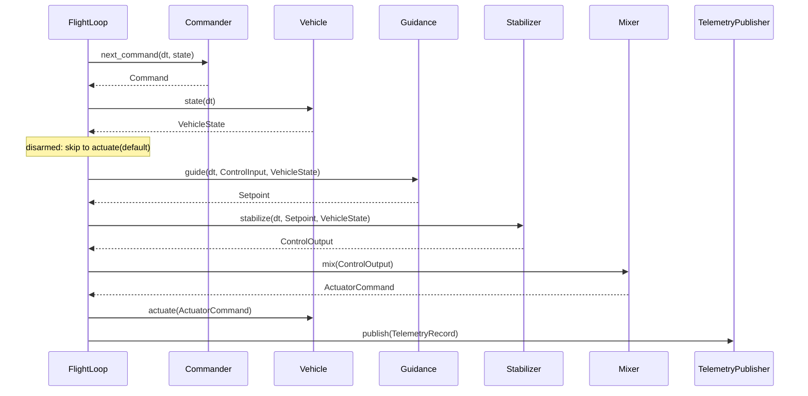

## Architecture

This document expands upon the high-level introduction provided in the [project README](README.md).

## Crate Boundaries

The repository is a Cargo workspace. Dependencies point one way:

```
stable-flight-tools ──► stable-flight-sitl ─────────────► stable-flight ◄── stable-flight-sitl-realflight
                          ▲       │                         ▲     ▲                 ┊
                          ┊       ▼                         │     │                 ┊
                          ┊  stable-flight-mavlink ─────────┘  stable-flight-link   ┊
                          ┊       ▲                                ▲                ┊
                          ┊       └─────── stable-flight-bridge ───┘                ┊
                          └┄┄┄┄┄┄┄┄┄┄┄┄┄┄┄┄┄┄┄┄┄┄┄┄┄┄┄ dev ┄┄┄┄┄┄┄┄┄┄┄┄┄┄┄┄┄┄┄┄┄┄┄┄┄┘
```

* **`stable-flight`** (`crates/stable-flight`): the flight-control core — pipeline traits, the data passed between them (`Command`/`ControlInput`, `Setpoint`, `VehicleState`, `ControlOutput`, `ActuatorCommand`, `TelemetryRecord`), copter guidance, the cascaded-PID stabilizers and their shared PID `controllers`, the mixers, and `FlightLoop`, which sequences one tick. No simulator, I/O, clock, or thread dependencies, and `no_std`, so it can run on hardware. Published.
* **`stable-flight-link`** (`crates/stable-flight-link`): the wire protocol between the flight controller and a companion computer — `Uplink`/`Downlink` messages, the frame codec, and the byte-level `Link` trait (see [Link](#link)). `no_std`, depends only on the core (with its `serde` feature). Published.
* **`stable-flight-mavlink`** (`crates/stable-flight-mavlink`): MAVLink message builders, pure functions from core values to `mavlink` payloads, plus the telemetry-only estimates they need (home, landed state, the geodetic projection). `std`; depends only on the core and `mavlink`, so the bridge's encoding is testable without I/O and reusable by an onboard MAVLink option ([#156](https://github.com/wboayue/stable-flight/issues/156)). Published.
* **`stable-flight-bridge`** (`crates/stable-flight-bridge`): the companion-computer binary that translates the native link to MAVLink for ground stations (see [Link](#link)). `std`; depends on the link crate, `stable-flight-mavlink`, and `mavlink`, never on the sitl harness, so it runs the same against SITL and a board. Published.
* **`stable-flight-sitl`** (`crates/stable-flight-sitl`): the simulator-independent software-in-the-loop harness — joystick and scripted commanders, `RealTimeRunner` (wall-clock pacing of a `FlightLoop`), and `ShutdownSignal` (SIGINT/SIGTERM/Ctrl-C flag). Published.
* **`stable-flight-sitl-realflight`** (`crates/stable-flight-sitl-realflight`): the RealFlight backend — `RealFlightVehicle`, `ActuatorMapping`, tuned `airframes`, and the RealFlight examples. Published.
* **`stable-flight-tools`** (`crates/stable-flight-tools`): developer binaries (`plot_flight`, `generate_figure_eight`). Unpublished, so library consumers never compile `plotters`.
* **`firmware/`**: excluded from the workspace; each board is its own nested workspace with its own target, profiles, and lockfile (e.g. `firmware/ark-fpv`).

## Simulator Backends

Each simulator gets its own `stable-flight-sitl-<simulator>` crate, so its dependencies (protocol clients, FFI, system libraries) never reach the core, the harness, or another backend.

* **Dependency rule.** A backend depends on the core, its simulator client, and small shared utilities (`log`; math types come through the core's `nalgebra` re-export), and never on `stable-flight-sitl` except as a dev-dependency (examples). So the backend works with any runner: the sitl runners, a HIL rig, or a third-party harness. CI fails if a backend lists `stable-flight-sitl` under `cargo tree -e normal`.
* **Frame contract.** Every `StateSource` reports `VehicleState` in one convention, whatever the simulator uses natively, so nothing downstream knows which simulator is attached. Each backend converts at its boundary. The table in the `VehicleState` rustdoc is the reference. The body frame is the airframe's own, whatever the simulator or board reports: a tailsitter's is the airplane's (x along the nose, as ArduPilot does), so it hovers at pitch +90°. A simulator's body frame that differs (RealFlight's eXplora reads level on its tail) is a constant rotation applied at the `StateSource` boundary (`RealFlightConfiguration::body_rotation`, set per airframe, #314); on hardware the same rotation is the IMU driver's or estimator's board orientation (#241). Controllers never see it, so they behave the same in SITL and on hardware.
* **Timing contract.** `FlightLoop` calls `state` then `actuate` once per tick, so a backend must say which call talks to the simulator and how old its state is. The `Vehicle` rustdoc is the reference; each backend documents its own timing (e.g. `RealFlightVehicle`).
* **Conformance.** `stable_flight::testing::conformance` (core `testing` feature) lists physical scenarios and the `VehicleState` each must yield, and `conformance_tests!` runs a backend's native fixtures through them. It lives in the core so backends, and in-core estimator adapters, test against it without pulling in the harness.
* **Airframes.** Tuned gains, the mixer, channel mappings, and the body rotation live in the backend's `airframes` module, next to the simulated model they were tuned on. Examples still inline their pipeline wiring.

## Link

`stable-flight-link` is the native protocol between the flight controller and a companion computer ([#150](https://github.com/wboayue/stable-flight/issues/150)). The wire format is the core types themselves (`Command`, `VehicleState`, an owned `TelemetryRecord`) in postcard, so the flight controller carries no MAVLink dialect; the bridge on the companion translates to MAVLink in `std` code.

* **Frame.** `[version u8][postcard payload][crc16 LE]`, COBS-encoded, `0x00`-terminated. COBS gives the length, so there is no length field. Postcard is not self-describing (a reordered field decodes as garbage, not an error), so every frame carries `PROTOCOL_VERSION` and the receiver rejects a mismatch; any message shape change bumps it. The CRC (CRC-16/IBM-3740, bitwise to save flash) is checked before the version, so a corrupted version byte reads as corruption, not a version mismatch.
* **Sealed messages.** Only `Uplink` and `Downlink` implement `Message`, so nothing else travels under the protocol version.
* **Fixed size.** Every message fits `MAX_FRAME_LEN` (256 bytes; a test checks the worst case), so both ends use stack buffers and nothing allocates.
* **One frame per decode.** `decode` rejects bytes after the delimiter, so a transport that hands over two frames at once fails loudly instead of losing the second.
* **Transport-agnostic.** `Link` moves encoded frames without blocking; the transport is picked where the pipeline is wired. Like `Vehicle`, it is two traits blanket-joined (`LinkRx` + `LinkTx`), so the router that receives and the publisher that sends can each own one half of the same transport. Every transport carries the same frames, so a host run exercises the real wire format:

| Setup | `Link` |
|---|---|
| Tests | `loopback::Loopback` (`testing` feature) |
| Flight controller (SITL) and bridge on one host, no USB | `udp::UdpLink` (`std` feature), UDP on localhost |
| Real board (planned; the firmware has no link yet) | USB-CDC, later a TELEM UART ([#155](https://github.com/wboayue/stable-flight/issues/155)) |

On the flight controller, reading the link is separate from commanding: `UplinkRouter` drains `LinkRx` between ticks (or in a receive task) and routes each uplink to a bounded queue, params to the `ParamServer` and `Control` to a link-fed commander ([#153](https://github.com/wboayue/stable-flight/issues/153)), so params work whichever commander flies. `LinkPublisher` is the `TelemetryPublisher` that owns `LinkTx`.

On the companion, `stable-flight-bridge` holds the other end of the link and speaks MAVLink for the flight controller (system 1, component 1), so MAVLink never runs on the board. It is a pure state machine (messages in, messages out, clock injected) behind a thin I/O loop. Its state is only what translation needs: the flight controller's last heartbeat (to send `HEARTBEAT` only while it is alive, and to confirm an arm or disarm before acking it), when the ground station was last heard (to keep the link fresh with `Control::Heartbeat` only while it is), and a param cache (to answer `PARAM_REQUEST_READ` without a round trip). Listings and writes go to the flight controller, whose echo is forwarded unchanged, so the flight controller stays the only judge of a param value. What it translates today: the [bridge README](crates/stable-flight-bridge/README.md).

Staleness, failsafe, and arm decisions stay on the flight controller ([#152](https://github.com/wboayue/stable-flight/issues/152)); the bridge translates and never decides.

## Flight Loop and Runners

The heart of the system is `FlightLoop` (core). It owns the six components and runs one tick per `step(dt)`, with no notion of time. A runner decides when ticks happen: `RealTimeRunner` (sitl) paces them on the wall clock until a `ShutdownSignal` is set; a lockstep simulator runner or a hardware timer interrupt can drive the same `FlightLoop` later and reuse the same `ShutdownSignal`. Shutdown, pacing, and tick sequencing are three separate pieces so each runner only supplies pacing.

## Core Components

* **Commander**: Generates Rate, Attitude, or Waypoint commands for guidance. Sources include joysticks, pre-recorded scripts, and autonomous navigation systems.
* **Vehicle**: Represents a physical or simulated vehicle. It is the composition `StateSource + Actuator` (blanket-implemented), so sensing and actuation can be separate components on hardware (IMU/estimator, ESC output) while a simulator bridge implements both on one type. `ComposedVehicle<S, A>` (core) joins a separate state source and actuator into a `Vehicle`. This abstraction allows for testing with simulators before deploying to real hardware.
* **Guidance**: The outer loop. Turns a `Command`'s `ControlInput` into a `Setpoint` (attitude or rate) for the stabilizer: position and altitude loops for waypoints, and stick interpretation that needs memory, such as the heading-hold target. Split from the stabilizer so the two can run at different rates (guidance is conventionally ~50 Hz, the inner loop ~250 Hz). `FlightLoop` calls both every tick, and a guidance paces its own slow loops (e.g. `CopterGuidance`'s lateral loop; its rustdoc has the rate). Pacing inside guidance rather than in the loop keeps pilot sticks read every tick; a loop-level divider would add up to a guidance period of stick latency.
* **Stabilizer**: The inner loop — typically cascaded PID loops — calculating `ControlOutput` based on the difference between the setpoint and actual state (setpoint units: `Setpoint` rustdoc).
* **Mixer**: Translates `ControlOutput` into actuator commands, mapping abstract thrust/moment values to `ActuatorCommand`'s generic motor and servo slots. The mixer sets what each slot means; the backend's mapping (e.g. `ActuatorMapping`) sets which output channel it drives.
* **TelemetryPublisher**: Publishes the current state of the vehicle for monitoring, debugging, and external systems. A tuple `(A, B)` of publishers is itself a publisher that fans each tick out to both, and `()` is the no-op sink (see `stable_flight::composition`).

## Flight Stabilization Loop

Each `FlightLoop::step` (called by the runner at its configured frequency) does the following. This section is the reference for tick ordering; other docs link here.

* The commander sees the **previous** tick's state; guidance and the stabilizer see this tick's **fresh** estimate.
* `FlightLoop::prime` runs once before the first tick: `state(Duration::ZERO)`, then `Guidance::prime` and `Stabilizer::prime` with that state.
* **`Command::arm` gates the motors.** A disarmed tick still runs the commander, the estimator, `actuate`, and telemetry, but skips guidance, the stabilizer, and the mixer: it actuates `ActuatorCommand::default()` (motors off) and records a neutral setpoint at the current heading with zero control, so nothing winds up on the ground. On each disarmed → armed edge (including the first armed tick) the loop re-primes guidance, then the stabilizer, from the fresh estimate, so integrals start from zero and the heading hold latches where the vehicle points. `arm` is a level the commander returns every tick; arming checks (throttle low, estimator healthy, link present) are commander-side policy ([#136](https://github.com/wboayue/stable-flight/issues/136), [link failsafe](#link-failsafe)).
* Telemetry is published after `actuate`, with the whole tick in one `TelemetryRecord`, including which limits it hit: guidance, the stabilizer, and the mixer each report a `Saturation` for their last call (only they know what they clipped), and the loop merges them (none while disarmed).



## Link Failsafe

A companion's link drops (late USB enumeration, brownouts, a crashed bridge), and the flight controller, not the companion, decides what happens. `FailsafeCommander<P, F>` (core `commanders::failsafe`) is a commander like any other, so it sits where the commander does, ahead of guidance:

* The primary is a `LinkedCommander`, which reports `since_update_s`: time since its last valid message, measured on the flight controller from the `dt` it is given, so no clock sync with the sender is needed. It runs every tick, flying or not, so it keeps draining its queue.
* What counts as fresh is the primary's call: `LinkCommander` takes any message while it flies a waypoint, but only commands while it flies sticks, so a joystick stream that stops falls back even though the link still heartbeats.
* **Falls back** when the primary has gone `timeout_s` without a message, or was never heard: it **starts in the fallback**. The `Fallback` is engaged once per switch with the current state and the last command flown; `HoldCommander` latches that position and arm state, or, if that command was an armed land, finishes the land at the same position (as PX4 does; [#263](https://github.com/wboayue/stable-flight/issues/263)).
* **Returns** only after the primary has been fresh for `recover_after_s` without a break, and the fallback allows it (`can_release`: a landing must finish, [#66](https://github.com/wboayue/stable-flight/issues/66)).
* **Arming:** the fallback may keep the vehicle armed or disarm it but never arms it (the failsafe enforces it); a fresh primary's disarm is always honored, even during recovery. At the handover back, the primary's latched arm is synced to the vehicle's (`LinkedCommander::sync_arm`), so an arm request made while the fallback flew, which a ground station has already seen fail, doesn't arm the vehicle later; a new request does.
* **Sticks after a hold:** to an armed vehicle, a stick input (attitude or rate) takes over only once an axis moves `takeover_stick_delta` from where it was at recovery, so a forgotten joystick at low throttle can't drop the vehicle out of a hold; a waypoint, or anything to a disarmed vehicle, takes over at once. A policy that stops an external commander from arming at all waits for a pilot arm source (RC, [#134](https://github.com/wboayue/stable-flight/issues/134)).
* The state reaches telemetry through `Commander::failsafe` → `TelemetryRecord::failsafe` (`Primary`, `Fallback`, or `AwaitingSticks`); the link heartbeat's `link_ok` is `false` while the fallback flies, and each change is announced once as status text, which the bridge shows in QGC (`STATUSTEXT`), so the pilot learns to move the sticks.
* **Landing:** while an armed `ControlInput::Land` flies, from the primary or the fallback, the failsafe watches it with a `TouchdownDetector` and, on touchdown, disarms and syncs the primary's arm, so it stays disarmed until the primary arms again. The detector lives here, not in the primary, because the primary runs every tick, even while the fallback flies: a hold that follows the land's descent would read as touchdown and disarm the vehicle in the air once the link returned. A land that carries on across a handover keeps its detector, so a link that drops after the vehicle stopped on the ground, but before the touchdown hold ended, still disarms; any interruption (a hold, a disarm, another input) starts it over.

This is the input side. The [input policy](#input-policy-no-panics-in-the-tick) below keeps a bad value from crashing the tick, and estimator-health failsafes are [#66](https://github.com/wboayue/stable-flight/issues/66).

## Input Policy (no panics in the tick)

Nothing that runs every tick panics on its inputs. Guidance, stabilizers, controllers, and mixers:

* **Saturate** out-of-range normalized commands (roll/pitch/yaw and moments to [-1, 1], throttle and thrust to [0, 1]) and physical targets to their configured limit (attitude setpoint angles to the stabilizer's `max_angles_rad`). A controller that produces a normalized command saturates its output; one that consumes it saturates its input too.
* Give an **unsupported `ControlInput` or `Setpoint` variant** (both are `#[non_exhaustive]`) neutral output rather than panicking: a guidance returns a level setpoint at the current heading with zero thrust, a stabilizer zero thrust and moments.
* Treat a **NaN command as neutral** (level, hold zero rate, no thrust).
* Return **neutral output on a non-finite error** (NaN/∞ setpoint or estimate), without letting it into integral or derivative state; the first finite tick afterwards has no derivative kick, and neither does the first tick after construction (altitude takes D from measured velocity, so it never kicks). Neutral is zero tilt/rate/moment, except altitude, whose neutral is **hover thrust** (0.5), not zero. The body-rate loop applies this per axis, so a bad gyro axis doesn't take damping off the others.
* **Wrap angles** to [-π, π) instead of range-checking them.

Only construction-time config validation and a positive, finite `dt` (guaranteed by the runners; one shared assert in every controller and composite) are asserted. The helpers live in the core's crate-private `math` module.

These are last-resort behaviors that keep the loop alive, not a failsafe. A NaN thrust reaching the mixer becomes 0, which cuts the motors. Holding the last thrust could fly away instead, and the stateless mixer can't choose better. Real failsafes (estimator health checks, then a land or disarm commander) belong upstream ([#66](https://github.com/wboayue/stable-flight/issues/66)).

## Config Ownership

Controllers hold only state (integral and derivative history); their gains and limits are a plain `Copy` config passed to every `control` call. Each composite (`CopterStabilizer`, `CopterGuidance`) owns exactly one config value (`CopterStabilizerConfig`, `CopterGuidanceConfig`, which embed the per-loop configs) and passes sub-references down each tick; nothing below it holds a copy, so the period of the guidance's lateral loop is also read from it every tick.

```text
FlightLoop ──set_guidance_config()───▶ CopterGuidance { config } ───&config.altitude──▶ AltitudeController
                                                                  ──&config.lateral───▶ LateralController
           ──set_stabilizer_config()─▶ CopterStabilizer { config } ─&config.body_rate─▶ BodyRateController (…)
```

The one write point is `Configurable::set_config` (see its rustdoc), which validates before committing; `FlightLoop::set_guidance_config`/`set_stabilizer_config` forward to it between ticks. Config access is a separate, opt-in trait rather than part of `Guidance`/`Stabilizer`, so implementors without config aren't burdened, and `FlightLoop` hands out no `&mut` to its components, so nothing can run them out of tick order: what callers need between ticks it forwards (`set_*_config`, and `start_tuning`/`tuning`/`stop_tuning` on a `Tunable` stabilizer). The contract:

* **Valid on entry.** Each config has `validate()` (composites tag errors with the loop, e.g. `body_rate.max_integral`); `new` and `set_config` enforce it. Controllers don't re-check every tick.
* **Bad config still never panics the tick.** Limits go through `math::clamp_symmetric`, under which a negative or NaN limit acts as 0 (neutral output) instead of panicking like `f32::clamp`.
* **Tolerate change between ticks.** State must stay coherent when the config changes: the integral is re-clamped to the current `max_integral` every tick, so shrinking it self-heals. Future filter state (e.g. a D-term low-pass cutoff) needs the same treatment.
* **Retuning `i` is bumpless.** Controllers integrate the error, not the I term, so a new integral gain would rescale `i · ∫e` and jump the output. `set_config` rescales each integral by `old_i / new_i` so the term carries over. Across a zero gain it resets the integral instead: an integral accumulated under `i = 0` was never applied, and a zeroed term has nothing to carry. Rescaling rather than resetting keeps a hover trim through a retune. The per-tick `max_integral` clamp still applies, so a large cut in `i` can still bump the output.
* **Tuning stages are runtime state, not config.** An autotune probe (`Tunable::start_probe`, #149) replaces one loop's output inside the tick (today a relay); it lives next to the controllers' state and is never part of `CopterStabilizerConfig` or its params. Handing the loop back seeds its integral so the I term equals the relay's measured trim (`seed_integral`); a following `set_config` with the tuned gains rescales it like any retune, so the trim carries through both.

### Params

`stable_flight::params` is the naming layer for live tuning (e.g. MAVLink `PARAM_SET`): a flat name → `f32` view over the same configs, not a second store. Each composite config lists its fields in a `ParamTable` (`STAB_RATE_RLL_P` → `body_rate.roll_gains.p`). Any `Configurable` with a table gets `Params`, whose `set_param` writes a copy of the config and commits it through `set_config`. Validation and the integrator policy above therefore apply to a param write as to any other config change, and an invalid value leaves the config unchanged. `FlightLoop` combines its guidance's and stabilizer's params.

* **Names** fit MAVLink's 16-byte `param_id`: uppercase, component prefix (`STAB_`, `GUID_`), then loop (`RATE_`, `ATT_`, `YAW_`, `ALT_`, `LAT_`). Vector components end in `_X`/`_Y`/`_Z`, which can't be confused with a `_P` gain. The full list with units is in the `params` rustdoc.
* **Units:** angles and angular rates are degrees and deg/s, as PX4 and ArduPilot expose them. They convert to the config's radians in the table row, so control code stays SI. Gains and integral limits keep the config's units.
* **Addressing:** params are indexed `0..param_count()` in stable table order, and that is the trait's primitive. Name lookup, read, write, and visit are default methods over it, so a combined view (`FlightLoop`) splits only the index. Indices let the flight controller send a few params per tick from a cursor, and `Downlink::Param` carries them, so the bridge passes them through as MAVLink's `param_index`.
* **Stores or rejects:** a successful write stores the value as given, up to deg ↔ rad rounding. Out-of-range values are rejected, never clamped, so a link can confirm a write by echoing what it sent.
* **Over the link:** the commander that decodes a request and the publisher that sends replies both run inside the tick, with no `&mut` to guidance or the stabilizer. So two bounded queues carry requests to `stable_flight_link::params::ParamServer`, polled between ticks (sitl `RealTimeRunner::run_with`, or the firmware loop task), and its replies to the publisher. Pacing, and the echo that lets a ground station confirm a write, are in its rustdoc.
* Out of scope: persistence and non-`f32` params. The commander/publisher wiring and MAVLink translation are [#153](https://github.com/wboayue/stable-flight/issues/153) and [#154](https://github.com/wboayue/stable-flight/issues/154).

## Autotune

PID autotune (#149), phase 1: relay feedback (Åström–Hägglund), so a fresh airframe can be tuned from a bad or unflyable start without a pilot nursing it. Phase 2 (#298) refines the gains from step responses in hover.

* **Measure** (`tuning::RelayTuner`, generic): the relay replaces one loop's controller output with `bias ± h`, switching on the error's sign with hysteresis. The limit cycle's period and amplitude give the ultimate point `Ku`, `Tu`. The relay ramps `h` until the cycle is large enough, and moves the bias to each cycle's mean output so a steady offset (CG, yaw drag) doesn't skew it. The describing function reads `Ku` a few percent low and `Tu` high: the conservative direction.
* **Rules** (`tuning::gains_from_ultimate`): Tyreus–Luyben (default) or no-overshoot Ziegler–Nichols, as PID, PI, PD, or P. Classic Ziegler–Nichols overshoots too much for a multirotor.
* **Probe and host** (`tuning::Probe`; `Tunable`, implemented by `CopterStabilizer`): a probe excites and measures one loop *inside* the tick on the fresh estimate, since a between-ticks driver would add a tick of delay and bias `Ku`/`Tu`. Each tick the host hands the probe the loop's setpoint, error, and whether its path clipped last tick (`LoopSignals`), before the loop's controller runs; the probe answers with one `Injection`: a replaced output (the relay: a rate loop's moment, an angle or heading loop's rate setpoint) or a replaced setpoint (a step). Every controller keeps running. The host owns the loop and the handoff, at the end of the tick; the probe owns the signal and the measurement. The relay's bias starts at the loop's I term, and the loop is handed back with the final bias as its I term (see Config Ownership); a step leaves the I term as it is.
* **Step response** (`tuning::StepProbe`, #298): holds the setpoint at the measurement at the start plus the step for a fixed window, so steps compare on equal terms, and reports `StepMetrics` normalized to the step (overshoot, 10–90% rise, settling into a band, bounce-back after the peak, final value) from the low-passed response, plus the time the loop's path was clipped: a clipped step measures the limit, not the loop. A rate step is short (0.25 s on QuadCopterX), since a held rate tilts the vehicle. The rate PID's D acts on the error, so the step's first tick kicks the moment, often to its limit; a step test allows a few clipped ticks (`StepTestPlan::max_saturated_s`: 10 on a rate loop, whose tuned P above 1 asks a 1 rad/s step for more than full moment until the rate catches up; 5 on an angle loop). `StepSummary` keeps means and ranges over steps, and overshoot per direction, whose difference shows a trim or CG offset.
* **Procedures and executor** (`tuning::autotune`, between ticks): each stage's `Method` becomes a procedure, a pure state machine fed the stage's start and each probe's `Measurement` (or abort) with the loop's committed gains, which answers "run this probe" (optionally on candidate gains), "finish with these gains", or "fail". It never touches the flight loop, so its decisions are tested by feeding it inputs. `Autotune` executes it: it settles before each probe (to the method's `Settle`, or the envelope's), runs it, guards the envelope, and commits. `Method::Relay` measures once; `Method::StepTest` alternates `+step` and `−step` and keeps the gains, a measurement of the current tune. A step clipped too long, or one during which the host stalled (`Autotune::note_stall`, e.g. on sitl's `RunStats::skipped_ticks`), runs again. Each has its own budget of steps in a row before the stage fails: 3 clipped (a clipped step measures the limit), 10 stalled (a stall says nothing about the loop, and RealFlight's proxy has frozen for 100 ms dozens of times a run). A procedure may also ask for a probe on *candidate* gains: the executor puts them in once the vehicle has settled on the committed gains and takes them out when the probe ends, so a candidate flies only its step; a breach during it reaches the procedure as a failed candidate.
* **Gain search** (`Method::Search`, #298): the largest gain of one term whose step pairs meet a criterion, assuming the response worsens as the gain grows. An optional relay first caps the gain (`0.6·Ku`) and seeds the other terms from its rule. A baseline on the start gains, then a bracket (`×1.3` per pair) and bisection to 10%, each point one `±` pair judged on its means (trim doesn't bias it); a step that aborts, or keeps clipping, fails its point. The result, backed off 10% (ArduPilot's), is verified with fresh pairs and kept only if it flies no worse than the baseline (overshoot, settling, unsettled steps, bounce-back: `Acceptance`); else the start stays. The copter search (`StagePlan::copter_search`) tunes roll and pitch rate, then angle, so the angle search flies on the tuned rate loops. The rate search seeds D from the relay's Tyreus–Luyben PD and searches P on overshoot ≤ 0.05 and bounce-back ≤ 0.1 (ArduPilot's default aggressiveness). The angle search has no relay (an angle loop's `Ku`, about 60, caps nothing) and searches P on overshoot and bounce-back ≤ 0.05 (ArduPilot's angle-P limit); bounce-back is the overshoot above where the response levels off, so it counts though a disturbance holds QuadCopterX's angle about 8% short of the step. Above the start, the candidates' moment demand clips before overshoot binds, and a search that treats clipping as failure finds the clipping limit instead (#304). The rate search keeps the 1 rad/s step and allows 10 clipped ticks (a 0.5 rad/s step doubled the noise relative to the step); the angle search steps 5° and stops at P 10. Rate P has a sharp limit on QuadCopterX (P 1.14 flew clean, 1.22 overshot 0.18), so a bracket point passes only on two pairs in a row (ArduPilot's `ignore_next`). An envelope breach while a candidate flies fails that candidate, not the run: the committed gains go back in and get `Envelope::recovery_s` (1 s) to bring the vehicle back before a breach fails the stage. It doesn't search D the way ArduPilot does (raise D until the response bounces back after its peak): on our closed-loop steps the rate I makes overshoot decay without falling back, so bounce-back never bounds D and the search overdamps the loop.
* **Sequence:** innermost first, so each stage flies on the gains the earlier ones found. The relay sequence is roll and pitch rate (PD), the loops a bad start breaks; the step-response search adds roll and pitch angle. A stage tunes only its form's terms; the rest keep their gains. That keeps the rate loops' I, which holds trim rather than shaping the response: the rule's integral time (`2.2·Tu`) is a fraction of a second on these fast loops, about 30× a flown hand tune on QuadCopterX (#295). The other loops keep their hand tune unless planned explicitly. Yaw rate: the relay can't measure it within the yaw authority the mixer leaves at hover (#296). Roll and pitch angle: the relay measures a real but high ultimate gain (about 60, an integrator around a fast rate loop), and the rule's P oscillates once a few degrees of error saturate the rate setpoint and moments; step-response tuning (phase 2) sees that saturation. Heading: both. Before each probe the vehicle must hold level and still (`Envelope::settle`; step tests use ArduPilot's tighter 2.5° for 0.5 s). A finished stage commits its gains through `set_stabilizer_config`.
* **Envelope and outcomes:** tilt, body rate, or altitude loss past the `Envelope` limits, a probe abort, or a rate setpoint interrupting an angle stage fails the run, and the config goes back to the last commit: the earlier stages stay, and nothing the failing stage tried survives. Disarming before completion reverts everything to the config at start. Completion keeps the gains; a search stage has already checked its own against its baseline. The caller owns the trigger and the logging (`AutotuneEvent`s), and the supervisor has no clock.
* **Rate stages keep the angle loop**, which holds the vehicle near level; the relay then measures the error the rate PID actually acts on, including the angle loop's D term.

## Design Patterns

### Dependency Injection

The system uses dependency injection to allow flexible configuration of components. This enables easy swapping of:

* Different command sources (joystick vs script)
* Vehicle implementations (simulation vs real hardware)
* Control algorithms
* Output mixing strategies for different vehicle configurations
* Telemetry systems

### Trait-Based Polymorphism

Each major component is defined by a trait interface, allowing multiple implementations while keeping a consistent API:

* Multiple Commander implementations (e.g., the core `WaypointFollower`, which follows any waypoint list, looping, holding, or landing and disarming at the end; sitl's ScriptCommander, which loads CSV waypoint scripts from `flights/` into a `WaypointFollower`; Extreme3DCommander; SpektrumCommander)
* Different Vehicle implementations (e.g., RealFlightVehicle in `stable-flight-sitl-realflight`)
* Guidance and stabilizer variants for different airframes (e.g., CopterGuidance and CopterStabilizer). A tailsitter stabilizer for the [eXplora VTOL](https://github.com/robustini/eXploraVTOL/tree/main/simulation) model is planned but not started.
* Mixer implementations for various aircraft configurations (e.g., QuadCopterMixer). `TailSitterMixer` is a placeholder: it returns zeroed actuator commands until the tailsitter stabilizer exists.
* Telemetry publishers (e.g., the link crate's `LinkPublisher`, which SITL uses and boards will share; MAVLink is the bridge's job)

## Real-Time Loop Management

`RealTimeRunner` (sitl) implements the timing around `FlightLoop::step`:

* Operates at a fixed frequency (e.g., 250 Hz) validated at construction (`RealTimeRunner::new` rejects non-positive or non-finite rates and ones whose period isn't a representable non-zero `Duration`)
* Primes the loop, then steps it with the nominal period and sleeps to the next accumulated deadline
* Checks the `ShutdownSignal` before each tick; SIGINT or SIGTERM (Unix) / Ctrl-C or Ctrl-Break (Windows) set it once installed, and a second stop signal terminates the process
* Catches up when up to 100 ms behind: deadlines accumulate, so simulator jitter is absorbed by back-to-back ticks and the sum of nominal `dt`s keeps tracking wall time (dropping those ticks instead would slow every `dt`-based clock: integrators, pacing, failsafe timeouts). After a longer stall (e.g. a simulator reconnect) it drops the missed deadlines and resyncs rather than replaying them, since a long burst would step stale state
* Returns `RunStats` (ticks, elapsed, average rate, overruns, skipped ticks)

## Configuration Example

Wiring a quadcopter in RealFlight means choosing one implementation per trait (e.g. `Extreme3DCommander` or `ScriptCommander`, `RealFlightVehicle`, `CopterGuidance` and `CopterStabilizer` with gains from `airframes::quadcopter_x()`, `QuadCopterMixer`, and the link crate's `LinkPublisher` via `FcLink`), assembling them into a `FlightLoop`, and handing it to a `RealTimeRunner` with a `ShutdownSignal` (`run_with`, so the link's poller serves params between ticks). The runnable code lives in the [`stable-flight-sitl` README](crates/stable-flight-sitl/README.md#running-the-loop) and `crates/stable-flight-sitl-realflight/examples/copter-*-realflight.rs`.

This architecture's modularity allows for easy testing with different components while maintaining the same core stabilization loop, making it ideal for iterative flight control system development.
