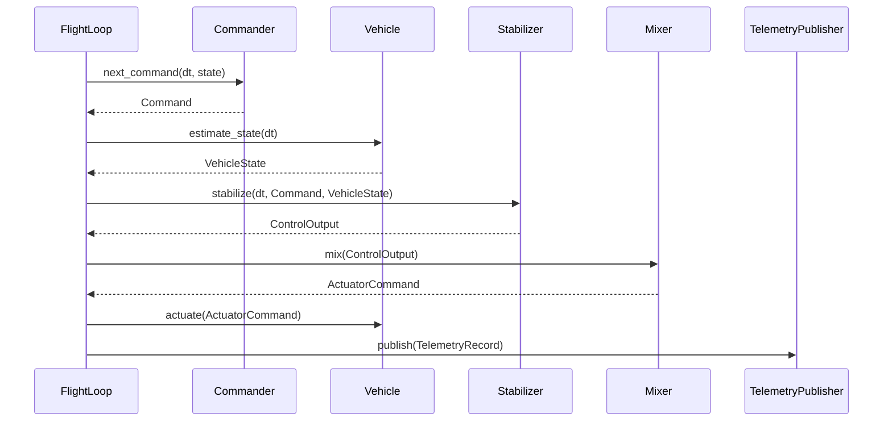

## Architecture

This document expands upon the high-level introduction provided in the [project README](README.md).

## Crate Boundaries

The repository is a Cargo workspace. Dependencies point one way:

```
stable-flight-tools ──► stable-flight-sitl ──► stable-flight
```

* **`stable-flight`** (`crates/stable-flight`): the flight-control core — pipeline traits, the data passed between them (`Command`, `VehicleState`, `ControlOutput`, `ActuatorCommand`, `TelemetryRecord`), the cascaded-PID stabilizers, the mixers, and `FlightLoop`, which sequences one tick. No simulator, I/O, clock, or thread dependencies, so it can run on hardware. Published.
* **`stable-flight-sitl`** (`crates/stable-flight-sitl`): the software-in-the-loop harness — the RealFlight vehicle, joystick and scripted commanders, MAVLink/file telemetry, `RealTimeRunner` (wall-clock pacing of a `FlightLoop`), and `ShutdownSignal` (SIGINT/Ctrl-C flag). Published.
* **`stable-flight-tools`** (`crates/stable-flight-tools`): developer binaries (`plot_flight`, `generate_figure_eight`). Unpublished, so library consumers never compile `plotters`.
* **`firmware/`**: excluded from the workspace; each board will be its own nested workspace with its own target, profiles, and lockfile.

The split continues per `plans/workspace-migration.md`: the core becomes `no_std`, and each simulator backend gets its own `stable-flight-sitl-<simulator>` crate.

## Flight Loop and Runners

The heart of the system is `FlightLoop` (core). It owns the five components and runs one tick per `step(dt)`, with no notion of time. A runner decides when ticks happen: `RealTimeRunner` (sitl) paces them on the wall clock until a `ShutdownSignal` is set; a lockstep simulator runner or a hardware timer interrupt can drive the same `FlightLoop` later and reuse the same `ShutdownSignal`. Shutdown, pacing, and tick sequencing are three separate pieces so each runner only supplies pacing.

## Core Components

* **Commander**: Generates Rate, Attitude, or Waypoint commands for the stabilizer. Sources include joysticks, pre-recorded scripts, and autonomous navigation systems.
* **Vehicle**: Represents a physical or simulated vehicle. It is the composition `StateEstimator + Actuator` (blanket-implemented), so sensing and actuation can be separate components on hardware (IMU/estimator, ESC output) while a simulator bridge implements both on one type. This abstraction allows for testing with simulators before deploying to real hardware.
* **Stabilizer**: Implements the flight control logic — typically cascaded PID loops — calculating `ControlOutput` based on the difference between commanded and actual state.
* **Mixer**: Translates `ControlOutput` into actuator commands, mapping abstract thrust/moment values to specific motor outputs or control surface positions.
* **TelemetryPublisher**: Publishes the current state of the vehicle for monitoring, debugging, and external systems.

## Flight Stabilization Loop

Each `FlightLoop::step` (called by the runner at its configured frequency) does the following. This section is the reference for tick ordering; other docs link here.

* The commander sees the **previous** tick's state; the stabilizer sees this tick's **fresh** estimate.
* `FlightLoop::prime` runs once before the first tick: `estimate_state(Duration::ZERO)`, then `Stabilizer::prime` with that state.
* Telemetry is published after `actuate`, with the whole tick in one `TelemetryRecord`.



## Design Patterns

### Dependency Injection

The system uses dependency injection to allow flexible configuration of components. This enables easy swapping of:

* Different command sources (joystick vs script)
* Vehicle implementations (simulation vs real hardware)
* Control algorithms
* Output mixing strategies for different vehicle configurations
* Telemetry systems

### Trait-Based Polymorphism

Each major component is defined by a trait interface, allowing multiple implementations while keeping a consistent API:

* Multiple Commander implementations (e.g., the core `WaypointFollower`, which follows and loops any waypoint list; sitl's ScriptCommander, which loads CSV waypoint scripts from `flights/` into a `WaypointFollower`; Extreme3DCommander; SpektrumCommander)
* Different Vehicle implementations (e.g., RealFlightVehicle)
* Stabilizer variants for different airframes (e.g., CopterStabilizer). A tailsitter stabilizer for the [eXplora VTOL](https://github.com/robustini/eXploraVTOL/tree/main/simulation) model is planned but not started.
* Mixer implementations for various aircraft configurations (e.g., QuadCopterMixer). `TailSitterMixer` is a placeholder: it returns zeroed actuator commands until the tailsitter stabilizer exists.
* Various telemetry publishers (e.g., MavlinkPublisher, FileLogger)

## Real-Time Loop Management

`RealTimeRunner` (sitl) implements the timing around `FlightLoop::step`:

* Operates at a fixed frequency (e.g., 250 Hz) validated at construction (`RealTimeRunner::new` rejects non-positive or non-finite values)
* Primes the loop, then steps it with the nominal period and sleeps to the next accumulated deadline
* Checks the `ShutdownSignal` before each tick; SIGINT (Unix) / Ctrl-C or Ctrl-Break (Windows) set it once installed
* Returns `RunStats` (ticks, elapsed, average rate)

## Configuration Example

The following example demonstrates how the components can be configured for a quadcopter in the RealFlight simulator:

```rust
// Configure joystick commander (defaults to Attitude mode)
let commander = Extreme3DCommander::new()
    .expect("Failed to create Extreme3D commander");

// Configure RealFlight simulator interface
let vehicle = RealFlightVehicle::new(RealFlightConfiguration {
    bridge: RealFlightRemoteBridge::new("10.211.55.3:8080").expect("Failed to create bridge"),
    mapping: ActuatorMapping {
        motors: [Some(2), Some(0), Some(1), Some(3), None, None, None, None],
        ..Default::default()
    },
});

// Cascaded PID stabilizer for multirotors
let stabilizer = CopterStabilizer::new(CopterStabilizerConfig::default());

// Mixer for quadcopter configuration
let mixer = QuadCopterMixer::default();

// Telemetry via MAVLink protocol
let telemetry = MavlinkPublisher::new(MavlinkConfiguration {});

let mut flight_loop = FlightLoop::new(commander, vehicle, stabilizer, mixer, telemetry);

// Ctrl-C (SIGINT) requests a graceful stop between ticks.
let shutdown = ShutdownSignal::install().expect("failed to install Ctrl-C handler");

// Prime the loop, then tick at 250 Hz until shutdown.
let stats = RealTimeRunner::new(250.0)
    .expect("valid loop frequency")
    .run(&mut flight_loop, &shutdown);
```

This architecture's modularity allows for easy testing with different components while maintaining the same core stabilization loop, making it ideal for iterative flight control system development.
