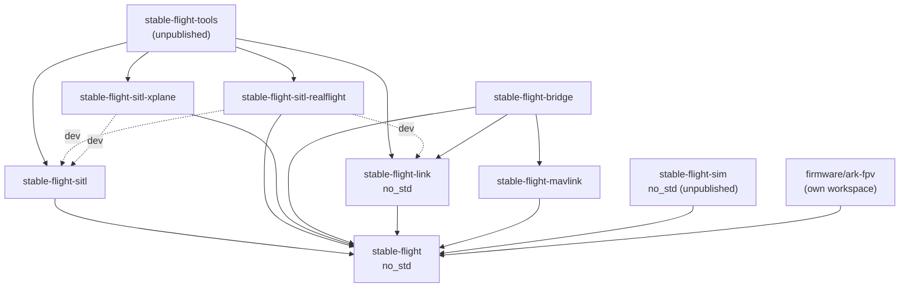

## Architecture

Design principles, crate boundaries, and a summary of each subsystem. Each subsystem's design,
rationale, and rejected alternatives are in [`docs/architecture/`](docs/architecture/), linked
from its summary below. The [project README](README.md) is the project overview; trait contracts
are in core rustdoc.

## Design Principles

Stable Flight is an autonomous flight stack for VTOL aircraft, split across two computers: a
`no_std` flight controller that keeps the vehicle flying, and a companion computer that decides
where it goes. The [link](docs/architecture/link.md#link) between them is the boundary.

* **The flight controller** owns everything that closes a loop at tick rate or that the vehicle
  needs with the companion gone: state estimation, stabilization and mixing, guidance to the
  targets it is given (hover, waypoint, land, transition, loiter), the arm gate and its checks
  ([#136](https://github.com/wboayue/stable-flight/issues/136), planned), failsafes, home and
  return to launch ([#468](https://github.com/wboayue/stable-flight/issues/468), planned; home is
  tracked in the bridge today), and params. Guidance flies the current target; a horizon of the
  current target and the next is planned
  ([#658](https://github.com/wboayue/stable-flight/issues/658)), never a whole mission.
* **The companion** owns everything above that horizon: mission storage, sequencing, and
  replanning ([#350](https://github.com/wboayue/stable-flight/issues/350), planned), and the
  ground station protocol (the bridge translates MAVLink and never decides). Later, perception
  too: camera, lidar, and ADS-B processed on the companion, which replans the mission and
  streams new targets.
* **The link carries** commands, target horizons, and companion measurements up, and
  timestamped state, telemetry, and status down; raw sensor data never crosses it. Measurements (visual odometry, height above
  ground) enter the flight controller's estimator as one more gated sensor
  ([#656](https://github.com/wboayue/stable-flight/issues/656), planned); attitude and rates
  stay onboard. Perception pairs its frames with state through flight-controller timestamps
  and a timesync exchange ([#655](https://github.com/wboayue/stable-flight/issues/655),
  planned), while freshness and failsafe timing stay on the flight controller's own `dt`.
* **The flight controller doesn't rely on the companion to stay safe.** A
  quiet companion ends in a failsafe the flight controller chooses
  ([Link Failsafe](docs/architecture/link.md#link-failsafe)). A misbehaving one stays inside a flight envelope the flight
  controller enforces on every command, whoever sends it: geofence, altitude, and distance
  limits ([#657](https://github.com/wboayue/stable-flight/issues/657), planned), and arming
  will pass the flight controller's own checks. Avoiding traffic and obstacles is the companion's
  job; the envelope is the backstop.

Where new work goes: on the flight controller only if it runs at tick rate or the vehicle needs
it with the companion gone; otherwise on the companion. Core's `WaypointFollower` and sitl's
`ScriptCommander` sequence whole routes on the flight controller as test and SITL tools; real
missions come from the companion.

Missions stay off the flight controller. If it held the mission, every replan would be a
re-upload, and after the companion went quiet it would fly on with a plan nobody can correct. The failsafe flies instead: a hold, or in plane a loiter
then return to launch ([#468](https://github.com/wboayue/stable-flight/issues/468)).

## Crate Boundaries

The repository is a Cargo workspace. Dependencies point one way:

Solid arrows are dependencies, dashed ones dev-dependencies (examples and tests).

* **`stable-flight`**: the flight-control core: pipeline traits, the data passed between them
  (`Command`/`ControlInput`, `Setpoint`, `VehicleState`, `ControlOutput`, `ActuatorCommand`,
  `TelemetryRecord`), guidance, stabilizers and their PID `controllers`, mixers, and
  `FlightLoop`. No simulator, I/O, clock, or thread dependencies, and `no_std`, so it runs on
  hardware.
* **`stable-flight-link`**: the flight controller ⇄ companion wire protocol ([Link](docs/architecture/link.md#link)).
  `no_std`; depends only on the core (`serde` feature).
* **`stable-flight-mavlink`**: pure functions from core values to `mavlink` payloads, plus the
  telemetry-only estimates they need (home, landed state, geodetic projection). Depends only on
  the core and `mavlink`, so the bridge's encoding is testable without I/O and reusable by an
  onboard MAVLink option ([#156](https://github.com/wboayue/stable-flight/issues/156)).
* **`stable-flight-bridge`**: the companion binary that translates the native link to MAVLink.
  Never depends on the sitl harness, so it runs the same against SITL and a board.
* **`stable-flight-sitl`**: the simulator-independent harness: joystick and scripted
  commanders, `RealTimeRunner`, and `ShutdownSignal`.
* **`stable-flight-sitl-realflight`**, **`stable-flight-sitl-xplane`**: the RealFlight and
  X-Plane backends ([Simulator Backends](docs/architecture/simulators.md#simulator-backends)).
* **`stable-flight-sim`**: the in-repo simulator for closed-loop tests ([In-Repo
  Simulator](docs/architecture/simulators.md#in-repo-simulator)). `no_std`; depends only on the core.
* **`stable-flight-tools`**: unpublished developer binaries, so library consumers never compile
  their dependencies.
* **`firmware/`**: excluded from the workspace; each board is its own nested workspace.

## Flight Loop and Runners

`FlightLoop` (core) owns the six components and runs one tick per `step(dt)`, with no notion of
time; a runner (`RealTimeRunner` in sitl, a lockstep simulator, a hardware timer) decides when
ticks happen. Details: [`flight-loop.md`](docs/architecture/flight-loop.md).

## Core Components

The pipeline's stages: commander, vehicle (`StateSource + Actuator`), guidance (the outer loops,
and owner of the flight mode; a plane's altitude and airspeed are one total energy loop), the
copter wind estimate, stabilizer (the inner loops), mixer (thrust and moments to motor and servo
slots), telemetry publisher, and `View`, which runs any guidance or stabilizer in a rotated body
frame (how a tailsitter hovers). Details:
[`flight-loop.md#core-components`](docs/architecture/flight-loop.md#core-components).

## Flight Stabilization Loop

The reference for tick order: the commander sees the previous tick's state, guidance and the
stabilizer this tick's; `Command::arm` gates the motors, and each disarmed → armed edge re-primes
guidance and the stabilizer; telemetry is published after `actuate`. It also holds the copter
rate path's gyro filters. Details:
[`flight-loop.md#flight-stabilization-loop`](docs/architecture/flight-loop.md#flight-stabilization-loop).

## Real-Time Loop Management

`RealTimeRunner` paces ticks at a fixed rate, catches up when up to 100 ms behind, and resyncs
after a longer stall, which slows `dt`-based clocks. Details:
[`flight-loop.md#real-time-loop-management`](docs/architecture/flight-loop.md#real-time-loop-management).

## Input Policy (no panics in the tick)

Nothing that runs every tick panics on its inputs. Guidance, stabilizers, controllers, and
mixers:

* **Saturate** out-of-range normalized commands (roll/pitch/yaw and moments to [-1, 1],
  throttle and thrust to [0, 1]) and physical targets to their configured limit (attitude
  setpoint angles to the stabilizer's `max_angles_rad`). A controller that produces a normalized
  command saturates its output; one that consumes it saturates its input too.
* Give an **unsupported `ControlInput` or `Setpoint` variant** (both `#[non_exhaustive]`) neutral
  output: a guidance returns a level setpoint at the current heading with zero thrust, a
  stabilizer zero thrust and moments.
* Treat a **NaN command as neutral** (level, hold zero rate, no thrust).
* Return **neutral output on a non-finite error** (NaN/∞ setpoint or estimate), without letting
  it into integral or derivative state; the first finite tick afterwards has no derivative kick,
  and neither does the first tick after construction (altitude takes D from measured velocity, so
  it never kicks). Neutral is zero tilt/rate/moment, except altitude, whose neutral is hover
  thrust. The body-rate loop applies this per axis, so a bad gyro axis doesn't take damping off
  the others.
* **Wrap angles** to [-π, π) instead of range-checking them.

Only construction-time config validation and a positive, finite `dt` (guaranteed by the runners)
are asserted. The helpers live in the core's crate-private `math` module.

These are last-resort behaviors that keep the loop alive, not a failsafe. A NaN thrust reaching
the mixer becomes 0, which cuts the motors; holding the last thrust could fly away instead, and
the stateless mixer can't choose better. Real failsafes (estimator health checks, then a land or
disarm commander) belong upstream ([#66](https://github.com/wboayue/stable-flight/issues/66)).

## Config Ownership

Controllers hold only state; each composite owns one validated config, written only through
`Configurable::set_config` between ticks. The detail covers integrals across a retune (bumpless
`i`), the lateral loop's anti-windup and drag feedforward, and why tuning probes are runtime
state: [`config.md`](docs/architecture/config.md).

### Params

`stable_flight::params` is a flat name → `f32` view over the same configs, named to fit
MAVLink's `param_id`, in degrees at the edge, indexed, and validated through `set_config`.
Details: [`config.md#params`](docs/architecture/config.md#params).

## Flight Regimes

A VTOL flies a copter and a plane regime. The commander requests a regime as a level every tick;
guidance alone owns the flown `FlightMode`. A tailsitter flips between its controllers through a
tilt ramp (`Transition`); a quadplane blends its lift rotors and wing through a lift share
(`LiftTransition`). The detail also covers the fallback (quadchute) and forward thrust in copter
flight: [`flight-regimes.md`](docs/architecture/flight-regimes.md).

## Link

`stable-flight-link` carries the core types in postcard, in COBS frames with a version byte and
a CRC, fixed-size and transport-agnostic. On the companion, the bridge translates to MAVLink and
never decides. Details: [`link.md`](docs/architecture/link.md).

## Link Failsafe

`FailsafeCommander` flies a fallback (a hold) when the link goes stale and hands back only after
it has been fresh for a while; the fallback never arms the vehicle, and after a hold a stick
takes over only once it moves. Details:
[`link.md#link-failsafe`](docs/architecture/link.md#link-failsafe).

## Simulator Backends

One crate per simulator, so its dependencies reach nothing else. Each meets the frame and timing
contracts and the conformance scenarios, and owns its airframes and mapping types. Details:
[`simulators.md`](docs/architecture/simulators.md).

### X-Plane

X-Plane runs free in real time, so `XPlaneVehicle` runs under `RealTimeRunner`, keeps position
relative to where the aircraft started (`LocalOrigin`), and writes once per received frame.
Details: [`simulators.md#x-plane`](docs/architecture/simulators.md#x-plane).

### In-Repo Simulator

`stable-flight-sim` is the plant for closed-loop tests in `cargo test`: deterministic, lockstep
copter, plane, tailsitter, and quadplane models whose geometry comes from the mixer, held to spec
bands across swept perturbations. Details:
[`simulators.md#in-repo-simulator`](docs/architecture/simulators.md#in-repo-simulator).

## Autotune

PID autotune tunes a fresh airframe from a bad or unflyable start without a pilot nursing it.
Probes excite and measure one loop inside the tick; between ticks a supervisor runs each stage's
procedure within a flight envelope.

* [`autotune.md`](docs/architecture/autotune.md): probes, sides, the executor, the gain search,
  stage order, the envelope, and robustness.
* [`autotune-design-search.md`](docs/architecture/autotune-design-search.md): the copter
  default, which fits each rate axis, designs its gains, then searches each loop from the design.
* [`autotune-plane.md`](docs/architecture/autotune-plane.md): the plane side, which fits a wing
  model in flight, designs on it, and checks on attitude steps.
