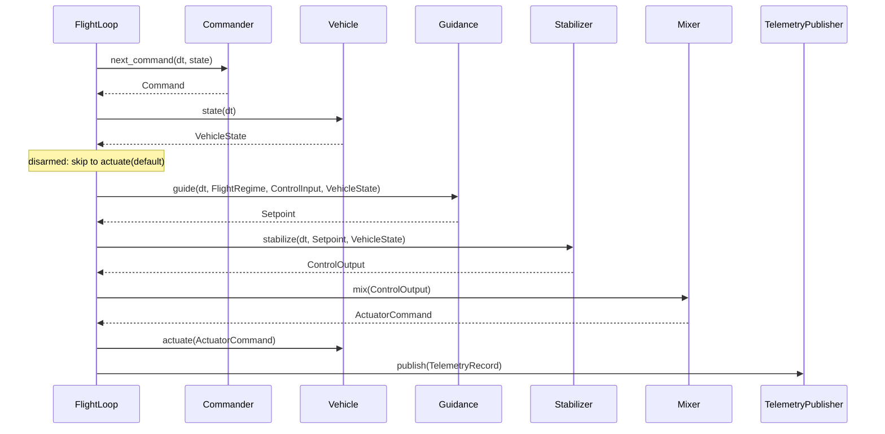

## Flight Loop and Runners

`FlightLoop` (core) owns the six components and runs one tick per `step(dt)`, with no notion of
time. A runner decides when ticks happen: `RealTimeRunner` (sitl) paces them on the wall clock
until a `ShutdownSignal` is set; a lockstep simulator runner or a hardware timer can drive the
same `FlightLoop`. Shutdown, pacing, and tick sequencing are separate pieces, so each runner only
supplies pacing.

## Core Components

* **Commander**: produces a `Command` (arm flag, requested `FlightRegime`, and `ControlInput`)
  each tick, from joysticks, scripts, the link, or navigation.
* **Vehicle**: `StateSource + Actuator` (blanket-implemented), so sensing and actuation can be
  separate components on hardware (IMU/estimator, ESC output) while a simulator client implements
  both on one type. `ComposedVehicle<S, A>` joins a separate state source and actuator.
* **Guidance**: the outer loop. Turns a `ControlInput` into a `Setpoint` (attitude or rate) in
  the requested regime, and owns the flight mode ([flight regimes](flight-regimes.md#flight-regimes)):
  position and altitude loops for waypoints, and stick interpretation that needs memory (the
  heading-hold target). `FlightLoop` calls guidance and the stabilizer every tick, and a guidance
  paces its own slow loops (`CopterGuidance`'s lateral loop); pacing inside guidance keeps pilot
  sticks read every tick, where a loop-level divider would add a guidance period of latency.
  A plane's waypoint altitude and airspeed are one total energy loop (`guidance::plane`
  `TecsConfig`, ArduPilot's and PX4's TECS): thrust sets the rate of total specific energy
  (height and airspeed together), pitch the balance between them. Separate pitch→altitude and
  thrust→airspeed loops each assume the other has margin: at the pitch limit the airspeed
  loop holds speed by taking the power the climb needs, and the Alia 250 sank asked to climb
  and limit-cycled ±10–15 m in level flight (#454). Rejected: keeping the pair and running
  full thrust while pitch is pinned (on the sim Alia it climbed, but a 30 m descent ran 235 m
  past its altitude); PX4's rates-only form with a trajectory generator (more state for the
  same behavior on these airframes); a synthetic airspeed when none is measured (core has no
  plane wind estimate, and ground speed reads fast in a tailwind: #456), so without an airspeed
  pitch holds altitude and thrust follows pitch, as ArduPilot does. The pitch integral acts
  on the balance rate error, against a high-passed airspeed rate, within the limits a forward
  transition passes in, and the pitch demand's airspeed part isn't held to half the climb's
  energy rate as thrust's is (#505). Rejected: an integral of the energy error (it winds
  nose-down through a descent's catch-up while the height error stays open, and the sim
  Alia's forward transition reached its airspeed gate only by its windup against the
  transition's pitch cap: with the cap passed in, it timed out); the held airspeed part (the
  transition pitches up against its rotors' acceleration and reaches its gate 3 s inside the
  timeout); ArduPilot's bound on the integral, 5° past the limits of the proportional term (at
  the transition's first few m/s that term sits far past a limit, and the bound winds the
  integral 70° up).
* **Wind estimate**: `CopterGuidance` owns a `estimation::wind::WindEstimator` and feeds it
  every airborne tick. Thrust acts along the thrust frame's `z`, so the specific force along
  its `x` and `y` is the air's push alone. Each axis inverts its drag model (bluff-body on the
  airspeed with the climb counted in, plus momentum, ArduPilot's and PX4's drag fusion) to air
  velocity, and a two-state linear Kalman filter on world wind fuses each axis with noise
  scaled by the drag's slope at the air the estimate predicts, or the measured air where that
  is steeper, as both stacks linearize at the state. Ticks climbing or sinking faster than
  1 m/s are skipped: a cambered wing climbing nose first lifts toward its belly, which the
  hover's drag model reads as wind (#608). A tailsitter
  hovers in `View::tailsitter`, so its thrust frame comes for free, and its span, with little
  drag, counts for little. Rejected: a full EKF with drag fusion, as both stacks run inside
  their navigation filters (the backends hand over a clean state, so inverting the model first
  leaves a linear filter); one isotropic drag model (a flat plate's push follows its normal,
  not the wind, which is what made the lean-chasing weathervane spin in #417); and estimating
  from the lateral loop's integral (it carries the push, not the wind, with the loop's lag);
  the slope at the measured air alone (bluff drag has none in still air, so a wrong estimate
  stayed there, #608).
  VTOL guidances pause it outside copter flight, and a quadplane while its pusher thrusts
  along the body. The estimate reaches telemetry through `Guidance::wind`, not the link yet.
* **Stabilizer**: the inner loops, attitude then body rate, from setpoint error to
  `ControlOutput` (setpoint units: `Setpoint` rustdoc; each loop's form:
  [loop shapes](../../crates/stable-flight/src/controllers/README.md#loop-shapes)).
* **Mixer**: maps thrust and moments to `ActuatorCommand`'s generic motor and servo slots. The
  mixer sets what each slot means; the backend's mapping (e.g. `ActuatorMapping`) sets which
  channel it drives. `TableMixer` covers multirotors and thrust-and-servo frames with one table
  per frame (a row per slot). A lift+cruise VTOL flies two actuator sets at once, so
  `ControlOutput::cruise` carries the pusher's thrust and the surfaces' moments beside the lift
  rotors' `thrust` and `moments`, and the table's pusher and servo rows take it (PX4 splits
  rotor and surface torque the same way, `Standard::fill_actuator_outputs`). It's an
  `Option`, `None` for every other frame, so their stabilizers and tables don't change.
  Rejected: PX4's body thrust vector (`thrust: Vec3`), which still needs a second moment set
  and has no lateral-thrust consumer; and a composite mixer over two tables, which needs slot
  offsets on `TableMixer` and a second overlap check.
* **TelemetryPublisher**: receives each tick's `TelemetryRecord`. A tuple `(A, B)` fans out to
  both, and `()` is the no-op sink (`stable_flight::composition`).
* **View**: `View<T>` runs any guidance or stabilizer in a body frame rotated by a constant: the
  state goes in rotated, and a stabilizer's moments come back in the body frame. A tailsitter
  hovers on the copter guidance and stabilizer in `View::tailsitter` (90° in pitch), where
  nose-up hover reads level, away from the airplane frame's Euler singularity, as ArduPilot's
  tailsitter AHRS view does (PX4 instead keeps a hover body frame and views its fixed-wing
  controllers). The view's Euler angles are singular at forward flight, which the transition
  pitches toward, so `CopterStabilizer` takes its attitude error from quaternions (tilt of the
  thrust axis, then heading, as PX4's multicopter attitude control does) rather than Euler
  differences, and its loops output body rates at any attitude.

## Flight Stabilization Loop

Each `FlightLoop::step` does the following; this section is the reference for tick ordering.

* The commander sees the **previous** tick's state; guidance and the stabilizer see this tick's
  **fresh** estimate.
* `FlightLoop::prime` runs once before the first tick: `state(Duration::ZERO)`, then
  `Guidance::prime` and `Stabilizer::prime` with that state.
* **`Command::arm` gates the motors.** A disarmed tick still runs the commander, the estimator,
  `actuate`, and telemetry, but skips guidance, the stabilizer, and the mixer: it actuates
  `ActuatorCommand::default()` (motors off) and records a neutral, idle setpoint at the current
  heading with zero control and a copter flight mode, so nothing winds up on the ground. Each
  disarmed → armed edge (including the first armed tick) re-primes guidance, then the
  stabilizer, from the fresh estimate, so integrals start from zero and the heading hold latches
  where the vehicle points. Armed at ground idle, `CopterStabilizer` clears its integrals each
  tick for the same reason. Guidance marks the setpoint `idle`, since only it knows the pilot's
  throttle and the mode: thrust alone can't tell, because the altitude loop asks for zero thrust
  in the air (shedding a climb) and a piloted idle throttle needn't be exactly zero. Waypoint and
  land setpoints are never idle: core has no land detector to tell a touchdown
  ([#395](https://github.com/wboayue/stable-flight/issues/395)). `arm` is a level the commander
  returns every tick; arming checks are commander-side policy ([#136](https://github.com/wboayue/stable-flight/issues/136),
  [link failsafe](link.md#link-failsafe)).
* **The copter's rate path** (`CopterStabilizer`): the rate loop flies the body rates through
  a two-pole Butterworth low-pass (`gyro_cutoff_hz`, 40 Hz, PX4's `IMU_GYRO_CUTOFF`), and its D
  acts on the filtered measured rate, not the error, so a setpoint step has no derivative kick
  (PX4's `RateControl`). The angle loop reads the attitude, so the filter sits in the rate loop
  alone. The filter's lag is the price: at 40 Hz it costs `quad_x`'s designed rate loop most of
  its margin unless the design models it (#373). On the sim's robustness noise (0.1 rad/s at
  90 Hz), 40 Hz passed the most rows; 20 Hz (ArduPilot's `INS_GYRO_FILTER`), 30 Hz, and 50 Hz
  and up lost clean ones. A D low-pass on the error, ArduPilot's `ATC_RAT_RLL_FLTD`, lost
  rows at 20 and 40 Hz. Ahead of the low-pass sits an optional notch for one vibration tone
  (`gyro_notch`, off by default), ArduPilot's fixed harmonic notch in form (`NotchFilter`,
  `INS_HNTCH_FREQ`/`_BW`/`_ATT`: a biquad of finite depth, its band edges geometric about the
  center) and in place (notch, then low-pass, as ArduPilot's `apply_gyro_filters` and PX4's
  `FilterAngularVelocity` order them). A low-pass barely touches a tone just above its
  cutoff: at `racer`'s 75 Hz the sim's 90 Hz tone kept the noise rows from settling. With a
  notch at the tone (90 Hz, half that wide, 40 dB) `racer`'s low start passes, and flown on
  every row it changes none; PX4's full notch (20 Hz wide) failed earlier. It notches roll
  and pitch only, where ArduPilot and PX4 notch all three axes: with yaw notched too, `quad_x`
  failed its yaw step spec on one seed of five from both starts (#597). The design models the
  notch with the low-pass (`GyroFilters`), since the rate loop's P and D act through it: on a
  `quad_x`-like axis a notch near the crossover (40 Hz) left out flies the loop 7.7° short of
  its margin.
* Telemetry is published after `actuate`, with the whole tick in one `TelemetryRecord`,
  including the limits it hit: guidance, the stabilizer, and the mixer each report a `Saturation`
  for their last call (only they know what they clipped), and the loop merges them (none while
  disarmed).

## Real-Time Loop Management

`RealTimeRunner` (sitl) implements the timing around `FlightLoop::step`:

* Runs at a fixed frequency (e.g. 250 Hz) validated at construction (`RealTimeRunner::new`
  rejects non-positive or non-finite rates and periods that aren't a representable non-zero
  `Duration`).
* Primes the loop, then steps it with the nominal period and sleeps to the next accumulated
  deadline.
* Checks the `ShutdownSignal` before each tick; SIGINT or SIGTERM (Unix) / Ctrl-C or Ctrl-Break
  (Windows) set it once installed, and a second stop signal terminates the process.
* Catches up when up to 100 ms behind: deadlines accumulate, so simulator jitter is absorbed by
  back-to-back ticks and the sum of nominal `dt`s keeps tracking wall time (dropping those ticks
  would slow every `dt`-based clock: integrators, pacing, failsafe timeouts). After a longer
  stall (e.g. a simulator reconnect) it drops the missed deadlines and resyncs rather than
  replaying them, since a long burst would step stale state; heavy resyncing therefore slows
  `dt`-based clocks.
* Returns `RunStats` (ticks, elapsed, average rate, overruns, skipped ticks).

Wiring a vehicle means one implementation per trait (commander, `RealFlightVehicle`, guidance and
stabilizer with an airframe's gains, the airframe's mixer, `LinkPublisher` via `FcLink`), a
`FlightLoop`, and a `RealTimeRunner::run_with` whose callback polls the link so params are served
between ticks. Runnable code: the [`stable-flight-sitl`
README](../../crates/stable-flight-sitl/README.md#running-the-loop) and
`crates/stable-flight-sitl-realflight/examples/`.
