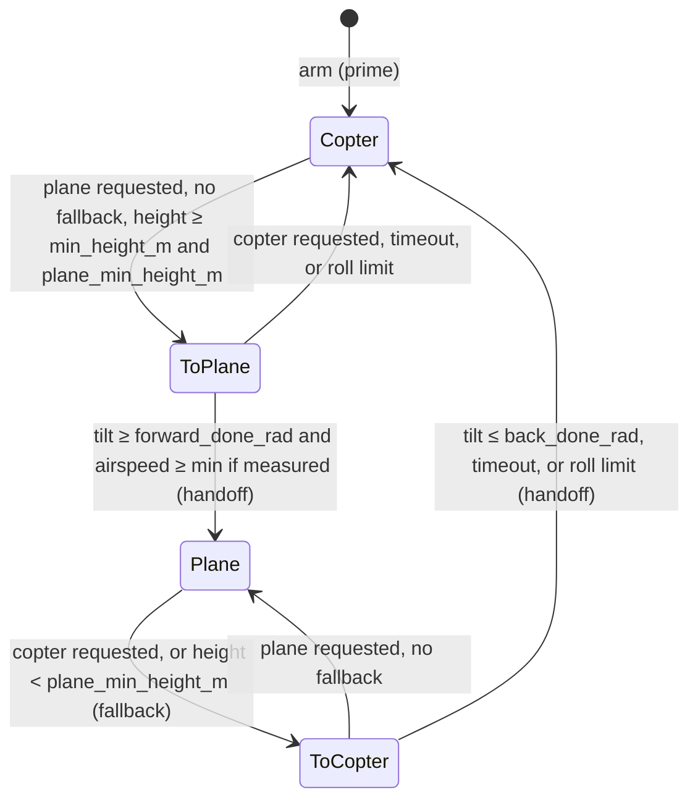

## Flight Regimes

A VTOL flies two regimes, copter (rotor-borne) and plane (wing-borne), and moves between them
deliberately. The pieces:

* **Request: `Command::regime`, a level.** The commander returns the regime it wants every tick,
  like `arm`, so repeating a request can't restart a transition and a failsafe's fallback asks
  for copter by default (`Command::new`). Both ArduPilot and PX4 treat the request as a level
  too: ArduPilot derives it from the flight mode (`ArduPlane/quadplane.cpp`, `in_vtol_mode`),
  PX4 latches a transition command (`vtol_att_control_main.cpp`). The regime is orthogonal to
  the `ControlInput`: the input says what to fly (sticks, a waypoint, a landing), the regime
  how. Rejected: a `FlightRequest` enum replacing `ControlInput` (`Takeoff`, `Fly`, `Land`
  duplicate inputs that exist), and a one-shot `ChangeRegime` input (it still has to say what to
  fly, and an event is lost if a tick drops it).
* **State: one owner, guidance.** `FlightMode` (`Copter`, `Plane`, `ToPlane`, `ToCopter`) is
  what guidance actually flies; `Guidance::flight_mode` reports it with a `ModeRefusal` when
  the request can't be met, and `FlightLoop` puts it in `TelemetryRecord::flight_mode` (and
  the link heartbeat). A copter-only guidance reports nothing: the loop records
  `FlightModeReport::copter_only`, which refuses `Plane` as `Unsupported`. Both stacks decide
  the mode in one place before control runs each tick. Rejected: a supervisor in `FlightLoop`
  broadcasting the mode to every stage; it would split mode logic from the guidance that has
  the state to decide it.
* **Phases are not modes.** Takeoff and landing are vertical, in the copter regime, flown by
  `ControlInput` (a waypoint up, `Land` down) and decided by commanders (`TouchdownDetector`).
  Height is a guard against starting a transition, not a mode: `guidance::vtol::Transition`
  refuses below a height above the arming point (`ModeRefusal::BelowMinAltitude`), which
  covers the ground too (`OnGround` waits for a landed estimator,
  [#66](https://github.com/wboayue/stable-flight/issues/66)). `Land` implies copter.
* **Flip, not blend.** A tailsitter drives the same elevons and motors in both regimes, so a
  transition hands control from one controller to the other instead of weighting both: one
  active controller and integrator set, testable per mode, one controller per tick. ArduPilot
  and PX4 both flip for tailsitters, with a short thrust hold or blend at the handoff
  (`ArduPlane/tailsitter.cpp`; PX4 `vtol_att_control/tailsitter.cpp`). Blending suits separate
  lift and cruise actuators; for a tailsitter it would mix two controllers fighting over shared
  actuators, their integrators winding on each other's errors, and attitude errors from
  different frames near the view's singularity. `guidance::vtol::Transition` owns the mode and
  ramps a frame-free tilt target (the nose's angle from vertical) for whichever controller
  flies the transition, and flags the tick control passes between them; `ThrustHandoff`
  blends thrust across it. The plane side is `PlaneGuidance` and `PlaneStabilizer`
  (`Setpoint::Plane` attitudes with coordinated turns, `Setpoint::PlaneRate` body rates at any
  attitude for rolls and loops). `TailsitterGuidance` wires them: the forward ramp on the
  hover controller, the back ramp on the plane controller, a roll past the limit cutting a
  transition short (checked before the step, since a sideways lean also tilts the nose), and
  the incoming guidance primed at the handoff. `TailsitterStabilizer` flies each setpoint on
  the side its variant names and primes the incoming side, so the mixer never sees the regime.
  Each composite's params chain its parts' tables.
* **Ramps fly past the cruise limits.** A ramp's setpoint is marked `transition`, and the
  stabilizer saturates its pitch at ±90° instead of the hover tilt or plane pitch limit, which
  sit below the handover angles (a plane's 30° cap against a 45° back handover): capped, a ramp
  stalls short of completing and flies to its timeout. ArduPilot's tailsitter ramps the same
  way, limited only to ±85° on either side (`Tailsitter_Transition::update` and
  `set_FW_roll_pitch`, applied after the plane's pitch limit in `Plane::stabilize`); PX4 flies its back ramp on the
  multicopter controller (`Tailsitter::update_transition_state`). Rejected: rejecting a cap
  below the handover when the configs are validated. The two values live in different
  components' configs and params, so it needs a cross-component check `FlightLoop` doesn't
  have, and it forces a high cap on all hover or plane flight.
* **Airspeed is optional.** `VehicleState::airspeed_mps` is `None` without air data
  (`valid_airspeed_mps` also drops NaN and negative readings). The forward transition
  completes on tilt and, when a valid airspeed is present, a minimum airspeed (as PX4 does).
  A forward timeout falls back to hover, as PX4's does, since without an airspeed gate the
  vehicle may not be flying; a back timeout completes, as in both stacks.

`Transition` moves through the modes as below (`TransitionConfig` names the limits). A forward
transition that times out or hits the roll limit, or plane flight below `plane_min_height_m`,
is a fallback (a quadchute): plane flight stays refused until copter is requested again, and
the guidance flies a waypoint as a hover where copter flight took over. A mission's plane
waypoint can be kilometers off; chasing it on the rotors at the plane leg's speed is what this
stops (#453). Sticks keep flying, as PX4's manual modes do after a quadchute. PX4 switches straight to hover below `VT_FW_MIN_ALT` and returns home
(`VtolType::isMinAltBreached`, `COM_QC_ACT`); here the back transition flies, losing 1.9–3.3 m
on the sim (#450), and the commander picks what follows the hover. Rejected: ArduPilot's
lift assist below `Q_ASSIST_ALT` (`VTOL_Assist::should_assist`), which stays in plane flight but
needs a new blend in `Plane` and has nothing to assist with on a tailsitter.

| Mode | Flown by | Tilt target (nose from vertical) |
|---|---|---|
| `Copter` | Hover: copter guidance and stabilizer in `View::tailsitter` | None |
| `ToPlane` | Hover | Ramps from the current tilt at `forward_rate_radps`, up to `forward_max_tilt_rad` |
| `Plane` | Plane: `PlaneGuidance`, `PlaneStabilizer` | None |
| `ToCopter` | Plane | Ramps from the current tilt to 0 at `back_rate_radps` |

At each handoff the incoming side is primed and `ThrustHandoff` blends thrust over `handoff_s`.

A lift+cruise VTOL (quadplane) stays level, so tilt can't mark its progress: its lift rotors
and wing share the lift through a transition, and `guidance::vtol::LiftTransition` owns the
mode and that lift share. Forward, the rotors hold the hover until a valid airspeed reaches
`min_airspeed_mps`, then hand the lift to the wing linearly over `lift_ramp_s` (ArduPilot's
SLT transition, `SLT_Transition::update`); without airspeed it never ramps and times
out to copter, since the wing's speed is unknown; the timeout bounds only that wait (as
ArduPilot's `Q_TRANS_FAIL`), so a started ramp never throws the weight back onto
the rotors mid-way. Back, the share ramps up over `back_ramp_s`
and the transition completes once the ground speed along the body `x` axis (airspeed without a
ground velocity) is below `back_speed_mps`, or after `back_timeout_s` (PX4's
`Standard::update_vtol_state` and `VT_B_TRANS_RAMP`). Height and abandonment are
`Transition`'s, through one shared gate. Rejected: generalizing `Transition` with a completion
policy, which would leave its tilt ramp, rates, and done angles meaningless for a quadplane
and its config validated per kind.

```mermaid
stateDiagram-v2
    [*] --> Copter: arm (prime)
    Copter --> ToPlane: plane requested, no fallback, height ≥ min_height_m and plane_min_height_m (lift share 1)
    ToPlane --> ToPlane: airspeed ≥ min_airspeed_mps starts the lift ramp (1 → 0 over lift_ramp_s)
    ToPlane --> Plane: lift ramp done (handoff)
    ToPlane --> Copter: copter requested, timeout_s waiting on airspeed, or roll limit
    Plane --> ToCopter: copter requested, or height < plane_min_height_m (fallback; lift share 0 → 1 over back_ramp_s)
    ToCopter --> Plane: plane requested, no fallback
    ToCopter --> Copter: forward speed < back_speed_mps, back_timeout_s, or roll limit (handoff)
```

* **Blend for lift+cruise.** The lift rotors and the surfaces and pusher are separate
  actuators, so a transition flies both controllers at once (as PX4's standard VTOL and
  ArduPilot's SLT do): `QuadPlaneGuidance` emits `Setpoint::Blend` (a hover attitude, a plane
  attitude, and the lift share) through a transition, and in copter flight while forward
  thrust is on (below), and either side's own setpoint otherwise; `QuadPlaneStabilizer` flies the lift rotors on `CopterStabilizer` (`thrust`,
  `moments`), weighted by the share, and the surfaces and pusher on `PlaneStabilizer`
  (`ControlOutput::cruise`), in full (PX4's `Standard::fill_actuator_outputs`), holding the surfaces
  neutral in a hover (PX4's `VT_ELEV_MC_LOCK`). A side that starts flying is primed.
* **Forward on the plane's thrust and pitch.** Through the forward transition the hover side
  holds the altitude it began at (a waypoint that moves with the vehicle, its tilt replaced),
  wings level; the pusher flies the plane guidance's thrust for the command, rising at most
  `pusher_slew_per_s` (PX4's `VT_PSHER_SLEW`) up to `forward_thrust`, and both sides fly its
  pitch within ArduPilot's transition limits (0 below 3 m/s, ±3° waiting, ±8° ramping,
  `SLT_Transition::set_FW_roll_pitch`, `Q_TRAN_PIT_MAX`), as ArduPilot flies its throttle and pitch from the
  plane controller. Measured on the sim quadplane (#391): forward 8.2 s, +0.6/−0.3 m.
  Rejected, with their numbers on the same flight: PX4's fixed `VT_F_TRANS_THR` (1.0)
  through ArduPilot's timed ramp, which overspeeds to 32 m/s, balloons 9 m, and dives 11 m
  after the handoff, since PX4 ends its ramp on airspeed instead; and pitch 0 on both sides
  (+1.0/−0.7 m), or the plane's pitch on the elevator alone with the lift rotors holding 0,
  two controllers fighting over pitch (+0.6/−0.2 m). Going back the pusher is cut and drag
  alone slows it, both sides level (7.3 s, −0.5 m).
* **Forward thrust in copter flight.** Tilted nose down to move ahead or hold into wind,
  the wing at negative α pushes a quadplane down: on the sim, 13 m lost on a 100 m leg, and
  no climb off the ground in an 11 m/s headwind; tail first it flips (#427). On a waypoint or
  land, `ForwardThrust` holds nose-down pitch to `pitch_limit_rad` and gives the pusher
  `gain · tan(pitch)`, ArduPilot's `Q_FWD_THR_USE` 1 (`QuadPlane::assign_tilt_to_fwd_thr`),
  flown as a blend at lift share 1; with it every leg and back transition on the sim loses at
  most 2 m. Off by default, as ArduPilot and PX4 ship it. Rejected, with their numbers:
  PX4's `(sin(limit) − sin(pitch)) · VT_FWD_THRUST_SC` (`VtolType::pusher_assist`), too weak
  under the 27° tilt cap to hold or fly upwind in 8 m/s of wind (blown 150–250 m); a lower
  tilt cap (10–15°), which fixes calm legs but leaves less lean than the 18° an 11 m/s
  headwind needs; a cruise-speed cap, which bounds ground speed, not airspeed, so a 5 m/s
  upwind leg in 8 m/s still crashes; and yawing toward the waypoint, which avoids the flip
  but not the sink.
