Part of the [architecture overview](../../architecture.md).

## Link

`stable-flight-link` is the native protocol between the flight controller and a companion
computer. The wire format is the core types themselves (`Command`, `VehicleState`, an owned
`TelemetryRecord`) in postcard, so the flight controller carries no MAVLink dialect; the bridge
translates to MAVLink in `std` code.

* **Frame.** `[version u8][postcard payload][crc16 LE]`, COBS-encoded, `0x00`-terminated. COBS
  gives the length. Postcard isn't self-describing (a reordered field decodes as garbage, not an
  error), so every frame carries `PROTOCOL_VERSION` and the receiver rejects a mismatch; any
  message shape change bumps it. The CRC (CRC-16/IBM-3740, bitwise to save flash) is checked
  before the version, so a corrupted version byte reads as corruption.
* **Sealed messages.** Only `Uplink` and `Downlink` implement `Message`.
* **Fixed size.** Every message fits `MAX_FRAME_LEN` (384 bytes; a test checks the worst case),
  so both ends use stack buffers.
* **One frame per decode.** `decode` rejects bytes after the delimiter, so a transport that hands
  over two frames at once fails loudly instead of losing the second.
* **Transport-agnostic.** `Link` moves encoded frames without blocking. Like `Vehicle`, it is two
  traits blanket-joined (`LinkRx` + `LinkTx`), so the router and the publisher each own one half
  of the same transport. Every transport carries the same frames:

| Setup | `Link` |
|---|---|
| Tests | `loopback::Loopback` (`testing` feature) |
| SITL flight controller and bridge on one host | `udp::UdpLink` (`std` feature) |
| Real board (planned) | USB-CDC, then a TELEM UART ([#155](https://github.com/wboayue/stable-flight/issues/155)) |

On the flight controller, reading the link is separate from commanding: `UplinkRouter` drains
`LinkRx` between ticks and routes each uplink to a bounded queue (params to the `ParamServer`,
`Control` to a link-fed commander), so params work whichever commander flies. `LinkPublisher` is
the `TelemetryPublisher` that owns `LinkTx`.

On the companion, `stable-flight-bridge` presents the flight controller as MAVLink system 1,
component 1, so MAVLink never runs on the board. It is a pure state machine (messages in,
messages out, clock injected) behind a thin I/O loop, holding only what translation needs: the
flight controller's last heartbeat (to send `HEARTBEAT` only while it is alive, and to confirm an
arm, disarm, land, or transition before acking it), when the ground station was last heard (to
send `Control::Heartbeat` only while it is), and a param cache (to answer `PARAM_REQUEST_READ`
without a round trip). Param listings and writes go to the flight controller, whose echo is
forwarded unchanged, so the flight controller stays the only judge of a value. Staleness,
failsafe, and arm decisions stay on the flight controller; the bridge translates and never
decides. What it translates: the [bridge README](../../crates/stable-flight-bridge/README.md).

## Link Failsafe

A companion's link drops (late USB enumeration, brownouts, a crashed bridge), and the flight
controller, not the companion, decides what happens. `FailsafeCommander<P, F>` (core
`commanders::failsafe`) is a commander like any other, ahead of guidance. Its state
(`FailsafeState`, limits from `FailsafeConfig`):

```mermaid
stateDiagram-v2
    [*] --> Fallback: first tick
    Primary --> Fallback: stale for timeout_s
    Fallback --> Primary: fresh for recover_after_s, fallback releases; waypoint or disarmed
    Fallback --> AwaitingSticks: same, but armed on sticks
    AwaitingSticks --> Primary: an axis moves takeover_stick_delta
    AwaitingSticks --> Fallback: stale
```

The fallback flies in `Fallback` and `AwaitingSticks`. The rules:

* The primary is a `LinkedCommander`, which reports `since_update_s`: time since its last valid
  message, measured on the flight controller from the `dt` it is given, so no clock sync with
  the sender is needed. It runs every tick, flying or not, so it keeps draining its queue.
* What counts as fresh is the primary's call: `LinkCommander` takes any message while it flies a
  waypoint, but only commands while it flies sticks, so a joystick stream that stops falls back
  even though the link still heartbeats.
* **Falls back** when the primary has gone `timeout_s` without a message, or was never heard: it
  starts in the fallback. The `Fallback` is engaged once per switch with the current state and
  the last command flown; `HoldCommander` latches that position and arm state, or, if that
  command was an armed land, finishes the land at the same position (as PX4 does).
* **Returns** only after the primary has been fresh for `recover_after_s` without a break, and
  the fallback allows it (`can_release`: a landing must finish).
* **Arming:** the fallback may keep the vehicle armed or disarm it but never arms it; a fresh
  primary's disarm is always honored, even during recovery. At the handover back, the primary's
  latched arm is synced to the vehicle's (`LinkedCommander::sync_arm`), so an arm request made
  while the fallback flew, which a ground station has already seen fail, doesn't arm the vehicle
  later; a new request does.
* **Regime:** a link requests a regime with `Control::Regime`, latched like `Arm`, not with each
  command's `regime`: setpoint streams (a joystick, an offboard app) then can't transition the
  vehicle as a side effect, and a ground station's transition needs no input to resend. At the
  handover back, the primary's regime is synced to the fallback's (`sync_regime`; a hold flies
  copter), so a VTOL the hold brought back to a hover stays there until a new request.
* **Sticks after a hold:** to an armed vehicle, a stick input takes over only once an axis moves
  `takeover_stick_delta` from where it was at recovery, so a forgotten joystick at low throttle
  can't drop the vehicle out of a hold; a waypoint, or anything to a disarmed vehicle, takes over
  at once. Stopping an external commander from arming at all waits for a pilot arm source (RC,
  [#134](https://github.com/wboayue/stable-flight/issues/134)).
* The state reaches telemetry through `Commander::failsafe` → `TelemetryRecord::failsafe`
  (`Primary`, `Fallback`, or `AwaitingSticks`); the link heartbeat's `link_ok` is `false` while
  the fallback flies, and each change is announced once as status text, which the bridge shows
  in QGC (`STATUSTEXT`).
* **Landing:** while an armed `ControlInput::Land` flies, from the primary or the fallback, the
  failsafe watches it with a `TouchdownDetector` and, on touchdown, disarms and syncs the
  primary's arm. The detector lives here, not in the primary, because the primary runs every
  tick even while the fallback flies: a hold that follows the land's descent would read as
  touchdown and disarm the vehicle in the air once the link returned. A land that carries on
  across a handover keeps its detector; any interruption (a hold, a disarm, another input)
  starts it over.

Estimator-health failsafes are [#66](https://github.com/wboayue/stable-flight/issues/66).
